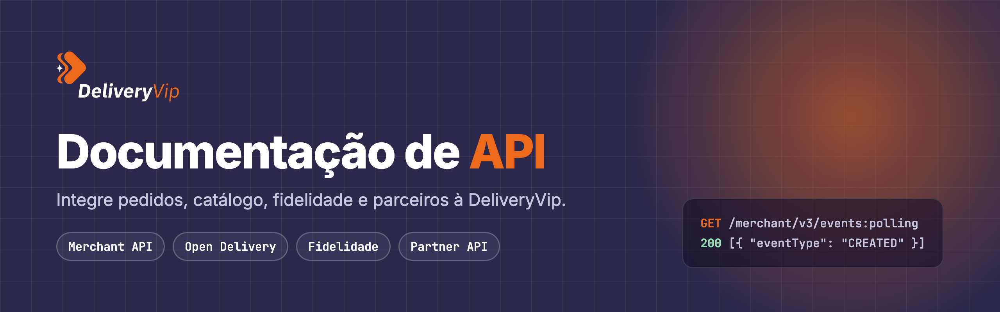

<p align="center">
  
</p>

# Documentação de API da DeliveryVip

[](https://discord.gg/AJF8Yha4)
[](https://mintlify.com)

A DeliveryVip é uma plataforma de delivery e cardápio digital para restaurantes. Esta é a documentação para quem integra com ela:

- **Merchant API:** pedidos por polling ou webhook, catálogo, descontos, comandas e mesas.
- **Open Delivery:** integração pelo padrão aberto da Abrasel, como Ordering Application.
- **Fidelidade:** o contrato para conectar um programa de cashback ao checkout.
- **Partner API:** cadastro e gestão de lojas, revendas, assinaturas e faturas para parceiros.

Cada guia traz exemplos em cURL, Node.js e Python. A referência de endpoints é gerada das especificações OpenAPI publicadas pela plataforma.

## 🚀 Início rápido

A documentação é feita com [Mintlify](https://mintlify.com). Você precisa do Node.js 20 ou mais novo.

```bash
npm install
npm run dev
```

Abra `http://localhost:3000` para ver a documentação. As páginas recarregam sozinhas quando você salva um arquivo.

## 📚 Estrutura

```
.
├── docs.json        # Configuração do Mintlify: tema, abas, navegação e redirects
├── index.mdx        # Página inicial
├── inicio/          # Primeiros passos, conceitos (autenticação, erros, datas) e produção
├── guides/
│   ├── merchant/      # Merchant API: pedidos, catálogo, descontos, comandas, fidelidade
│   ├── open-delivery/ # Integração Open Delivery
│   └── partner/       # Partner API: lojas, revendas, assinaturas, faturas
├── reference/       # Páginas de abertura da referência de endpoints
├── changelog.mdx    # Novidades da API
├── deprecations.mdx # Rotas descontinuadas e datas de desligamento
├── images/          # Imagens e diagramas (versões clara e escura)
├── logo/            # Logos para os temas claro e escuro
├── scripts/art/     # Fontes dos diagramas (kit de artes)
└── style.css        # Ajustes de estilo
```

O caminho do arquivo é a URL da página: `guides/merchant/webhooks.mdx` vira `/guides/merchant/webhooks`. Ao renomear ou mover uma página, adicione um redirect em `docs.json` para os links antigos continuarem funcionando.

## 🔧 Desenvolvimento local

| Comando | O que faz |
| --- | --- |
| `npm run dev` | Sobe a documentação em `http://localhost:3000`. |
| `npm run validate` | Faz o build estrito. Precisa passar antes de abrir um PR. |
| `npm run links` | Procura links quebrados, âncoras inexistentes e redirects inválidos. |

### Diagramas

Os diagramas não usam Mermaid: são PNGs gerados pelo kit em `scripts/art/`. Cada diagrama é uma especificação curta em `scripts/art/diagramas.html`. Para criar ou alterar um:

1. Edite a especificação em `diagramas.html`.
2. Sirva a pasta com `python3 -m http.server 8765` dentro de `scripts/art` e abra no navegador.
3. Capture o elemento `#<id>` em escala 2x para `images/<id>.png` e, com `?theme=dark` na URL, para `images/<id>-dark.png`.

### Estilo

O guia de estilo está em [`CLAUDE.md`](CLAUDE.md): estrutura das páginas, componentes, exemplos de código e regras de exatidão. Em resumo: português claro e direto, toda chamada com exemplos em cURL, Node.js e Python, e nada documentado sem conferir no código da plataforma.

### Problemas comuns

- **`npm run dev` não sobe:** apague `node_modules` e rode `npm install` de novo.
- **Página nova não aparece no menu:** ela precisa estar listada em `navigation` no `docs.json`.
- **Endpoint some da referência:** confira se o método e o caminho no `docs.json` batem exatamente com a especificação OpenAPI.

## 🚢 Deploy

Mudanças no branch `main` são publicadas automaticamente pela [integração do Mintlify com o GitHub](https://mintlify.com/docs/settings/github).

## 💬 Suporte

- Converse com a gente na [comunidade no Discord](https://discord.gg/AJF8Yha4).
- Encontrou um erro na documentação? [Abra uma issue](https://github.com/DeliveryVip/developer-docs/issues).
- Quer conversar sobre uma integração? [Agende uma reunião](https://calendar.app.google/EchaXk57y7xp8Hyx6).
