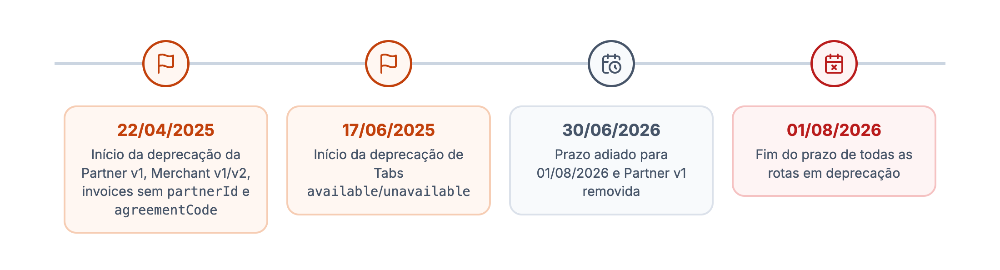
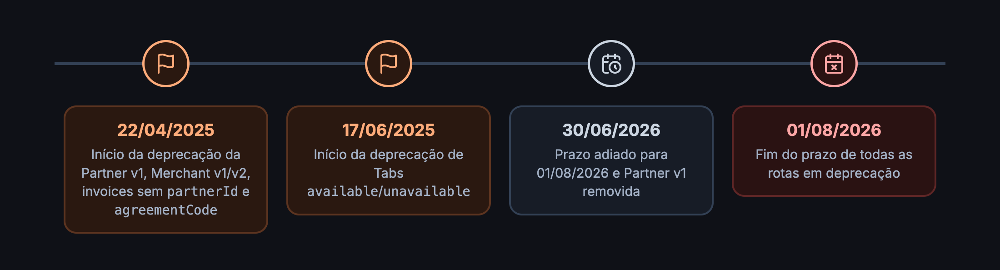

Esta página lista as rotas que estão sendo descontinuadas, o que usar no lugar e como migrar. Rotas em deprecação continuam respondendo, mas podem ser removidas: migre o quanto antes.

## Situação atual

| Rota | Substituta | Status | Prazo |
| --- | --- | --- | --- |
| Partner API **v1** (todas as rotas) | [Partner API V2](/guides/partner) | <Badge color="red">Removida</Badge> | Encerrado |
| Merchant API **v1/v2** (todas as rotas) | [Merchant API V3](/guides/merchant) | <Badge color="orange">Prazo encerrado</Badge> | 01/08/2026 |
| Tabs `available` / `unavailable` | Tabs `opened` / `closed` | <Badge color="orange">Prazo encerrado</Badge> | 01/08/2026 |
| Invoices sem `{partnerId}` (Partner V2) | Invoices com `{partnerId}` | <Badge color="orange">Prazo encerrado</Badge> | 01/08/2026 |
| `agreementCode` (Partner V2) | `subscription` | <Badge color="orange">Prazo encerrado</Badge> | 01/08/2026 |

<Danger>
O prazo de 01/08/2026 já passou. As rotas marcadas como **Prazo encerrado** ainda respondem, mas não há garantia de que continuem: integrações que dependem delas podem parar a qualquer momento. Migre agora.
</Danger>

## Linha do tempo

<Frame caption="Linha do tempo das deprecações">
  
  
</Frame>

## Como identificar uma rota em deprecação

Rotas em deprecação respondem normalmente, com dois headers a mais:

```http
HTTP/1.1 200 OK
Deprecation: true
Sunset: Mon, 01 Dec 2025 00:00:00 GMT
Content-Type: application/json
```

<Tip>
Registre um alerta no seu cliente HTTP sempre que uma resposta vier com `Deprecation: true`. Assim você descobre rotas antigas esquecidas antes que elas parem.
</Tip>

<Warning>
O valor do `Sunset` enviado hoje não reflete o adiamento para 01/08/2026: as rotas de Merchant v1/v2 e Tabs enviam `Mon, 01 Dec 2025 00:00:00 GMT`, e as de invoices e `agreementCode` da Partner V2 enviam `Tue, 01 Jul 2025 00:00:00 GMT`. Use o header como sinal de deprecação e esta página como referência de prazo.
</Warning>

Depois da remoção, a rota responde `410 Gone` (ou deixa de existir) e a integração que não migrou deixa de funcionar.

```http
HTTP/1.1 410 Gone
```

## Migrando

<AccordionGroup>
<Accordion title="Tabs: available / unavailable → opened / closed" icon="receipt">
Anunciado em 16/06/2025. As ações de abrir e fechar comanda ganharam nomes que dizem o que fazem.

| Deprecada | Substituta |
| --- | --- |
| `POST /merchant/v3/{merchantId}/tabs/{tabId}/available` | `POST /merchant/v3/{merchantId}/tabs/{tabId}/opened` |
| `POST /merchant/v3/{merchantId}/tabs/{tabId}/unavailable` | `POST /merchant/v3/{merchantId}/tabs/{tabId}/closed` |

<Steps>
<Step title="Troque o caminho">
Substitua `/available` por `/opened` (abrir a comanda para consumo) e `/unavailable` por `/closed` (fechar a comanda).
</Step>
<Step title="Confira o header">
Depois da troca, as respostas não devem mais trazer `Deprecation: true`.
</Step>
</Steps>

Veja [Indoor](/guides/merchant/indoor).
</Accordion>

<Accordion title="Partner V2: invoices sem partnerId" icon="file-invoice-dollar">
Anunciado em 22/04/2025, com o novo sistema de cobrança.

| Deprecada | Substituta |
| --- | --- |
| `GET /partner/v2/merchants/invoices` | `GET /partner/v2/{partnerId}/merchants/invoices` |
| `GET /partner/v2/resales/invoices` | `GET /partner/v2/{partnerId}/resales/invoices` |

<Steps>
<Step title="Inclua o partnerId no caminho">
Use o ID do parceiro dono das faturas. Um token com vários parceiros faz uma chamada por parceiro.
</Step>
<Step title="Revise o parse da resposta">
As rotas novas seguem o modelo de faturas por plano. Veja [Invoices](/guides/partner/invoices).
</Step>
</Steps>
</Accordion>

<Accordion title="Partner V2: agreementCode → subscription" icon="file-signature">
Anunciado em 22/04/2025.

| Deprecada | Substituta |
| --- | --- |
| `PUT /partner/v2/merchants/{merchantId}/agreementCode` | `PUT /partner/v2/merchants/{merchantId}/subscription` |
| `PUT /partner/v2/resales/{resaleId}/agreementCode` | `PUT /partner/v2/resales/{resaleId}/subscription` |

<Steps>
<Step title="Troque a rota">
Envie o mesmo código de contrato pela rota `subscription`, que atualiza a assinatura inteira.
</Step>
<Step title="Revise o corpo">
Veja os campos aceitos em [Gerenciar assinatura dos merchants](/guides/partner/merchant/utilizando-a-api/gerenciar-assinatura-dos-merchants) e [das revendas](/guides/partner/resale/utilizando-a-api/gerenciar-assinatura-das-revendas).
</Step>
</Steps>
</Accordion>

<Accordion title="Merchant API v1/v2 → V3" icon="store">
Anunciado em 22/04/2025. Todas as rotas v1 e v2 da Merchant API foram substituídas pela V3, que segue o modelo Open Delivery.

<Steps>
<Step title="Gere o token com o scope od.all">
A V3 usa o mesmo [OAuth2](/inicio/conceitos/autenticacao) com o scope `od.all`.
</Step>
<Step title="Reimplemente o fluxo de pedidos">
Siga [Receba seu primeiro pedido](/guides/merchant/order/fluxo-de-integracao/recepcao-de-pedidos): eventos, acknowledgment, detalhes e ações.
</Step>
<Step title="Migre o catálogo">
Use `merchantUpdate`, `merchantUpsert` e `merchantForce`. Veja [Catálogo](/guides/merchant/catalog-and-services).
</Step>
</Steps>
</Accordion>

<Accordion title="Partner API v1 → V2" icon="handshake">
Anunciado em 22/04/2025 e **já removida**: as rotas v1 não são mais atendidas. Use a [Partner API V2](/guides/partner) com o scope `dv.partner`.
</Accordion>
</AccordionGroup>

## Histórico de avisos

<AccordionGroup>
<Accordion title="16/06/2025: Tabs API" icon="calendar">
Início da deprecação em 17/06/2025 das rotas `available` e `unavailable` das comandas, substituídas por `opened` e `closed`. Prazo original de descontinuação: 01/08/2026.
</Accordion>
<Accordion title="22/04/2025: Partner API e Merchant API v1/v2" icon="calendar">
A Partner API consolidou operações redundantes e introduziu assinaturas com governança unificada. Entraram em deprecação as invoices sem `partnerId`, as rotas `agreementCode`, todas as rotas v1/v2 da Merchant API e todas as rotas v1 da Partner API. O prazo foi adiado para 01/08/2026 em 30/06/2026, quando a Partner v1 foi removida.
</Accordion>
</AccordionGroup>
