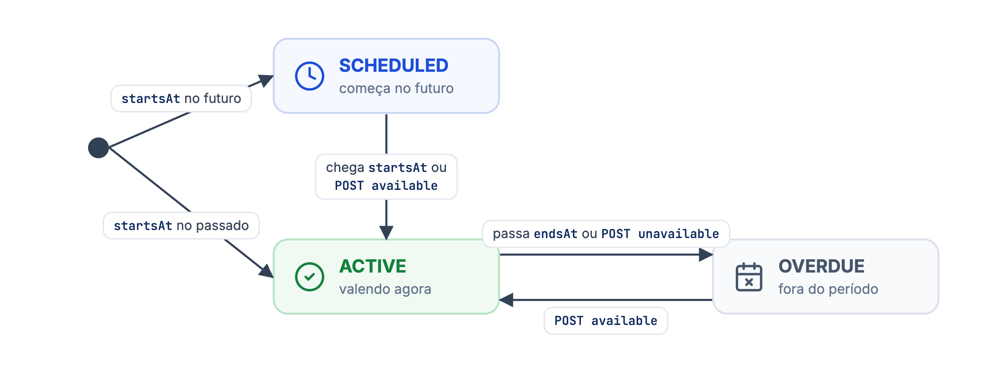
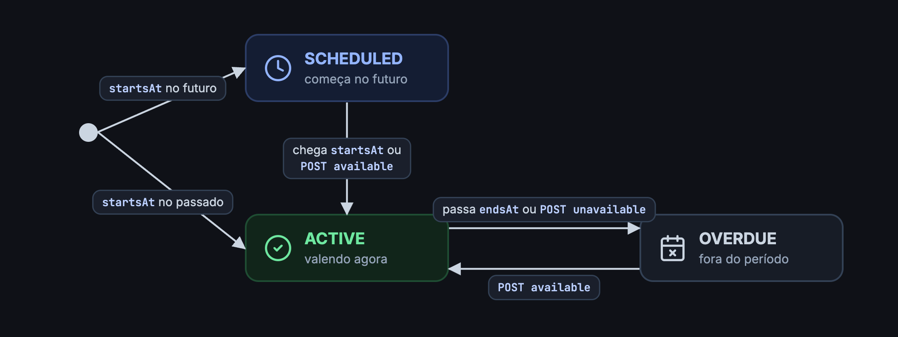

As rotas de descontos gerenciam os descontos **do marketplace**: cupons e descontos automáticos que valem nos pedidos feitos pelo marketplace, nas lojas que você escolher. São rotas **por marketplace**: o `marketplaceId` vai no caminho. Veja como obtê-lo na [Introdução](/guides/marketplace#para-começar) e as regras de `x-marketplaces` em [Header x-marketplaces](/guides/marketplace#header-x-marketplaces).

Todas as rotas ficam em `https://api.deliveryvip.com.br/marketplace/v1/{marketplaceId}/discounts`.

| Operação | Rota | Referência |
| --- | --- | --- |
| Listar descontos | `GET /discounts` | [Listar descontos](/api-reference/descontos/listar-descontos) |
| Criar um desconto | `POST /discounts` | [Criar desconto](/api-reference/descontos/criar-desconto) |
| Consultar um desconto | `GET /discounts/{discountId}` | [Consultar desconto](/api-reference/descontos/consultar-desconto) |
| Atualizar um desconto | `PATCH /discounts/{discountId}` | [Atualizar desconto](/api-reference/descontos/atualizar-desconto) |
| Excluir um desconto | `DELETE /discounts/{discountId}` | [Excluir desconto](/api-reference/descontos/excluir-desconto) |
| Ativar agora | `POST /discounts/{discountId}/available` | [Ativar desconto](/api-reference/descontos/ativar-desconto) |
| Desativar agora | `POST /discounts/{discountId}/unavailable` | [Desativar desconto](/api-reference/descontos/desativar-desconto) |
| Estatísticas | `GET /discounts/{discountId}/stats` | [Consultar estatísticas do desconto](/api-reference/descontos/consultar-estatísticas-do-desconto) |

## Como funcionam

<CardGroup cols={2}>
<Card title="SMART" icon="wand-magic-sparkles">
Desconto automático. Entra sozinho na sacola quando o pedido cumpre as regras. Identificado por `name`.
</Card>
<Card title="COUPON" icon="ticket">
Cupom. O consumidor digita o `code` na sacola para aplicar. Identificado por `code`.
</Card>
</CardGroup>

Os tipos, as regras de valor e a combinação entre cupom e desconto automático funcionam como na Merchant API. Veja [Tipos de desconto](/guides/merchant/discount#tipos-de-desconto).

### Status

O `status` é calculado a partir de `startsAt` e `endsAt` a cada consulta. Você não o envia:

| `status` | Quando |
| --- | --- |
| `SCHEDULED` | `startsAt` ainda não chegou. |
| `ACTIVE` | Já começou, e `endsAt` é vazio ou ainda não passou. |
| `OVERDUE` | `endsAt` já passou. |

<Frame caption="Status de um desconto">
  
  
</Frame>

### Diferenças da Merchant API

| | Merchant API | Marketplace API |
| --- | --- | --- |
| **Dono do desconto** | A loja. | O marketplace. |
| **Onde vale** | No canal de venda da própria loja. | Nos pedidos feitos pelo marketplace, nas lojas listadas em `merchantIds`. |
| **`merchantIds`** | Não existe. | Obrigatório na criação e presente na resposta. |
| **Módulo de descontos** | Exigido pela API: sem ele, `403 growth_discount_not_hired`. | A API não verifica. Veja o aviso abaixo. |
| **Opção `SUBSCRIBER`** | Recusada com `422`. | Aceita: o desconto fica restrito aos assinantes do marketplace. |
| **Uso por cliente** | Contado na loja. | Contado no marketplace. |

<Warning>
A API cria o desconto para qualquer loja do marketplace, mas, na sacola, ele **só é oferecido nas lojas que têm o módulo de descontos contratado**. Numa loja sem o módulo, o cupom não é aceito e o desconto automático não aparece, sem erro na API.
</Warning>

## Criar um desconto

`POST /marketplace/v1/{marketplaceId}/discounts` cria um cupom ou um desconto automático. Em caso de sucesso, a resposta é **`201 Created`** com o desconto criado.

O corpo pode ir envolvido em `{"discount": {...}}`, como nos exemplos, ou direto, com os campos na raiz.

<CodeGroup>
```bash cURL
curl --request POST 'https://api.deliveryvip.com.br/marketplace/v1/7b1f2c3d-0000-4000-8000-000000000001/discounts' \
  --header 'Authorization: Bearer {token}' \
  --header 'Content-Type: application/json' \
  --data '{
    "discount": {
      "type": "COUPON",
      "code": "BLACKFRIDAY10",
      "startsAt": "2026-11-27T00:00:00-03:00",
      "endsAt": "2026-11-30T23:59:59-03:00",
      "rules": {
        "valueType": "PERCENTAGE",
        "value": 10,
        "minimumOrderValue": 50,
        "usageLimit": 500,
        "usagePerCustomer": "ONCE",
        "discountType": "SUBTOTAL"
      },
      "options": ["CUMULATIVE_WITH_SMART"],
      "merchantIds": [
        "7b1f2c3d-0000-4000-8000-000000000101",
        "7b1f2c3d-0000-4000-8000-000000000102"
      ]
    }
  }'
```

```js Node.js
const response = await fetch(
  `https://api.deliveryvip.com.br/marketplace/v1/${marketplaceId}/discounts`,
  {
    method: 'POST',
    headers: { Authorization: `Bearer ${token}`, 'Content-Type': 'application/json' },
    body: JSON.stringify({
      discount: {
        type: 'COUPON',
        code: 'BLACKFRIDAY10',
        startsAt: '2026-11-27T00:00:00-03:00',
        endsAt: '2026-11-30T23:59:59-03:00',
        rules: {
          valueType: 'PERCENTAGE',
          value: 10,
          minimumOrderValue: 50,
          usageLimit: 500,
          usagePerCustomer: 'ONCE',
          discountType: 'SUBTOTAL',
        },
        options: ['CUMULATIVE_WITH_SMART'],
        merchantIds: [merchantA, merchantB],
      },
    }),
  },
)
const discount = await response.json()
```

```python Python
response = requests.post(
    f"https://api.deliveryvip.com.br/marketplace/v1/{marketplace_id}/discounts",
    headers={"Authorization": f"Bearer {token}"},
    json={
        "discount": {
            "type": "COUPON",
            "code": "BLACKFRIDAY10",
            "startsAt": "2026-11-27T00:00:00-03:00",
            "endsAt": "2026-11-30T23:59:59-03:00",
            "rules": {
                "valueType": "PERCENTAGE",
                "value": 10,
                "minimumOrderValue": 50,
                "usageLimit": 500,
                "usagePerCustomer": "ONCE",
                "discountType": "SUBTOTAL",
            },
            "options": ["CUMULATIVE_WITH_SMART"],
            "merchantIds": [merchant_a, merchant_b],
        }
    },
)
discount = response.json()
```
</CodeGroup>

### Campos

<ParamField path="marketplaceId" type="uuid" required>
O marketplace. Se ele não existir, não tiver instalado o app ou ficar de fora de `x-marketplaces`, a resposta é `404`.
</ParamField>

<ParamField body="type" type="string" required>
`COUPON` (cupom) ou `SMART` (automático), em maiúsculas ou minúsculas.
</ParamField>

<ParamField body="code" type="string">
Código que o consumidor digita. **Obrigatório em `COUPON`.** Só letras e números, sem espaços, e único entre os cupons não excluídos do marketplace, sem diferenciar maiúsculas de minúsculas.
</ParamField>

<ParamField body="name" type="string">
Nome do desconto. **Obrigatório em `SMART`.**
</ParamField>

<ParamField body="startsAt" type="date-time" required>
Início da vigência. Uma data no futuro deixa o desconto `SCHEDULED`.
</ParamField>

<ParamField body="endsAt" type="date-time">
Fim da vigência. Precisa ser depois de `startsAt`. Sem ele, o desconto não expira.
</ParamField>

<ParamField body="rules" type="object" required>
Regras de valor e de uso. Os valores de enum são aceitos em maiúsculas ou minúsculas.

<Expandable title="campos">
<ParamField body="value" type="number" required>
Valor do desconto, maior que `0`. Em `PERCENTAGE`, no máximo `100`.
</ParamField>
<ParamField body="valueType" type="string" default="PERCENTAGE">
`PERCENTAGE` (porcentagem) ou `FIXED_AMOUNT` (valor em reais).
</ParamField>
<ParamField body="discountType" type="string" default="TOTAL">
Sobre o que o desconto incide: `TOTAL` (itens e taxas), `SUBTOTAL` (só os itens) ou `DELIVERY` (só a taxa de entrega; recusado em pedidos para retirada e de consumo no local).
</ParamField>
<ParamField body="minimumOrderValue" type="number" default="0">
Subtotal mínimo dos itens, sem taxas, para o desconto valer. `0` não exige mínimo.
</ParamField>
<ParamField body="usageLimit" type="integer" default="0">
Quantas vezes o desconto pode ser usado no total, somando todos os consumidores. `0` é ilimitado.
</ParamField>
<ParamField body="usagePerCustomer" type="string" default="ONCE">
`ONCE` (uma vez por consumidor no marketplace), `MANY` (sem limite por consumidor) ou `FIRST_ORDER` (só no primeiro pedido do consumidor no marketplace). Consumidores sem cadastro só podem usar descontos `MANY`.
</ParamField>
</Expandable>
</ParamField>

<ParamField body="options" type="string[]">
Opções extras, **em maiúsculas**:

- `CUMULATIVE_WITH_SMART`: o cupom se soma ao desconto automático em vez de substituí-lo. **Só em `COUPON`**: em `SMART`, a resposta é `422`.
- `NON_PROMOTION_PRODUCTS`: o valor do desconto e o mínimo do pedido são calculados só sobre o subtotal dos produtos que não estão em promoção (mais as taxas do pedido, quando `discountType` é `TOTAL`).
- `SUBSCRIBER`: só assinantes do marketplace podem usar o desconto. Os demais consumidores têm o cupom recusado e não recebem o desconto automático.
</ParamField>

<ParamField body="merchantIds" type="uuid[]" required>
Lojas do marketplace onde o desconto vale. Use os `id` de [Lojas](/guides/marketplace/lojas). Ids de lojas que não são do marketplace são descartados.
</ParamField>

<Warning>
**`merchantIds` fora do marketplace são descartados em silêncio.** A resposta é `201`, mas o desconto vale só nas lojas que sobraram: confira `merchantIds` na resposta. Se nenhum id sobrar, ou se o campo não for enviado, a resposta é `422` com `{"merchantIds": ["can't be blank"]}`.
</Warning>

<Warning>
**`options` diferencia maiúsculas de minúsculas.** Um valor como `cumulative_with_smart` ou um nome desconhecido é **ignorado sem erro**, e o desconto é criado sem a opção. Diferente dos campos de `type` e `rules`, que aceitam as duas grafias.
</Warning>

<Info>
`status` não é aceito: é ignorado se enviado. Ele é sempre [calculado pelas datas](#status).
</Info>

### Resposta

Retorna `201 Created` com o [desconto](#campos-do-desconto) criado.

```json 201 Created
{
  "id": "7b1f2c3d-0000-4000-8000-000000000201",
  "createdAt": "2026-11-17T10:12:30-03:00",
  "startsAt": "2026-11-27T00:00:00-03:00",
  "endsAt": "2026-11-30T23:59:59-03:00",
  "type": "COUPON",
  "code": "BLACKFRIDAY10",
  "status": "SCHEDULED",
  "rules": {
    "valueType": "PERCENTAGE",
    "value": 10.0,
    "minimumOrderValue": 50.0,
    "usageLimit": 500,
    "usagePerCustomer": "ONCE",
    "discountType": "SUBTOTAL"
  },
  "options": ["CUMULATIVE_WITH_SMART"],
  "merchantIds": [
    "7b1f2c3d-0000-4000-8000-000000000101",
    "7b1f2c3d-0000-4000-8000-000000000102"
  ]
}
```

<Accordion title="Exemplo de desconto automático (SMART)" icon="wand-magic-sparkles">
```json
{
  "discount": {
    "type": "SMART",
    "name": "Frete grátis acima de R$ 80",
    "startsAt": "2026-12-01T00:00:00-03:00",
    "rules": {
      "valueType": "PERCENTAGE",
      "value": 100,
      "minimumOrderValue": 80,
      "usagePerCustomer": "MANY",
      "discountType": "DELIVERY"
    },
    "options": ["SUBSCRIBER"],
    "merchantIds": ["7b1f2c3d-0000-4000-8000-000000000101"]
  }
}
```
</Accordion>

### Erros

Em erros de validação, `title` é um objeto que associa cada campo às suas mensagens, em inglês. As chaves são os campos do corpo, em camelCase e com o caminho completo: `type`, `rules.usageLimit`, `merchantIds`, `endsAt`. Erros de `CUMULATIVE_WITH_SMART`, `NON_PROMOTION_PRODUCTS` e `SUBSCRIBER` vêm em `options`.

```json 422 Unprocessable Content
{
  "status": "422",
  "title": { "code": ["has already been taken"] }
}
```

| Status | Quando |
| --- | --- |
| `404 Not Found` | O marketplace não existe, não instalou o app ou ficou de fora de `x-marketplaces`. |
| `422 Unprocessable Content` | `type` ausente ou inválido; `name` ou `code` faltando; `code` repetido ou com espaços; `value` zero ou acima de `100` em `PERCENTAGE`; `endsAt` antes de `startsAt`; `CUMULATIVE_WITH_SMART` num `SMART` (`options`); `merchantIds` ausente ou sem nenhuma loja do marketplace. Corpo vazio responde `param is missing: discount`, com `title` como string. |

## Listar descontos

`GET /marketplace/v1/{marketplaceId}/discounts` lista os descontos do marketplace, cupons e automáticos, do mais recente para o mais antigo. Descontos excluídos não aparecem; os vencidos (`OVERDUE`) aparecem. Não há filtros.

<CodeGroup>
```bash cURL
curl --include 'https://api.deliveryvip.com.br/marketplace/v1/7b1f2c3d-0000-4000-8000-000000000001/discounts?perPage=50' \
  --header 'Authorization: Bearer {token}'
```

```js Node.js
const discounts = []
let cursor = null

do {
  const url = new URL(`https://api.deliveryvip.com.br/marketplace/v1/${marketplaceId}/discounts`)
  url.searchParams.set('perPage', '50')
  if (cursor) url.searchParams.set('next', cursor)

  const response = await fetch(url, { headers: { Authorization: `Bearer ${token}` } })
  if (response.status === 204) break

  discounts.push(...(await response.json()))
  cursor = response.headers.get('x-next-cursor')
} while (cursor)
```

```python Python
discounts, cursor = [], None

while True:
    params = {"perPage": 50, **({"next": cursor} if cursor else {})}
    response = requests.get(
        f"https://api.deliveryvip.com.br/marketplace/v1/{marketplace_id}/discounts",
        headers={"Authorization": f"Bearer {token}"},
        params=params,
    )
    if response.status_code == 204:
        break
    discounts.extend(response.json())
    cursor = response.headers.get("x-next-cursor")
    if not cursor:
        break
```
</CodeGroup>

<ParamField query="perPage" type="integer" default="30">
Descontos por página, entre **30** e **250**. Valores fora dessa faixa são ajustados para o limite mais próximo; um valor ausente, inválido ou zero vale 30.
</ParamField>

<ParamField query="next" type="string">
Cursor da próxima página, copiado do header `X-Next-Cursor` da resposta anterior.
</ParamField>

<ParamField query="previous" type="string">
Cursor da página anterior, copiado do header `X-Previous-Cursor`. Não envie `next` e `previous` juntos: a resposta é `400`.
</ParamField>

A paginação funciona como a de [Pedidos](/guides/marketplace/pedidos#paginação): os cursores vêm nos headers `X-Next-Cursor` e `X-Previous-Cursor` e as URLs prontas no header `Link`. Sem `X-Next-Cursor`, você chegou à última página.

| Status | Quando |
| --- | --- |
| `200 OK` | Lista de [descontos](#campos-do-desconto) da página. |
| `204 No Content` | O marketplace não tem descontos. Sem corpo. |
| `400 Bad Request` | `next` e `previous` enviados juntos. |
| `404 Not Found` | O marketplace não existe, não instalou o app ou ficou de fora de `x-marketplaces`. |

## Consultar um desconto

`GET /marketplace/v1/{marketplaceId}/discounts/{discountId}` devolve um desconto.

<CodeGroup>
```bash cURL
curl 'https://api.deliveryvip.com.br/marketplace/v1/7b1f2c3d-0000-4000-8000-000000000001/discounts/7b1f2c3d-0000-4000-8000-000000000201' \
  --header 'Authorization: Bearer {token}'
```

```js Node.js
const response = await fetch(
  `https://api.deliveryvip.com.br/marketplace/v1/${marketplaceId}/discounts/${discountId}`,
  { headers: { Authorization: `Bearer ${token}` } },
)
const discount = await response.json()
```

```python Python
response = requests.get(
    f"https://api.deliveryvip.com.br/marketplace/v1/{marketplace_id}/discounts/{discount_id}",
    headers={"Authorization": f"Bearer {token}"},
)
discount = response.json()
```
</CodeGroup>

<ParamField path="discountId" type="uuid" required>
O desconto. Se ele não existir, tiver sido excluído ou for de outro marketplace, a resposta é `404` com `Record not found`.
</ParamField>

## Campos do desconto

Todas as rotas, exceto as estatísticas, respondem com este objeto. Campos opcionais vazios são **omitidos**, não enviados como `null`.

<ResponseField name="id" type="uuid" required>
Id do desconto. É o `discountId` das outras rotas.
</ResponseField>

<ResponseField name="createdAt" type="date-time" required>
Data de criação.
</ResponseField>

<ResponseField name="startsAt" type="date-time" required>
Início da vigência.
</ResponseField>

<ResponseField name="endsAt" type="date-time">
Fim da vigência. Omitido quando o desconto não expira.
</ResponseField>

<ResponseField name="type" type="string" required>
`COUPON` ou `SMART`.
</ResponseField>

<ResponseField name="code" type="string">
Código do cupom. Só em `COUPON`.
</ResponseField>

<ResponseField name="name" type="string">
Nome do desconto. Só em `SMART`.
</ResponseField>

<ResponseField name="status" type="string" required>
`SCHEDULED`, `ACTIVE` ou `OVERDUE`, calculado pelas datas. Veja [Status](#status).
</ResponseField>

<ResponseField name="rules" type="object" required>
Regras do desconto, sempre com todos os campos.

<Expandable title="campos">
<ResponseField name="valueType" type="string">`PERCENTAGE` ou `FIXED_AMOUNT`.</ResponseField>
<ResponseField name="value" type="number">Valor do desconto.</ResponseField>
<ResponseField name="minimumOrderValue" type="number">Subtotal mínimo dos itens, sem taxas.</ResponseField>
<ResponseField name="usageLimit" type="integer">Limite total de usos. `0` é ilimitado.</ResponseField>
<ResponseField name="usagePerCustomer" type="string">`ONCE`, `MANY` ou `FIRST_ORDER`.</ResponseField>
<ResponseField name="discountType" type="string">`TOTAL`, `SUBTOTAL` ou `DELIVERY`.</ResponseField>
</Expandable>
</ResponseField>

<ResponseField name="options" type="string[]">
`CUMULATIVE_WITH_SMART`, `NON_PROMOTION_PRODUCTS` e `SUBSCRIBER`, as que estiverem ligadas. Omitido quando não há opções.
</ResponseField>

<ResponseField name="merchantIds" type="uuid[]" required>
Lojas onde o desconto vale.
</ResponseField>

## Atualizar um desconto

`PATCH /marketplace/v1/{marketplaceId}/discounts/{discountId}` altera um desconto. Os campos são os mesmos da [criação](#campos), todos opcionais: envie só o que muda. O que não for enviado fica como está, inclusive dentro de `rules`. Um campo enviado como `null` também é ignorado. O `type` pode ser trocado entre `COUPON` e `SMART`.

<Info>
Para tirar a data de fim, envie `"endsAt": ""`. Com `"endsAt": null`, a data de fim continua a mesma.
</Info>

<CodeGroup>
```bash cURL
curl --request PATCH 'https://api.deliveryvip.com.br/marketplace/v1/7b1f2c3d-0000-4000-8000-000000000001/discounts/7b1f2c3d-0000-4000-8000-000000000201' \
  --header 'Authorization: Bearer {token}' \
  --header 'Content-Type: application/json' \
  --data '{
    "discount": {
      "rules": { "value": 15 },
      "merchantIds": ["7b1f2c3d-0000-4000-8000-000000000101"]
    }
  }'
```

```js Node.js
const response = await fetch(
  `https://api.deliveryvip.com.br/marketplace/v1/${marketplaceId}/discounts/${discountId}`,
  {
    method: 'PATCH',
    headers: { Authorization: `Bearer ${token}`, 'Content-Type': 'application/json' },
    body: JSON.stringify({ discount: { rules: { value: 15 }, merchantIds: [merchantA] } }),
  },
)
const discount = await response.json()
```

```python Python
response = requests.patch(
    f"https://api.deliveryvip.com.br/marketplace/v1/{marketplace_id}/discounts/{discount_id}",
    headers={"Authorization": f"Bearer {token}"},
    json={"discount": {"rules": {"value": 15}, "merchantIds": [merchant_a]}},
)
discount = response.json()
```
</CodeGroup>

`merchantIds` e `options` **substituem o conjunto inteiro** quando enviados:

| Campo | Enviado | Omitido |
| --- | --- | --- |
| `merchantIds` | As lojas que ficaram de fora deixam de ter o desconto. Ids fora do marketplace são descartados; se nenhum sobrar, as lojas não mudam. | As lojas não mudam. |
| `options` | As opções que ficaram de fora são desligadas. `[]` desliga todas. | As opções não mudam. |

<Warning>
Para incluir uma loja, envie a lista **completa**, com as lojas atuais e a nova. Uma lista só com a loja nova tira o desconto de todas as outras.
</Warning>

Enviar `merchantIds: []`, ou só ids fora do marketplace, não dá erro: as lojas do desconto continuam as mesmas.

Retorna `200 OK` com o [desconto](#campos-do-desconto) atualizado.

| Status | Quando |
| --- | --- |
| `404 Not Found` | O marketplace não foi encontrado, ou o desconto não existe, foi excluído ou é de outro marketplace. |
| `422 Unprocessable Content` | O resultado da alteração é inválido, pelas mesmas regras da [criação](#erros); corpo vazio (`param is missing: discount`); ou `discountId` que não é um UUID em minúsculas (`{"discountId": ["is invalid"]}`). |

## Ativar e desativar

As ações ligam ou desligam um desconto na hora, sem você calcular datas. Cada uma é um `POST` **sem corpo** e responde `200 OK` com o [desconto](#campos-do-desconto) já alterado.

| Ação | Rota | Efeito nas datas | `status` resultante |
| --- | --- | --- | --- |
| Ativar | `POST /discounts/{discountId}/available` | `startsAt` vira agora e `endsAt` é apagado. | `ACTIVE` |
| Desativar | `POST /discounts/{discountId}/unavailable` | `startsAt` e `endsAt` viram agora. | `OVERDUE` |

<Warning>
**As ações sobrescrevem `startsAt`, e a data original se perde.** Ativar um desconto agendado faz ele começar na hora e sem data de fim. Desativar também troca `startsAt`, então não dá para recuperar o período antigo depois. Se o seu sistema guarda o período de uma campanha, mantenha-o do seu lado ou use a [atualização](#atualizar-um-desconto) com `startsAt` e `endsAt` em vez das ações. Para só tirar a data de fim sem mexer em `startsAt`, use a atualização com `"endsAt": ""`.
</Warning>

<CodeGroup>
```bash cURL
curl --request POST 'https://api.deliveryvip.com.br/marketplace/v1/7b1f2c3d-0000-4000-8000-000000000001/discounts/7b1f2c3d-0000-4000-8000-000000000201/unavailable' \
  --header 'Authorization: Bearer {token}'
```

```js Node.js
const response = await fetch(
  `https://api.deliveryvip.com.br/marketplace/v1/${marketplaceId}/discounts/${discountId}/unavailable`,
  { method: 'POST', headers: { Authorization: `Bearer ${token}` } },
)
const discount = await response.json()
```

```python Python
response = requests.post(
    f"https://api.deliveryvip.com.br/marketplace/v1/{marketplace_id}/discounts/{discount_id}/unavailable",
    headers={"Authorization": f"Bearer {token}"},
)
discount = response.json()
```
</CodeGroup>

Para ativar, troque `unavailable` por `available`. Um desconto inexistente, excluído ou de outro marketplace responde `404`.

## Excluir um desconto

`DELETE /marketplace/v1/{marketplaceId}/discounts/{discountId}` exclui o desconto. Ele deixa de valer, some da listagem e não pode mais ser consultado nem alterado. Se for cupom, o `code` fica livre para outro cupom. Os pedidos que já usaram o desconto não mudam.

<CodeGroup>
```bash cURL
curl --request DELETE 'https://api.deliveryvip.com.br/marketplace/v1/7b1f2c3d-0000-4000-8000-000000000001/discounts/7b1f2c3d-0000-4000-8000-000000000201' \
  --header 'Authorization: Bearer {token}'
```

```js Node.js
const response = await fetch(
  `https://api.deliveryvip.com.br/marketplace/v1/${marketplaceId}/discounts/${discountId}`,
  { method: 'DELETE', headers: { Authorization: `Bearer ${token}` } },
)
const discount = await response.json()
```

```python Python
response = requests.delete(
    f"https://api.deliveryvip.com.br/marketplace/v1/{marketplace_id}/discounts/{discount_id}",
    headers={"Authorization": f"Bearer {token}"},
)
discount = response.json()
```
</CodeGroup>

Retorna `200 OK` com o [desconto](#campos-do-desconto) excluído. Excluir de novo, ou excluir um desconto que não existe, responde `404`.

<Tip>
Quer só pausar o desconto e continuar consultando as estatísticas? [Desative](#ativar-e-desativar) em vez de excluir. Depois da exclusão, as estatísticas respondem `404`.
</Tip>

## Estatísticas

`GET /marketplace/v1/{marketplaceId}/discounts/{discountId}/stats` devolve o desempenho acumulado do desconto desde a criação.

<CodeGroup>
```bash cURL
curl 'https://api.deliveryvip.com.br/marketplace/v1/7b1f2c3d-0000-4000-8000-000000000001/discounts/7b1f2c3d-0000-4000-8000-000000000201/stats' \
  --header 'Authorization: Bearer {token}'
```

```js Node.js
const response = await fetch(
  `https://api.deliveryvip.com.br/marketplace/v1/${marketplaceId}/discounts/${discountId}/stats`,
  { headers: { Authorization: `Bearer ${token}` } },
)
const stats = await response.json()
```

```python Python
response = requests.get(
    f"https://api.deliveryvip.com.br/marketplace/v1/{marketplace_id}/discounts/{discount_id}/stats",
    headers={"Authorization": f"Bearer {token}"},
)
stats = response.json()
```
</CodeGroup>

Os valores em dinheiro vêm como objeto com `value` e `currency` (sempre `BRL`).

<ResponseField name="id" type="uuid">
Id do desconto.
</ResponseField>

<ResponseField name="totalDiscount" type="object">
Soma do desconto concedido nos pedidos que usaram este desconto.

<Expandable title="campos">
<ResponseField name="value" type="number">Valor.</ResponseField>
<ResponseField name="currency" type="string">`BRL`.</ResponseField>
</Expandable>
</ResponseField>

<ResponseField name="totalOrder" type="object">
Soma dos totais desses pedidos. Mesmo formato de `totalDiscount`.
</ResponseField>

<ResponseField name="totalOrderAverage" type="object">
Ticket médio desses pedidos. Mesmo formato de `totalDiscount`; `value` é `0` quando não há pedidos.
</ResponseField>

<ResponseField name="totalOrderCount" type="integer">
Quantos pedidos usaram o desconto.
</ResponseField>

<ResponseField name="totalNewCustomers" type="integer">
Consumidores cujo **primeiro pedido no marketplace** usou o desconto.
</ResponseField>

<ResponseField name="totalReactivatedCustomers" type="integer">
Consumidores que usaram o desconto num pedido feito mais de 30 dias depois de um pedido anterior deles, em qualquer loja ou canal.
</ResponseField>

```json 200 OK
{
  "id": "7b1f2c3d-0000-4000-8000-000000000201",
  "totalDiscount": { "value": 1250.4, "currency": "BRL" },
  "totalOrder": { "value": 11840.0, "currency": "BRL" },
  "totalOrderAverage": { "value": 92.5, "currency": "BRL" },
  "totalOrderCount": 128,
  "totalNewCustomers": 37,
  "totalReactivatedCustomers": 15
}
```

<Info>
As estatísticas contam os pedidos em **qualquer estado**, inclusive os cancelados. Para conciliar faturamento, use a [listagem de pedidos](/guides/marketplace/pedidos) e filtre por `lastEvent`: cancelados e recusados vêm como `CANCELLED`, e pedidos aguardando pagamento ou com pagamento não concluído vêm sem `lastEvent`.
</Info>

## Dúvidas comuns

<AccordionGroup>
<Accordion title="Criei o desconto, mas ele não aparece na sacola de uma loja" icon="eye-slash">
Confira, nesta ordem: se a loja está em `merchantIds` na resposta (ids fora do marketplace são descartados); se o `status` é `ACTIVE`; se a loja tem o módulo de descontos contratado; e, com `SUBSCRIBER`, se o consumidor é assinante do marketplace.
</Accordion>
<Accordion title="Posso usar um desconto do marketplace pela Merchant API?" icon="store">
Não. A Merchant API só enxerga os descontos da própria loja. Os descontos do marketplace são gerenciados só por estas rotas.
</Accordion>
<Accordion title="Um cupom do marketplace pode ter o mesmo código de um cupom da loja?" icon="ticket">
Pode. O `code` é único entre os cupons não excluídos **do marketplace**, sem diferenciar maiúsculas de minúsculas. Um cupom de uma loja com o mesmo código é aceito na criação. Se a loja também liberar o cupom dela para pedidos feitos pelo marketplace, a sacola usa o de menor pedido mínimo (no empate, o mais antigo), e só ele: se esse for recusado, o outro não é tentado. Evite repetir códigos entre o marketplace e as lojas.
</Accordion>
</AccordionGroup>

## Erros comuns

Os erros de cada operação estão nas seções acima. Os de autenticação, de scope e de `x-marketplaces` estão em [Erros comuns](/guides/marketplace#erros-comuns). Duas mensagens são próprias dos descontos:

| Mensagem | O que fazer |
| --- | --- |
| `{"merchantIds": ["can't be blank"]}` | Envie em `merchantIds` ao menos uma loja do marketplace. |
| `param is missing: discount` | Envie o corpo com os campos do desconto. |

## Próximos passos

<CardGroup cols={2}>
<Card title="Lojas" icon="store" href="/guides/marketplace/lojas">
Liste as lojas do marketplace para montar o `merchantIds`.
</Card>
<Card title="Pedidos" icon="receipt" href="/guides/marketplace/pedidos">
Acompanhe os pedidos que usaram os descontos.
</Card>
</CardGroup>
