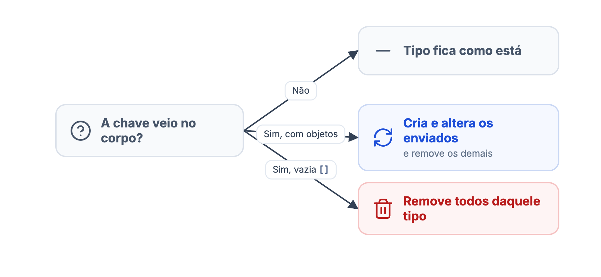
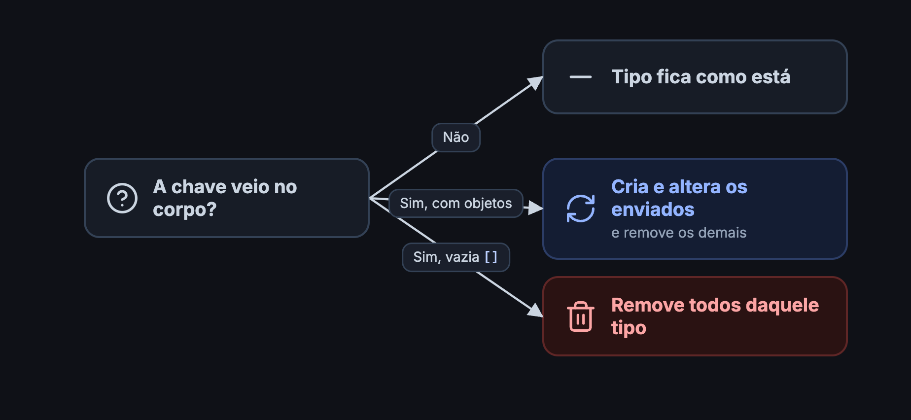

`POST /merchant/v3/{merchantId}/merchantForce` recebe a loja inteira, no mesmo formato do [GET da loja](/guides/merchant/catalog-and-services/details), e deixa o catálogo da DeliveryVip igual ao enviado. Cada lista enviada cria e altera os objetos dela e **remove os que não vieram**. Use na carga inicial ou quando o seu sistema for a fonte da verdade do catálogo inteiro.

<Danger>
**Lista vazia apaga tudo daquele tipo.** `"items": []` tira todos os produtos do cardápio, e uma lista com um produto só deixa a loja com um produto só. Antes de chamar o force, confirme que cada lista enviada está completa.
</Danger>

## O que acontece com cada lista

<Frame caption="O que o force faz com cada lista do corpo">
  
  
</Frame>

| Lista | Objetos que não vieram |
| --- | --- |
| `options`, `optionGroups`, `categories`, `items` | Saem do catálogo. Se forem enviados de novo com o mesmo `id`, em um force ou upsert, voltam. |
| `paymentMethods` | São **apagados** de vez. |
| `services` | Nada é removido: só os serviços enviados são alterados. |

As listas são gravadas nesta ordem: `services`, `options`, `optionGroups`, `categories`, `items` e `paymentMethods`. Por isso um produto pode apontar para uma categoria criada na mesma chamada, e um grupo para opções criadas na mesma chamada. Tudo roda numa única transação: se qualquer objeto falhar, nada é gravado.

<Warning>
O `status` é obrigatório e sempre aplicado: `AVAILABLE` abre a loja e `UNAVAILABLE` fecha. Envie o estado que a loja deve ter depois da chamada.
</Warning>

## Corpo da requisição

<ParamField body="id" type="uuid" required>
ID da loja. Use o mesmo `merchantId` da URL.
</ParamField>

<ParamField body="lastUpdate" type="datetime" required>
Data e hora da versão do catálogo no seu sistema. Obrigatório, mas hoje não é usado.
</ParamField>

<ParamField body="ttl" type="integer" required>
Obrigatório para manter o formato do GET, mas hoje não é usado. Envie `3600`.
</ParamField>

<ParamField body="status" type="string" required>
`AVAILABLE` abre a loja, `UNAVAILABLE` fecha.
</ParamField>

<ParamField body="basicInfo" type="object">
Aceito para manter o formato do GET, mas **não altera** os dados cadastrais da loja. Se enviado, precisa de `name`, `document` e `corporateName`, e o `address`, se vier, de `state`, `city`, `district`, `street`, `number` e `postalCode`. Pode ser omitido.
</ParamField>

<ParamField body="services" type="object[]">
Serviços de entrega e retirada, com os campos de [`SERVICE`](/guides/merchant/catalog-and-services/actions/upsert#service).
</ParamField>

<ParamField body="options" type="object[]">
Opções, com os campos de [`OPTION`](/guides/merchant/catalog-and-services/actions/upsert#option).
</ParamField>

<ParamField body="optionGroups" type="object[]">
Grupos de opções, com os campos de [`OPTION_GROUP`](/guides/merchant/catalog-and-services/actions/upsert#option_group).
</ParamField>

<ParamField body="categories" type="object[]">
Categorias, com os campos de [`CATEGORY`](/guides/merchant/catalog-and-services/actions/upsert#category).
</ParamField>

<ParamField body="items" type="object[]">
Produtos com modificadores, com os campos de [`ITEM`](/guides/merchant/catalog-and-services/actions/upsert#item).
</ParamField>

<ParamField body="paymentMethods" type="object[]">
Formas de pagamento, com os campos de [`PAYMENT_METHOD`](/guides/merchant/catalog-and-services/actions/upsert#payment_method).
</ParamField>

Os objetos de cada lista seguem as mesmas regras do [upsert](/guides/merchant/catalog-and-services/actions/upsert), inclusive os campos obrigatórios. As regras de formato, imagens e erros estão em [Ações](/guides/merchant/catalog-and-services/actions).

## Requisição

Reescrever só as categorias, sem tocar em produtos, opções e formas de pagamento:

<CodeGroup>
```bash cURL
curl --request POST 'https://api.deliveryvip.com.br/merchant/v3/{merchantId}/merchantForce' \
  --header 'Authorization: Bearer {token}' \
  --header 'Content-Type: application/json' \
  --data '{
    "id": "{merchantId}",
    "lastUpdate": "2023-09-26T18:29:16-03:00",
    "ttl": 3600,
    "status": "AVAILABLE",
    "categories": [
      { "id": "41678b1b-1902-4f34-b7b0-e2271e93283c", "index": 1, "name": "Pizzas", "status": "AVAILABLE" },
      { "id": "d37d1183-d544-4d15-a067-0f0ad38f7680", "index": 2, "name": "Bebidas", "status": "AVAILABLE" }
    ]
  }'
```

```js Node.js
const response = await fetch(
  `https://api.deliveryvip.com.br/merchant/v3/${merchantId}/merchantForce`,
  {
    method: 'POST',
    headers: { Authorization: `Bearer ${token}`, 'Content-Type': 'application/json' },
    body: JSON.stringify({
      id: merchantId,
      lastUpdate: new Date().toISOString(),
      ttl: 3600,
      status: 'AVAILABLE',
      categories: [
        { id: '41678b1b-1902-4f34-b7b0-e2271e93283c', index: 1, name: 'Pizzas', status: 'AVAILABLE' },
        { id: 'd37d1183-d544-4d15-a067-0f0ad38f7680', index: 2, name: 'Bebidas', status: 'AVAILABLE' },
      ],
    }),
  },
)
if (response.status !== 204) console.error(await response.json())
```

```python Python
from datetime import datetime, timezone

response = requests.post(
    f"https://api.deliveryvip.com.br/merchant/v3/{merchant_id}/merchantForce",
    headers={"Authorization": f"Bearer {token}"},
    json={
        "id": merchant_id,
        "lastUpdate": datetime.now(timezone.utc).isoformat(),
        "ttl": 3600,
        "status": "AVAILABLE",
        "categories": [
            {"id": "41678b1b-1902-4f34-b7b0-e2271e93283c", "index": 1, "name": "Pizzas", "status": "AVAILABLE"},
            {"id": "d37d1183-d544-4d15-a067-0f0ad38f7680", "index": 2, "name": "Bebidas", "status": "AVAILABLE"},
        ],
    },
)
if response.status_code != 204:
    print(response.json())
```
</CodeGroup>

Depois dessa chamada, a loja tem só essas duas categorias. As demais saem do cardápio. A resposta de sucesso é `204 No Content`, sem corpo.

<Accordion title="Exemplo de catálogo completo" icon="code">
```json
{
  "id": "7b32f751-5088-4398-bd7b-36c4dc9de062",
  "lastUpdate": "2023-09-26T18:29:16-03:00",
  "ttl": 3600,
  "status": "AVAILABLE",
  "services": [
    { "status": "AVAILABLE", "serviceType": "DELIVERY", "serviceTime": 15 },
    { "status": "AVAILABLE", "serviceType": "TAKEOUT", "serviceTime": 15 }
  ],
  "paymentMethods": [
    {
      "id": "41678b1b-1902-4f34-b7b0-e2271e93283c",
      "index": 1,
      "name": "Visa - Crédito",
      "mode": "CREDIT",
      "externalCode": "13",
      "status": "AVAILABLE"
    }
  ],
  "options": [
    {
      "id": "a493064b-f4dd-4780-85da-fc3ecc6b1cb6",
      "name": "Calabresa",
      "description": "Molho de tomate, mussarela e calabresa",
      "externalCode": "152",
      "status": "AVAILABLE",
      "image": {
        "url": "https://exemplo.com/calabresa.jpg",
        "checksum": "9fOMBLAAaCVVpx03oiViRQ=="
      }
    }
  ],
  "optionGroups": [
    {
      "id": "0f0e34d5-386e-4574-bb14-3615fbe090b1",
      "name": "Sabores tradicionais",
      "externalCode": "2",
      "status": "AVAILABLE",
      "optionIds": ["a493064b-f4dd-4780-85da-fc3ecc6b1cb6"]
    }
  ],
  "categories": [
    {
      "id": "d37d1183-d544-4d15-a067-0f0ad38f7680",
      "index": 1,
      "name": "Pizzas",
      "status": "AVAILABLE"
    }
  ],
  "items": [
    {
      "id": "fdbd50f9-63a7-4259-82e6-24ac5b7dc3c2",
      "index": 1,
      "name": "Pizza Grande",
      "description": "Até 2 sabores",
      "externalCode": "104",
      "status": "AVAILABLE",
      "categoryId": "d37d1183-d544-4d15-a067-0f0ad38f7680",
      "menu": ["DELIVERY", "TAKEOUT", "INDOOR"],
      "price": { "value": 50.0, "originalValue": 50.0, "currency": "BRL" },
      "image": {
        "url": "https://exemplo.com/pizza.jpg",
        "checksum": "9fOMBLAAaCVVpx03oiViRQ=="
      },
      "modifiers": [
        {
          "id": "79d89952-67cd-43e9-98a4-67b5e3357be9",
          "index": 1,
          "name": "Escolha os sabores",
          "externalCode": "123",
          "status": "AVAILABLE",
          "rule": "APPORTIONMENT",
          "minPermitted": 1,
          "maxPermitted": 2,
          "optionGroups": [
            {
              "optionGroupId": "0f0e34d5-386e-4574-bb14-3615fbe090b1",
              "index": 1,
              "options": [
                {
                  "optionId": "a493064b-f4dd-4780-85da-fc3ecc6b1cb6",
                  "index": 1,
                  "status": "AVAILABLE",
                  "price": { "value": 0.0, "originalValue": 0.0, "currency": "BRL" }
                }
              ]
            }
          ]
        }
      ]
    }
  ]
}
```
</Accordion>

## Boas práticas

<Check>
* Gere o corpo a partir do catálogo completo do seu sistema, nunca de uma lista parcial ou filtrada.
* Omita as chaves dos tipos que você não quer reescrever. Uma chave ausente não remove nada; uma lista vazia remove tudo.
* Para mudanças do dia a dia, prefira o [update](/guides/merchant/catalog-and-services/actions/update) ou o [upsert](/guides/merchant/catalog-and-services/actions/upsert): são menores e não arriscam remover objetos.
* Depois de um force, confira o resultado com o [GET da loja](/guides/merchant/catalog-and-services/details).
</Check>
