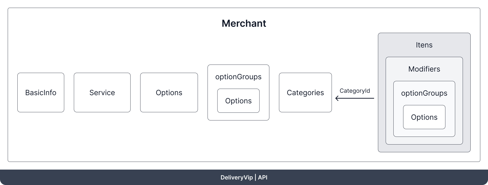

`GET /merchant/v3/{merchantId}` devolve tudo o que a DeliveryVip sabe sobre a loja: dados cadastrais, endereço, serviços de entrega e retirada, formas de pagamento e o catálogo completo. Use para conferir o estado atual antes de sincronizar, ou para montar o catálogo no seu sistema pela primeira vez.

## Requisição

<CodeGroup>
```bash cURL
curl 'https://api.deliveryvip.com.br/merchant/v3/{merchantId}' \
  --header 'Authorization: Bearer {token}'
```

```js Node.js
const response = await fetch(`https://api.deliveryvip.com.br/merchant/v3/${merchantId}`, {
  headers: { Authorization: `Bearer ${token}` },
})
const merchant = await response.json()
```

```python Python
response = requests.get(
    f"https://api.deliveryvip.com.br/merchant/v3/{merchant_id}",
    headers={"Authorization": f"Bearer {token}"},
)
merchant = response.json()
```
</CodeGroup>

| Status | Quando |
| --- | --- |
| `200 OK` | A loja foi encontrada. O corpo traz os campos abaixo. |
| `401 Unauthorized` | Token ausente, expirado ou inválido. |
| `404 Not Found` | O `merchantId` não existe ou a loja não autorizou o seu app. |

## Estrutura da loja

<Frame caption="Estrutura do merchant">
  
</Frame>

<Info>
Campos opcionais sem valor são **omitidos** da resposta, não enviados como `null`. O mesmo vale para as listas do catálogo: uma loja sem produtos não traz a chave `items`.
</Info>

<ResponseField name="id" type="uuid" required>
Identificador da loja. É o `merchantId` usado nas rotas.
</ResponseField>

<ResponseField name="lastUpdate" type="datetime" required>
Última alteração no cadastro da loja, com fuso horário (por exemplo `2023-09-26T18:29:16-03:00`).
</ResponseField>

<ResponseField name="ttl" type="integer" required>
Sugestão de intervalo, em segundos, para consultar a loja de novo. Hoje é sempre `3600`.
</ResponseField>

<ResponseField name="status" type="string" required>
`AVAILABLE` quando a loja está aberta, `UNAVAILABLE` quando está fechada.
</ResponseField>

<ResponseField name="basicInfo" type="object" required>
Dados cadastrais da loja.

<Expandable title="propriedades">
<ResponseField name="name" type="string">
Nome fantasia.
</ResponseField>
<ResponseField name="document" type="string">
CNPJ ou CPF, só com dígitos.
</ResponseField>
<ResponseField name="corporateName" type="string">
Razão social.
</ResponseField>
<ResponseField name="description" type="string">
Descrição da loja. Só vem quando preenchida.
</ResponseField>
<ResponseField name="contactEmails" type="string[]">
E-mails de contato. Só vem quando a loja tem e-mail e e-mail do responsável cadastrados.
</ResponseField>
<ResponseField name="contactPhones" type="object">
Só vem quando a loja tem telefone.

<Expandable title="propriedades">
<ResponseField name="commercialNumber" type="string">
Telefone comercial no formato E.164.
</ResponseField>
</Expandable>
</ResponseField>
<ResponseField name="createdAt" type="datetime">
Data de cadastro da loja.
</ResponseField>
<ResponseField name="address" type="object">
Endereço da loja.

<Expandable title="propriedades">
<ResponseField name="country" type="string">
Sigla do país.
</ResponseField>
<ResponseField name="state" type="string">
Sigla do estado.
</ResponseField>
<ResponseField name="city" type="string">
Cidade.
</ResponseField>
<ResponseField name="district" type="string">
Bairro.
</ResponseField>
<ResponseField name="street" type="string">
Rua.
</ResponseField>
<ResponseField name="number" type="string">
Número.
</ResponseField>
<ResponseField name="complement" type="string">
Complemento. Só vem quando preenchido.
</ResponseField>
<ResponseField name="reference" type="string">
Ponto de referência. Só vem quando preenchido.
</ResponseField>
<ResponseField name="postalCode" type="string">
CEP.
</ResponseField>
<ResponseField name="formattedAddress" type="string">
Endereço completo em uma linha.
</ResponseField>
<ResponseField name="coordinates" type="object">
`latitude` e `longitude` da loja.
</ResponseField>
</Expandable>
</ResponseField>
</Expandable>
</ResponseField>

<ResponseField name="services" type="object[]" required>
Sempre dois itens: um `DELIVERY` e um `TAKEOUT`.

<Expandable title="propriedades">
<ResponseField name="status" type="string">
`AVAILABLE` se a loja aceita o serviço, `UNAVAILABLE` se não.
</ResponseField>
<ResponseField name="serviceType" type="string">
`DELIVERY` (entrega) ou `TAKEOUT` (retirada).
</ResponseField>
<ResponseField name="serviceTime" type="integer">
Tempo do serviço, em minutos.
</ResponseField>
</Expandable>
</ResponseField>

<ResponseField name="paymentMethods" type="object[]">
Formas de pagamento, ordenadas por `index`.

<Expandable title="propriedades">
<ResponseField name="id" type="uuid">
Identificador da forma de pagamento.
</ResponseField>
<ResponseField name="index" type="integer">
Posição na lista.
</ResponseField>
<ResponseField name="name" type="string">
Nome exibido ao cliente.
</ResponseField>
<ResponseField name="mode" type="string">
`CASH`, `CREDIT`, `DEBIT`, `PIX`, `MEAL_VOUCHER`, `FOOD_VOUCHER` ou `OTHER`.
</ResponseField>
<ResponseField name="externalCode" type="string">
Código no seu sistema. Só vem quando preenchido.
</ResponseField>
<ResponseField name="status" type="string">
`AVAILABLE` ou `UNAVAILABLE`.
</ResponseField>
</Expandable>
</ResponseField>

<ResponseField name="options" type="object[]">
Opções do catálogo, em ordem alfabética.

<Expandable title="propriedades">
<ResponseField name="id" type="uuid">
Identificador da opção.
</ResponseField>
<ResponseField name="name" type="string">
Nome da opção.
</ResponseField>
<ResponseField name="description" type="string">
Descrição. Só vem quando preenchida.
</ResponseField>
<ResponseField name="externalCode" type="string">
Código no seu sistema. Só vem quando preenchido.
</ResponseField>
<ResponseField name="status" type="string">
`AVAILABLE` ou `UNAVAILABLE`.
</ResponseField>
<ResponseField name="image" type="object">
Só vem quando a opção tem imagem.

<Expandable title="propriedades">
<ResponseField name="url" type="string">
Endereço da imagem.
</ResponseField>
<ResponseField name="checksum" type="string">
MD5 do arquivo em Base64. Compare com o checksum da sua imagem para saber se precisa enviá-la de novo.
</ResponseField>
</Expandable>
</ResponseField>
</Expandable>
</ResponseField>

<ResponseField name="optionGroups" type="object[]">
Grupos de opções, em ordem alfabética.

<Expandable title="propriedades">
<ResponseField name="id" type="uuid">
Identificador do grupo.
</ResponseField>
<ResponseField name="name" type="string">
Nome do grupo.
</ResponseField>
<ResponseField name="externalCode" type="string">
Código no seu sistema. Só vem quando preenchido.
</ResponseField>
<ResponseField name="status" type="string">
`AVAILABLE` ou `UNAVAILABLE`.
</ResponseField>
<ResponseField name="optionIds" type="uuid[]">
IDs das opções que fazem parte do grupo.
</ResponseField>
</Expandable>
</ResponseField>

<ResponseField name="categories" type="object[]">
Categorias, ordenadas por `index`.

<Expandable title="propriedades">
<ResponseField name="id" type="uuid">
Identificador da categoria.
</ResponseField>
<ResponseField name="index" type="integer">
Posição no cardápio.
</ResponseField>
<ResponseField name="name" type="string">
Nome da categoria.
</ResponseField>
<ResponseField name="description" type="string">
Descrição. Só vem quando preenchida.
</ResponseField>
<ResponseField name="externalCode" type="string">
Código no seu sistema. Só vem quando preenchido.
</ResponseField>
<ResponseField name="status" type="string">
`AVAILABLE` ou `UNAVAILABLE`.
</ResponseField>
</Expandable>
</ResponseField>

<ResponseField name="items" type="object[]">
Produtos, ordenados por `index`.

<Expandable title="propriedades">
<ResponseField name="id" type="uuid">
Identificador do produto.
</ResponseField>
<ResponseField name="index" type="integer">
Posição dentro da categoria.
</ResponseField>
<ResponseField name="name" type="string">
Nome do produto.
</ResponseField>
<ResponseField name="description" type="string">
Descrição. Só vem quando preenchida.
</ResponseField>
<ResponseField name="externalCode" type="string">
Código no seu sistema. Só vem quando preenchido.
</ResponseField>
<ResponseField name="status" type="string">
`AVAILABLE` ou `UNAVAILABLE`.
</ResponseField>
<ResponseField name="ean" type="string">
Código de barras EAN. Só vem quando preenchido.
</ResponseField>
<ResponseField name="menu" type="string[]">
Onde o produto é vendido: `DELIVERY` (entrega), `TAKEOUT` (retirada) e `INDOOR` (consumo no local).

Quando o produto tem `DELIVERY` **e** `TAKEOUT`, a lista inclui **também** o valor agregado `DELIVERY_TAKEOUT`, mantido por retrocompatibilidade. Baseie-se nos tipos individuais e ignore o agregado.
</ResponseField>
<ResponseField name="price" type="object">
<Expandable title="propriedades">
<ResponseField name="value" type="number">
Preço atual.
</ResponseField>
<ResponseField name="originalValue" type="number">
Preço original. Quando é maior que `value`, o produto está em promoção.
</ResponseField>
<ResponseField name="currency" type="string">
Sempre `BRL`.
</ResponseField>
</Expandable>
</ResponseField>
<ResponseField name="categoryId" type="uuid">
Categoria do produto.
</ResponseField>
<ResponseField name="image" type="object">
`url` e `checksum` da imagem, como em `options`. Só vem quando o produto tem imagem.
</ResponseField>
<ResponseField name="modifiers" type="object[]">
Modificadores do produto, ordenados por `index`. Só vem quando o produto tem modificadores.

<Expandable title="propriedades">
<ResponseField name="id" type="uuid">
Identificador do modificador.
</ResponseField>
<ResponseField name="index" type="integer">
Posição no produto.
</ResponseField>
<ResponseField name="name" type="string">
Pergunta exibida ao cliente, por exemplo "Escolha os sabores".
</ResponseField>
<ResponseField name="externalCode" type="string">
Código no seu sistema. Só vem quando preenchido.
</ResponseField>
<ResponseField name="status" type="string">
`AVAILABLE` ou `UNAVAILABLE`.
</ResponseField>
<ResponseField name="rule" type="string">
Como o preço das opções escolhidas é calculado: `ADDITION`, `APPORTIONMENT` ou `HIGHEST`. Veja as [regras de preço](/guides/merchant/catalog-and-services/actions#regras-de-preço-do-modificador).
</ResponseField>
<ResponseField name="minPermitted" type="integer">
Mínimo de opções que o cliente precisa escolher.
</ResponseField>
<ResponseField name="maxPermitted" type="integer">
Máximo de opções que o cliente pode escolher. `0` significa sem limite.
</ResponseField>
<ResponseField name="optionGroups" type="object[]">
Grupos de opções do modificador.

<Expandable title="propriedades">
<ResponseField name="optionGroupId" type="uuid">
ID do grupo de opções.
</ResponseField>
<ResponseField name="index" type="integer">
Posição do grupo no modificador.
</ResponseField>
<ResponseField name="options" type="object[]">
Opções do grupo neste modificador, com preço próprio.

<Expandable title="propriedades">
<ResponseField name="optionId" type="uuid">
ID da opção.
</ResponseField>
<ResponseField name="index" type="integer">
Posição da opção.
</ResponseField>
<ResponseField name="status" type="string">
`AVAILABLE` ou `UNAVAILABLE`.
</ResponseField>
<ResponseField name="price" type="object">
`value`, `originalValue` e `currency` da opção neste modificador.
</ResponseField>
</Expandable>
</ResponseField>
</Expandable>
</ResponseField>
</Expandable>
</ResponseField>
</Expandable>
</ResponseField>

<Accordion title="Exemplo de resposta completa" icon="code">
```json 200 OK
{
  "id": "8c64a3f9-65d7-4e3b-9a2d-7c85bc3b3a17",
  "lastUpdate": "2023-09-26T18:29:16-03:00",
  "ttl": 3600,
  "status": "AVAILABLE",
  "basicInfo": {
    "name": "Pizzaria Exemplo",
    "document": "12345678000190",
    "corporateName": "Pizzaria Exemplo LTDA",
    "contactEmails": ["contato@exemplo.com.br"],
    "contactPhones": { "commercialNumber": "+5511999999999" },
    "createdAt": "2022-01-10T09:00:00-03:00",
    "address": {
      "country": "BR",
      "state": "SP",
      "city": "São Paulo",
      "district": "Moema",
      "street": "Avenida Exemplo",
      "number": "100",
      "postalCode": "04000-000",
      "formattedAddress": "Avenida Exemplo, 100 - Moema, São Paulo - SP",
      "coordinates": {
        "latitude": -23.6,
        "longitude": -46.66
      }
    }
  },
  "services": [
    { "status": "AVAILABLE", "serviceType": "DELIVERY", "serviceTime": 15 },
    { "status": "AVAILABLE", "serviceType": "TAKEOUT", "serviceTime": 15 }
  ],
  "paymentMethods": [
    {
      "id": "41678b1b-1902-4f34-b7b0-e2271e93283c",
      "index": 1,
      "name": "Visa - Crédito",
      "mode": "CREDIT",
      "externalCode": "13",
      "status": "AVAILABLE"
    }
  ],
  "options": [
    {
      "id": "c6f193a1-93ea-4aa6-af50-8cc6ed40fb7e",
      "name": "Calabresa",
      "description": "Molho de tomate, mussarela e calabresa",
      "externalCode": "152",
      "status": "AVAILABLE",
      "image": {
        "url": "https://exemplo.com/calabresa.jpg",
        "checksum": "9fOMBLAAaCVVpx03oiViRQ=="
      }
    }
  ],
  "optionGroups": [
    {
      "id": "b4a8a52e-2dd8-4d94-a198-2e68a7ee2d68",
      "name": "Sabores tradicionais",
      "externalCode": "2",
      "status": "AVAILABLE",
      "optionIds": ["c6f193a1-93ea-4aa6-af50-8cc6ed40fb7e"]
    }
  ],
  "categories": [
    {
      "id": "d37d1183-d544-4d15-a067-0f0ad38f7680",
      "index": 1,
      "name": "Pizzas",
      "status": "AVAILABLE"
    }
  ],
  "items": [
    {
      "id": "a3a74a38-9b1d-4c6f-8c53-63eafcdac477",
      "index": 1,
      "name": "Pizza Gigante",
      "description": "Até 4 sabores",
      "externalCode": "104",
      "status": "AVAILABLE",
      "menu": ["DELIVERY", "TAKEOUT", "INDOOR", "DELIVERY_TAKEOUT"],
      "price": { "value": 50.0, "originalValue": 50.0, "currency": "BRL" },
      "categoryId": "d37d1183-d544-4d15-a067-0f0ad38f7680",
      "image": {
        "url": "https://exemplo.com/pizza.jpg",
        "checksum": "9fOMBLAAaCVVpx03oiViRQ=="
      },
      "modifiers": [
        {
          "id": "5a451f76-9e48-49e5-9a62-181bfc6b1a92",
          "index": 1,
          "name": "Escolha os sabores",
          "status": "AVAILABLE",
          "rule": "HIGHEST",
          "minPermitted": 1,
          "maxPermitted": 4,
          "optionGroups": [
            {
              "optionGroupId": "b4a8a52e-2dd8-4d94-a198-2e68a7ee2d68",
              "index": 1,
              "options": [
                {
                  "optionId": "c6f193a1-93ea-4aa6-af50-8cc6ed40fb7e",
                  "index": 1,
                  "status": "AVAILABLE",
                  "price": { "value": 0.0, "originalValue": 0.0, "currency": "BRL" }
                }
              ]
            }
          ]
        }
      ]
    }
  ]
}
```
</Accordion>

## Status e horários da loja

Para saber só se a loja está aberta e quais são os horários de atendimento, use `GET /merchant/v3/{merchantId}/status`. A resposta é bem menor que a da loja completa.

```bash
curl 'https://api.deliveryvip.com.br/merchant/v3/{merchantId}/status' \
  --header 'Authorization: Bearer {token}'
```

<ResponseField name="status" type="string" required>
`AVAILABLE` (aberta) ou `UNAVAILABLE` (fechada).
</ResponseField>

<ResponseField name="services" type="object[]" required>
Um item com o `id` da loja e `serviceHours[].weekHours[]`: cada faixa traz `dayOfWeek` (por exemplo `["MONDAY"]`) e `timePeriods` com `startTime` e `endTime` no horário local da loja (`HH:MM:SS`).
</ResponseField>

<ResponseField name="orderingAppMerchantId" type="uuid" required>
ID da loja na DeliveryVip.
</ResponseField>

## Próximos passos

<CardGroup cols={2}>
<Card title="Ações" icon="arrows-rotate" href="/guides/merchant/catalog-and-services/actions">
Escolha entre update, upsert e force para sincronizar o catálogo.
</Card>
<Card title="Upsert" icon="file-import" href="/guides/merchant/catalog-and-services/actions/upsert">
Crie ou altere produtos, opções e categorias.
</Card>
</CardGroup>
