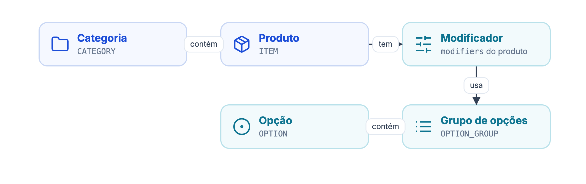
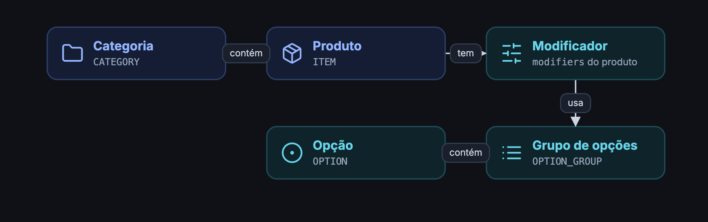

A API de catálogo mantém o cardápio da loja na DeliveryVip igual ao do seu sistema. Você lê tudo em uma chamada e escreve com uma de três rotas, conforme o tamanho da mudança.

| Endpoint | Para quê |
| --- | --- |
| `GET /merchant/v3/{merchantId}` | Ler dados da loja, serviços, formas de pagamento e o catálogo completo. |
| `POST /merchant/v3/{merchantId}/merchantUpdate` | Alterar objetos que já existem. |
| `POST /merchant/v3/{merchantId}/merchantUpsert` | Criar ou alterar objetos de um tipo. |
| `POST /merchant/v3/{merchantId}/merchantForce` | Reescrever o catálogo: o que não vier na lista é removido. |

Todas as rotas exigem o token no header `Authorization` (veja [autenticação](/inicio/conceitos/autenticacao)) e só aceitam lojas que autorizaram o seu app.

## Como o catálogo se organiza

Opções e grupos de opções são cadastrados uma vez e reaproveitados. Um produto usa modificadores, e cada modificador aponta para grupos de opções.

<Frame caption="Como o catálogo se organiza">
  
  
</Frame>

| Entidade | O que é | Exemplo |
| --- | --- | --- |
| `CATEGORY` | Seção do cardápio. | Pizzas |
| `ITEM` | Produto vendido, sempre dentro de uma categoria. | Pizza Gigante |
| `modifiers` | Pergunta feita ao cliente ao escolher o produto, com regra de preço e limites de escolha. Existe só dentro de um `ITEM`. | Escolha os sabores (1 a 4) |
| `OPTION_GROUP` | Lista reutilizável de opções. | Sabores tradicionais |
| `OPTION` | Escolha individual. | Calabresa |
| `SERVICE` | Entrega (`DELIVERY`) e retirada (`TAKEOUT`): disponibilidade e tempo de preparo. | Entrega em 40 min |
| `PAYMENT_METHOD` | Forma de pagamento aceita na loja. | Visa crédito |

<Info>
Os IDs são gerados pelo seu sistema. Crie um UUID para cada objeto e use o mesmo UUID em todas as chamadas seguintes: é ele que liga o objeto da DeliveryVip ao registro do seu sistema.
</Info>

## Por onde seguir

<CardGroup cols={2}>
<Card title="Detalhes" icon="magnifying-glass" href="/guides/merchant/catalog-and-services/details">
O que o `GET` da loja devolve, campo a campo.
</Card>
<Card title="Ações" icon="arrows-rotate" href="/guides/merchant/catalog-and-services/actions">
Qual rota usar, regras comuns e erros.
</Card>
</CardGroup>
