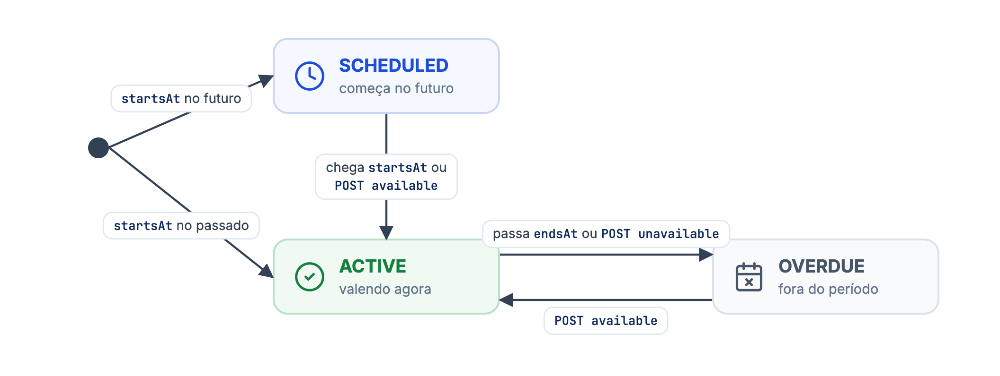
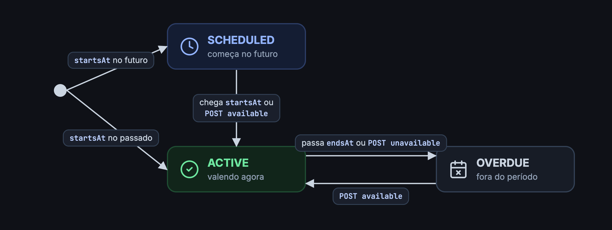

A API de descontos permite cadastrar, alterar, ativar, desativar e remover os descontos de uma loja, e consultar quanto cada um vendeu.

<Warning>
**API em beta.** Ela ainda pode mudar. Acompanhe o [changelog](/changelog) antes de cada atualização da sua integração.
</Warning>

## Tipos de desconto

<CardGroup cols={2}>
<Card title="SMART" icon="wand-magic-sparkles">
Desconto automático. Entra sozinho na sacola quando o pedido cumpre as regras, sem o cliente fazer nada. Identificado por `name`.
</Card>
<Card title="COUPON" icon="ticket">
Cupom. O cliente digita o `code` na sacola para aplicar. Bom para campanhas com influenciadores ou para enviar a um cliente específico.
</Card>
</CardGroup>

Um pedido recebe no máximo um desconto `SMART` e um cupom. Se o cliente aplicar um cupom, ele substitui o desconto automático, a menos que o cupom tenha a opção `CUMULATIVE_WITH_SMART`: nesse caso os dois se somam.

## Status

O `status` não é um campo que você envia. Ele é calculado a partir de `startsAt` e `endsAt` a cada consulta:

| `status` | Quando |
| --- | --- |
| `SCHEDULED` | `startsAt` ainda não chegou. |
| `ACTIVE` | Já começou e `endsAt` é vazio ou ainda não passou. |
| `OVERDUE` | `endsAt` já passou. |

<Frame caption="Status de um desconto">
  
  
</Frame>

Para ligar ou desligar um desconto na hora, use as [ações](/guides/merchant/discount/acoes-dos-descontos).

## Endpoints

Todas as rotas ficam em `https://api.deliveryvip.com.br/merchant/v3/{merchantId}/discounts`.

| Ação | Endpoint | Sucesso |
| --- | --- | --- |
| [Listar descontos](/guides/merchant/discount/listar-descontos) | `GET /discounts` | `200` ou `204` |
| [Obter um desconto](/guides/merchant/discount/obter-detalhes-do-desconto) | `GET /discounts/{discountId}` | `200` |
| [Estatísticas](/guides/merchant/discount/obter-estatistica-do-desconto) | `GET /discounts/{discountId}/stats` | `200` |
| [Adicionar](/guides/merchant/discount/adicionar-um-desconto) | `POST /discounts` | `200` |
| [Atualizar](/guides/merchant/discount/atualizar-um-desconto) | `PATCH /discounts/{discountId}` | `200` |
| [Remover](/guides/merchant/discount/remover-um-desconto) | `DELETE /discounts/{discountId}` | `200` |
| [Ativar](/guides/merchant/discount/acoes-dos-descontos/ativar-um-desconto) | `POST /discounts/{discountId}/available` | `200` |
| [Desativar](/guides/merchant/discount/acoes-dos-descontos/desativar-um-desconto) | `POST /discounts/{discountId}/unavailable` | `200` |

## Requisitos

<Info>
A loja precisa ter o módulo de descontos contratado. Sem ele, **todas** as rotas respondem `403` com `"title": "growth_discount_not_hired"`.
</Info>

Os descontos criados ou alterados pela API valem só no canal de venda da própria loja.

## Erros comuns

Os erros seguem o [formato padrão](/inicio/conceitos/erros): `{ "status": "...", "title": ... }`.

| Status | Quando |
| --- | --- |
| `401 Unauthorized` | Token ausente, expirado ou inválido. |
| `403 Forbidden` | A loja não contratou o módulo de descontos (`growth_discount_not_hired`). |
| `404 Not Found` | O `merchantId` não autorizou o seu app, ou o desconto não existe ou foi removido. |
| `422 Unprocessable Content` | Dados inválidos no cadastro ou na atualização. O `title` traz os campos com problema. |
