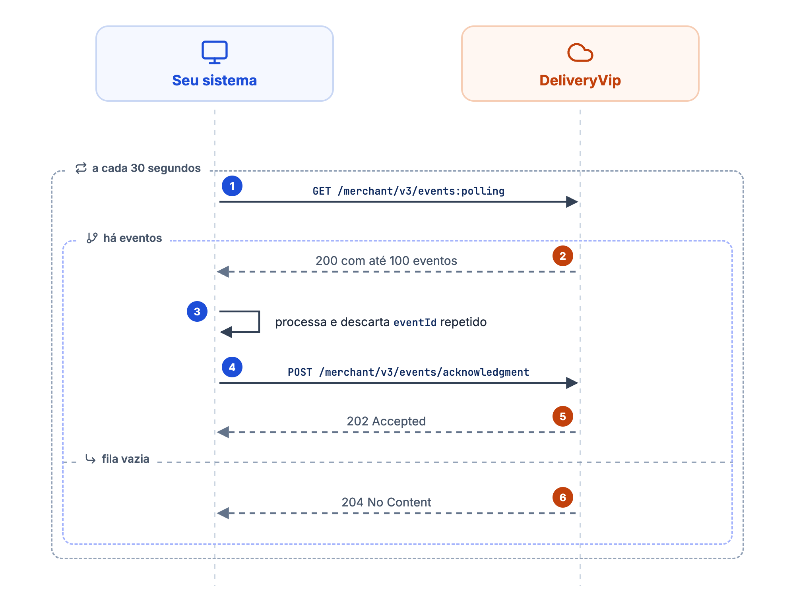
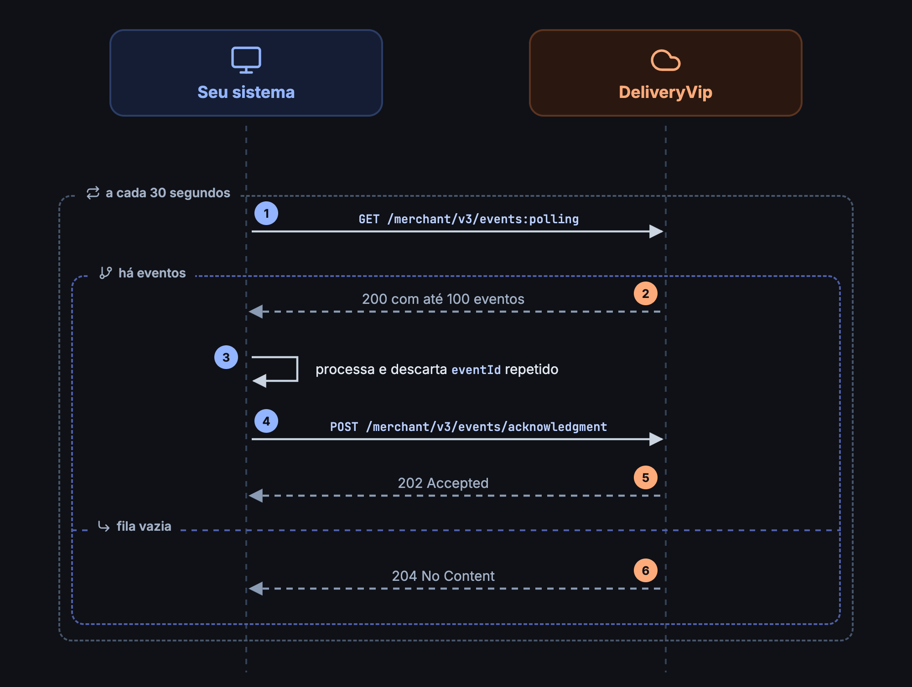

Toda mudança relevante numa loja gera um evento: um pedido criado, confirmado, despachado ou cancelado, um cliente chamando o garçom ou pedindo a conta. O seu sistema recebe esses eventos de duas formas, que funcionam de modo independente.

<CardGroup cols={2}>
<Card title="Webhook" icon="bolt" href="/guides/merchant/webhooks">
A DeliveryVip faz um `POST` na sua URL assim que o evento acontece. Sem fila para drenar, sem limite de 100 e sem intervalo de consulta.
</Card>
<Card title="Polling" icon="arrows-rotate" href="/guides/merchant/order/fluxo-de-integracao/consultar-novos-pedidos">
O seu sistema chama `GET /merchant/v3/events:polling` a cada 30 segundos e confirma o que processou.
</Card>
</CardGroup>

<Check>
Uma integração robusta usa o **webhook como canal principal** e o **polling como reconciliação**. Receber um evento por webhook não o tira da fila do polling, e vice-versa.
</Check>

## Como funciona o polling

<Frame caption="O ciclo do polling de eventos">
  
  
</Frame>

<Steps>
<Step title="Consulte a fila">
`GET /merchant/v3/events:polling` devolve até **100 eventos**, do mais antigo para o mais recente, ou `204` quando não há nada novo.
</Step>
<Step title="Processe cada evento">
Use o `eventType` para decidir o que fazer. Eventos de pedido trazem a `orderURL` para buscar os detalhes.
</Step>
<Step title="Confirme o recebimento">
Envie os `eventId` processados em `POST /merchant/v3/events/acknowledgment`. Eventos sem acknowledgment voltam na próxima chamada.
</Step>
</Steps>

<Warning>
Se a resposta trouxer 100 eventos, a fila está acumulada. Envie o acknowledgment e chame o polling de novo **sem esperar os 30 segundos**, até receber menos de 100 eventos ou `204`.
</Warning>

<Info>
O polling só considera eventos criados nas **últimas 24 horas**. Eventos mais antigos deixam de ser retornados, mesmo sem acknowledgment.
</Info>

## Tipos de evento

<CardGroup cols={2}>
<Card title="Eventos de pedidos" icon="receipt" href="/guides/merchant/order/fluxo-de-integracao/eventos-de-pedidos">
`CREATED`, `CONFIRMED`, `DISPATCHED`, `CANCELLED` e os demais estados do pedido.
</Card>
<Card title="Eventos de indoor" icon="utensils" href="/guides/merchant/indoor/fluxo-de-integracao/eventos-de-indoor">
`CALL_WAITER` e `CLOSE_ACCOUNT`, gerados pelas comandas e mesas do autoatendimento.
</Card>
</CardGroup>

## Próximos passos

<CardGroup cols={2}>
<Card title="Consultar novos pedidos" icon="magnifying-glass" href="/guides/merchant/order/fluxo-de-integracao/consultar-novos-pedidos">
Requisição, filtros por tipo de evento, tipo de pedido e loja.
</Card>
<Card title="Acknowledgment" icon="check-double" href="/guides/merchant/order/fluxo-de-integracao/acknowledgment-de-eventos">
Como confirmar os eventos e tirar da fila.
</Card>
</CardGroup>
