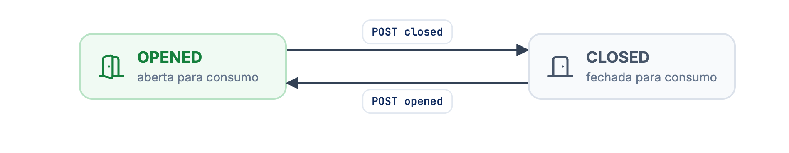
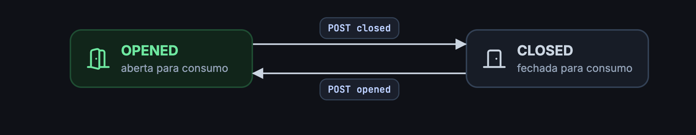

Cada ação é um `POST` sem corpo em `/merchant/v3/{merchantId}/tabs/{tabId}/<ação>`. A resposta de sucesso é `202 Accepted` com o `id` da comanda.

| Ação | Endpoint | Efeito | Estado |
| --- | --- | --- | --- |
| [Abrir para consumo](/guides/merchant/indoor/comanda-api/acoes-das-comandas/abrir-para-consumo-uma-comanda) | `opened` | `situation` vira `OPENED`. | Atual |
| [Fechar para consumo](/guides/merchant/indoor/comanda-api/acoes-das-comandas/fechar-para-consumo-uma-comanda) | `closed` | `situation` vira `CLOSED`. | Atual |
| [Ativar](/guides/merchant/indoor/comanda-api/acoes-das-comandas/ativar-uma-comanda) | `available` | `status` vira `AVAILABLE` e `situation`, `OPENED`. | Em deprecação |
| [Desativar](/guides/merchant/indoor/comanda-api/acoes-das-comandas/desativar-uma-comanda) | `unavailable` | `status` vira `UNAVAILABLE` e `situation`, `CLOSED`. | Em deprecação |

<Frame caption="Abrir e fechar uma comanda para consumo">
  
  
</Frame>

As ações são idempotentes: abrir uma comanda já aberta, ou fechar uma já fechada, responde `202` sem mudar nada.

```json 202 Accepted
{ "id": "6b7cd994-d8ff-4d12-8064-251becc39b08" }
```

## Erros

| Status | Quando |
| --- | --- |
| `404 Not Found` | O `merchantId` não autorizou o seu app, a comanda não existe ou foi removida, ou o `tabId` não é um UUID válido. |
