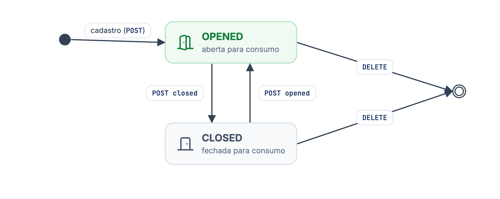
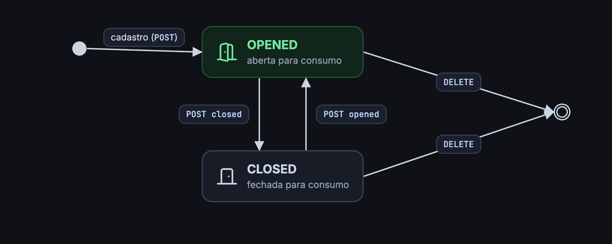

A comanda (`tab`) é o cartão ou ficha que acompanha o cliente no salão. Cada uma tem um nome que a equipe vê, um código e um QR Code. O cliente lê o QR Code, faz os pedidos e eles ficam ligados à comanda.

## O objeto comanda

<ResponseField name="id" type="uuid">
Identificador da comanda. É o `tabId` das rotas e dos eventos.
</ResponseField>

<ResponseField name="createdAt" type="datetime">
Quando a comanda foi cadastrada.
</ResponseField>

<ResponseField name="name" type="string">
Identificação que a equipe vê, como `0013` ou `Comanda 13`.
</ResponseField>

<ResponseField name="code" type="string">
Código da comanda, único na loja. Vem `null` depois que a comanda é removida.
</ResponseField>

<ResponseField name="qrcode" type="string">
URL que o QR Code impresso na comanda deve conter. Ela usa o `id` da comanda, então não muda quando você altera `name` ou `code`.
</ResponseField>

<ResponseField name="status" type="string">
`AVAILABLE` ou `UNAVAILABLE`. Campo legado: só muda pelas rotas [descontinuadas](#rotas-descontinuadas) ou quando a comanda é removida. Comandas `UNAVAILABLE` não aceitam pedidos.
</ResponseField>

<ResponseField name="situation" type="string">
`OPENED` ou `CLOSED`. Diz se a comanda está aberta para consumo. É o campo que você controla pelas [ações](/guides/merchant/indoor/comanda-api/acoes-das-comandas).
</ResponseField>

```json Comanda
{
  "id": "6b7cd994-d8ff-4d12-8064-251becc39b08",
  "createdAt": "2023-02-09T17:56:43-03:00",
  "name": "0013",
  "code": "0013",
  "qrcode": "https://qrcode.dvstore.com/qrcode/indoor_tab_6b7cd994-d8ff-4d12-8064-251becc39b08",
  "status": "AVAILABLE",
  "situation": "OPENED"
}
```

## Ciclo de vida

Toda comanda nasce `AVAILABLE` e `OPENED`. Daí em diante, você alterna a situação entre aberta e fechada.

<Frame caption="Ciclo de vida de uma comanda">
  
  
</Frame>

Com a comanda `CLOSED`, o cliente que lê o QR Code vê o aviso de comanda fechada e não consegue finalizar pedidos nem pedir a conta com ela.

## Endpoints

Todas as rotas ficam em `https://api.deliveryvip.com.br/merchant/v3/{merchantId}/tabs`.

| Ação | Endpoint | Sucesso |
| --- | --- | --- |
| [Listar comandas](/guides/merchant/indoor/comanda-api/listar-comandas) | `GET /tabs` | `200` ou `204` |
| [Obter uma comanda](/guides/merchant/indoor/comanda-api/obter-detalhes-da-comanda) | `GET /tabs/{tabId}` | `200` |
| [Adicionar](/guides/merchant/indoor/comanda-api/adicionar-uma-comanda) | `POST /tabs` | `201` |
| [Atualizar](/guides/merchant/indoor/comanda-api/atualizar-uma-comanda) | `PATCH /tabs/{tabId}` | `200` |
| [Remover](/guides/merchant/indoor/comanda-api/remover-uma-comanda) | `DELETE /tabs/{tabId}` | `200` |
| [Abrir para consumo](/guides/merchant/indoor/comanda-api/acoes-das-comandas/abrir-para-consumo-uma-comanda) | `POST /tabs/{tabId}/opened` | `202` |
| [Fechar para consumo](/guides/merchant/indoor/comanda-api/acoes-das-comandas/fechar-para-consumo-uma-comanda) | `POST /tabs/{tabId}/closed` | `202` |

### Rotas descontinuadas

`POST /tabs/{tabId}/available` e `POST /tabs/{tabId}/unavailable` estão em deprecação. Use `opened` e `closed`. Veja [ativar](/guides/merchant/indoor/comanda-api/acoes-das-comandas/ativar-uma-comanda) e [desativar](/guides/merchant/indoor/comanda-api/acoes-das-comandas/desativar-uma-comanda).

## Erros comuns

Os erros seguem o [formato padrão](/inicio/conceitos/erros): `{ "status": "...", "title": ... }`.

| Status | Quando |
| --- | --- |
| `401 Unauthorized` | Token ausente, expirado ou inválido. |
| `404 Not Found` | O `merchantId` não autorizou o seu app, a comanda não existe, foi removida ou o `tabId` não é um UUID válido. |
| `422 Unprocessable Content` | Dados inválidos no cadastro ou na atualização, como `code` repetido. |
