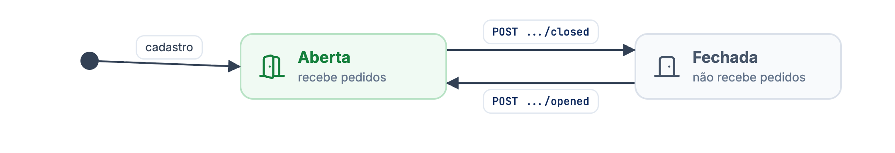
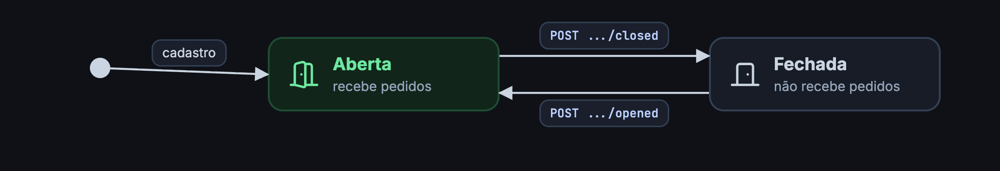

O indoor é o autoatendimento dentro do estabelecimento: o cliente faz o pedido pelo celular, lendo o QR Code da mesa ou da comanda, ou por um tablet fixo na mesa. Pela API, o seu PDV recebe os pedidos e os chamados do salão e controla quais mesas e comandas aceitam consumo.

<Warning>
**API em beta.** Ela ainda pode mudar. Acompanhe o [changelog](/changelog) antes de cada atualização da sua integração.
</Warning>

## Conceitos

<CardGroup cols={2}>
<Card title="Place (mesa)" icon="chair">
Um ponto de atendimento fixo: um **QR Code de mesa** ou um **tablet**. O `id` traz o tipo no prefixo, como `indoor_qrcode_…` ou `indoor_tablet_…`. Os places são cadastrados no painel; pela API você lista e abre ou fecha cada um.
</Card>
<Card title="Comanda (tab)" icon="ticket">
Um cartão ou ficha que acompanha o cliente, com nome, código e QR Code próprio. Pela API você cadastra, edita, remove e abre ou fecha cada comanda.
</Card>
<Card title="Pedido INDOOR" icon="receipt">
Os pedidos feitos no salão chegam como pedidos do tipo `INDOOR` e seguem o mesmo fluxo de [pedidos](/guides/merchant/order) de delivery e retirada.
</Card>
<Card title="Eventos do salão" icon="bell-concierge">
`CALL_WAITER` (chamar garçom) e `CLOSE_ACCOUNT` (pedir a conta) chegam pelo mesmo polling e webhook dos pedidos.
</Card>
</CardGroup>

## Aberto e fechado para consumo

Mesas e comandas têm uma situação que diz se aceitam pedidos. Enquanto estiver fechada, o cliente que abrir aquela mesa ou comanda vê o aviso de mesa fechada e não consegue finalizar pedidos nela.

<Frame caption="Aberta e fechada para consumo">
  
  
</Frame>

O uso típico é fechar a comanda ou a mesa quando a conta é paga e reabrir quando ela volta a ser usada. Veja [ações das comandas](/guides/merchant/indoor/comanda-api/acoes-das-comandas) e [ações de places](/guides/merchant/indoor/places-api/acoes-de-places).

## Por onde seguir

<CardGroup cols={2}>
<Card title="Fluxo de integração" icon="diagram-project" href="/guides/merchant/indoor/fluxo-de-integracao">
Receba e confirme os eventos de chamar garçom e fechar conta.
</Card>
<Card title="Comandas" icon="ticket" href="/guides/merchant/indoor/comanda-api">
Cadastre, liste, edite e abra ou feche comandas.
</Card>
<Card title="Places" icon="chair" href="/guides/merchant/indoor/places-api">
Liste as mesas e veja quais estão livres, ocupadas ou fechadas.
</Card>
<Card title="Pedidos" icon="receipt" href="/guides/merchant/order">
Receba e atualize os pedidos `INDOOR`, que seguem o fluxo de pedidos.
</Card>
</CardGroup>

<Info>
Todos os endpoints de indoor exigem um token com o scope `od.all` e respondem `404` quando o `merchantId` não está entre as lojas que autorizaram o seu app.
</Info>
