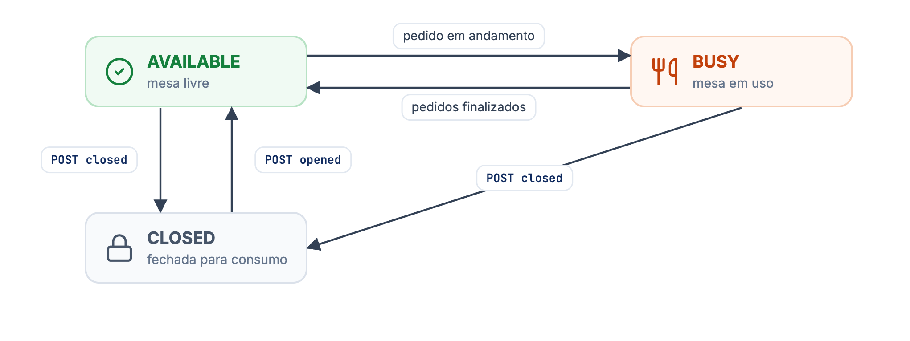
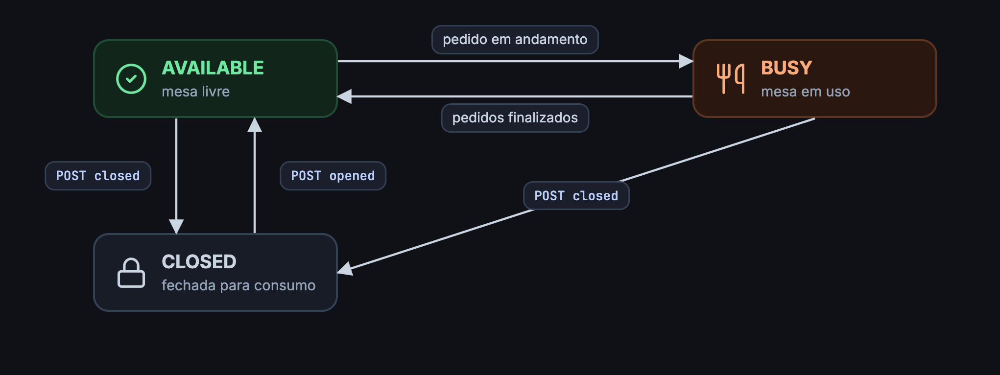

Um place é um ponto fixo de atendimento: uma mesa com **QR Code** ou com **tablet**. Os places são cadastrados pela loja no painel. Pela API você lista os places com a situação de cada um e abre ou fecha cada mesa para consumo.

## O objeto place

<ResponseField name="id" type="string">
Identificador do place, com o tipo no prefixo: `indoor_qrcode_{uuid}` para mesas com QR Code e `indoor_tablet_{uuid}` para tablets. Use o valor inteiro nas rotas e para relacionar o `placeId` dos [eventos](/guides/merchant/indoor/fluxo-de-integracao/eventos-de-indoor).
</ResponseField>

<ResponseField name="name" type="string">
Nome da mesa, como `Mesa 20`.
</ResponseField>

<ResponseField name="status" type="string">
Situação atual da mesa. Veja a tabela abaixo.
</ResponseField>

| `status` | Significado |
| --- | --- |
| `AVAILABLE` | Aberta para consumo e sem pedidos em andamento. |
| `BUSY` | Aberta para consumo e com pedidos em andamento. |
| `CLOSED` | Fechada para consumo: o cliente vê o aviso de mesa fechada e não consegue finalizar pedidos. |

`BUSY` é calculado a partir dos pedidos da mesa e não pode ser definido pela API. O que você controla é se a mesa está aberta ou fechada.

<Frame caption="Status de uma mesa (place)">
  
  
</Frame>

## Endpoints

| Ação | Endpoint | Sucesso |
| --- | --- | --- |
| [Listar places](/guides/merchant/indoor/places-api/listar-places) | `GET /merchant/v3/{merchantId}/places` | `200` ou `204` |
| [Abrir para consumo](/guides/merchant/indoor/places-api/acoes-de-places/abrir-para-consumo-um-place) | `POST /merchant/v3/{merchantId}/places/{placeId}/opened` | `202` |
| [Fechar para consumo](/guides/merchant/indoor/places-api/acoes-de-places/fechar-para-consumo-um-place) | `POST /merchant/v3/{merchantId}/places/{placeId}/closed` | `202` |

<Info>
Não há rotas para cadastrar, editar ou remover places. Isso é feito pela loja no painel.
</Info>
