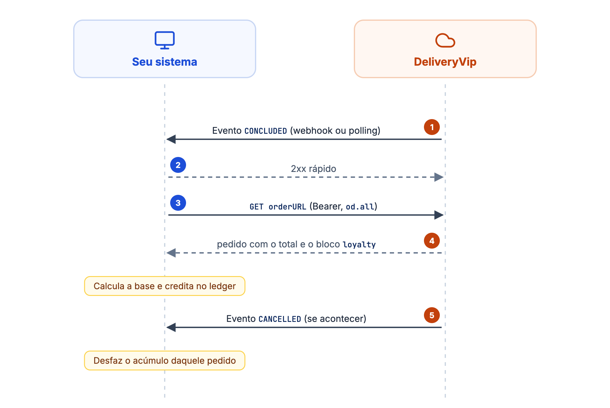
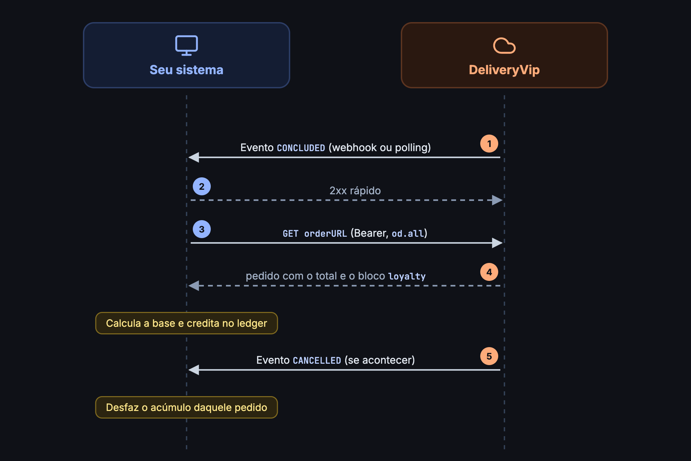

O acúmulo é o ciclo **evento → pedido → seu ledger**. A DeliveryVip nunca envia um "valor a acumular": ela avisa que o pedido mudou de estado e expõe os dados; quem calcula é você.

<Frame caption="O ciclo do acúmulo">
  
  
</Frame>

<Steps>
<Step title="Receba o evento">
Os eventos de pedido chegam por [**webhook**](/guides/merchant/webhooks) (push na URL de notificação do app) ou por **polling** (`GET /merchant/v3/events:polling`). Nos dois canais o evento é **só notificação**: um envelope, sem dados de fidelidade.

```json
{
  "eventId": "209c060f-41f2-4420-81ab-15f2b5559c58",
  "createdAt": "2026-06-30T12:00:00-03:00",
  "merchantId": "22815773000169-dbc7e35a-c936-4665-9e13-eb55eb8b6824",
  "eventType": "CONCLUDED",
  "orderId": "52122852-6626-11ed-9022-0242ac120002",
  "orderURL": "https://api.deliveryvip.com.br/merchant/v3/orders/52122852-6626-11ed-9022-0242ac120002",
  "orderType": "DELIVERY"
}
```

* `eventType` vem em **MAIÚSCULAS** (`CONCLUDED`, `CANCELLED`, ...), e a grafia do campo de URL é **`orderURL`**.
* **Deduplique por `eventId`**: o mesmo evento pode chegar mais de uma vez.
* `CONCLUDED` é o gatilho de **acúmulo**; `CANCELLED` é o gatilho de **estorno do acúmulo** daquele pedido, nunca um mecanismo de débito.
</Step>

<Step title="Busque o pedido">
Com o token de scope `od.all`, busque o pedido pela `orderURL` (ou `GET /merchant/v3/orders/{orderId}`).

<CodeGroup>
```bash cURL
curl "$ORDER_URL" --header 'Authorization: Bearer {token}'
```

```js Node.js
const response = await fetch(event.orderURL, {
  headers: { Authorization: `Bearer ${token}` },
})
const order = await response.json()
```

```python Python
response = requests.get(event["orderURL"], headers={"Authorization": f"Bearer {token}"})
order = response.json()
```
</CodeGroup>

No pedido de um cliente vinculado ao **seu** programa vem o bloco `loyalty`:

```json
"loyalty": {
  "accountId": "acc-1",
  "programId": "pb-123",
  "redemption": {
    "externalId": "red-1",
    "status": "CONFIRMED",
    "amount": {
      "value": 25.0,
      "currency": "BRL"
    }
  }
}
```

<ResponseField name="loyalty" type="object">
Só presente quando o cliente está vinculado ao seu programa.

<Expandable title="propriedades">
<ResponseField name="accountId" type="string">
A conta do cliente no seu lado: o mesmo id que você devolveu no [link](/guides/merchant/loyalty/contrato-do-operador/vinculo-e-pin).
</ResponseField>
<ResponseField name="programId" type="string">
O seu programa.
</ResponseField>
<ResponseField name="redemption" type="object">
O resgate debitado neste pedido, **se houve**. Pedido sem resgate **não tem a chave**.

<Expandable title="propriedades">
<ResponseField name="externalId" type="string">
O `redemptionId` que você emitiu no [débito](/guides/merchant/loyalty/contrato-do-operador/resgate-e-estorno).
</ResponseField>
<ResponseField name="status" type="string">
`CONFIRMED` ou `REVERSED`.
</ResponseField>
<ResponseField name="amount" type="object">
`{value, currency}`, o mesmo formato de dinheiro do resto do pedido.
</ResponseField>
</Expandable>
</ResponseField>
</Expandable>
</ResponseField>

<Info>
**Privacidade entre operadores**: o bloco `loyalty` só aparece para o app cujo programa o cliente aderiu. Cada app vê **apenas o próprio programa**. Sem vínculo, o pedido não tem a chave `loyalty`; e o `redemption` só chega ao app que foi debitado.
</Info>
</Step>

<Step title="Calcule a base: ela é sua">
A DeliveryVip **não** manda valor calculado: a base de acúmulo é uma regra do **seu** programa, extraída dos totais do próprio pedido.

* `orderAmount` (o total) **inclui frete e taxas**;
* `itemsPrice − discount` é a base **só de itens**, sem frete.

Escolha a que o seu programa usa e aplique suas regras de percentual, campanha etc. O `redemption.status` muda a conta:

| `redemption` | O que significa | Base |
| ------------ | --------------- | ---- |
| Sem a chave | Não houve resgate. | Os totais como estão. |
| `CONFIRMED` | O resgate vale; o desconto que ele custeou está dentro de `total.discount`. | Os totais como estão. Se você não acumula sobre a parte paga com cashback, a base já está certa. |
| `REVERSED` | O saldo [voltou ao cliente](/guides/merchant/loyalty/contrato-do-operador/resgate-e-estorno#estorno-reversal), que pagou aquele valor por outros meios. Os totais **continuam mostrando o desconto**. | Some `redemption.amount.value` de volta. |

Exemplo: itens de 40 com resgate de 25 estornado. Os totais indicam 15; `15 + 25 = 40` é o que o cliente realmente pagou.

<CodeGroup>
```js Node.js
function accrualBase(order, { includeFees = false } = {}) {
  const { itemsPrice, discount, orderAmount } = order.total
  let base = includeFees
    ? orderAmount.value
    : itemsPrice.value - (discount?.value ?? 0)

  const redemption = order.loyalty?.redemption
  if (redemption?.status === 'REVERSED') base += redemption.amount.value

  return Math.round(base * 100) / 100
}
```

```python Python
def accrual_base(order, include_fees=False):
    total = order["total"]
    if include_fees:
        base = total["orderAmount"]["value"]
    else:
        base = total["itemsPrice"]["value"] - (total.get("discount") or {}).get("value", 0)

    redemption = (order.get("loyalty") or {}).get("redemption")
    if redemption and redemption["status"] == "REVERSED":
        base += redemption["amount"]["value"]

    return round(base, 2)
```
</CodeGroup>
</Step>

<Step title="Estorne o acúmulo no CANCELLED">
Ao receber `CANCELLED` de um pedido sobre o qual você já acumulou, desfaça o acúmulo no seu ledger. O estorno do **resgate** (devolução do saldo debitado) é responsabilidade da DeliveryVip via [reversal](/guides/merchant/loyalty/contrato-do-operador/resgate-e-estorno#estorno-reversal): o `CANCELLED` cuida só do acúmulo que você concedeu.
</Step>
</Steps>

## Webhook: regras de entrega

Se usar webhook como canal (recomendado), valem as regras da [documentação de webhooks](/guides/merchant/webhooks):

* assinatura `X-App-Signature`: HMAC-SHA256 do corpo bruto com o Client Secret do app, a mesma verificação das [chamadas do contrato](/guides/merchant/loyalty/contrato-do-operador#autenticação-das-chamadas);
* o `X-App-Id` dos webhooks é um identificador **fixo** da plataforma, não o `client_id` do seu app;
* qualquer `2xx` é sucesso; apenas `408` e `429` são retentados (3 tentativas no total);
* **qualquer outro não-2xx, inclusive `5xx`, é recusa definitiva** (fica para reenvio manual);
* 10 falhas consecutivas suspendem as entregas do app.

<Check>
Responda `2xx` rápido e processe o acúmulo de forma assíncrona. Se a busca do pedido falhar, não marque o `eventId` como processado: o polling (enquanto você não enviar o acknowledgment, por até 24 horas) ou um reenvio manual traz o evento de volta.
</Check>
