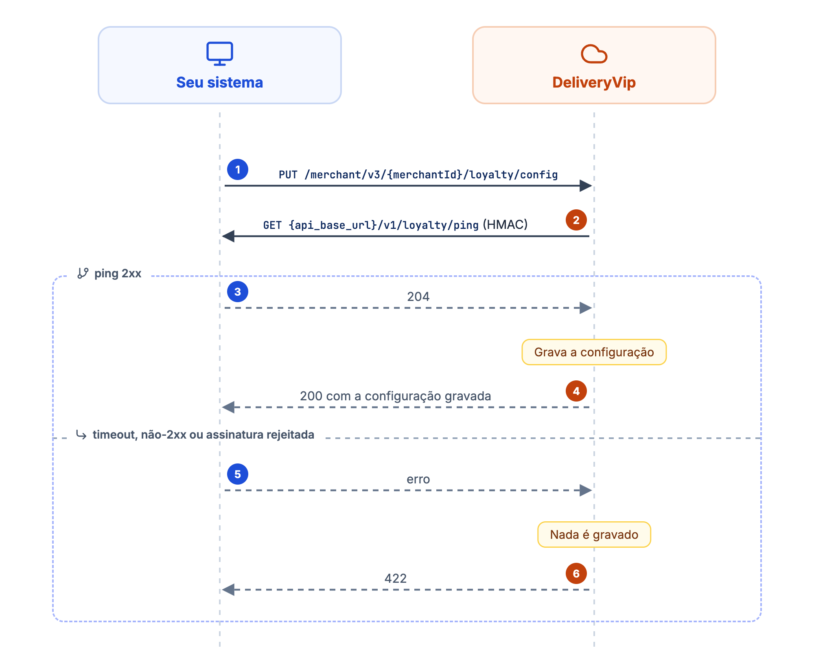
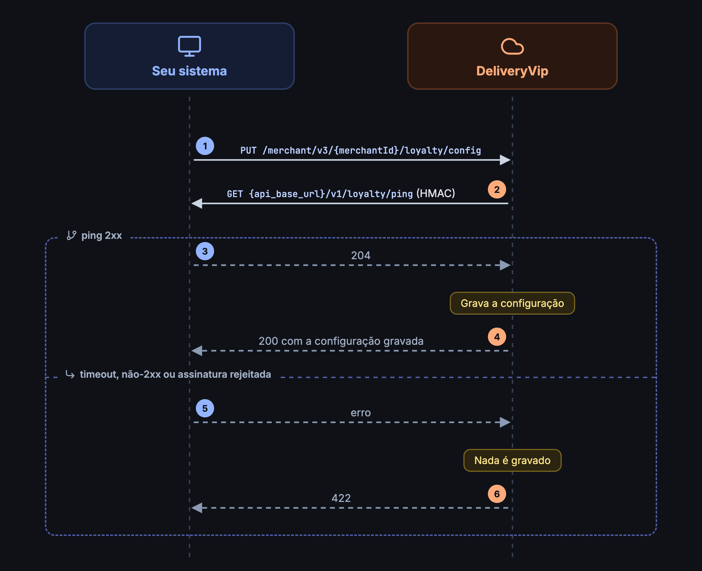

A ativação do programa em uma loja é sempre um **push seu** para a DeliveryVip. Não existe discovery: a plataforma nunca "pergunta" se você tem um programa; é você quem declara, loja a loja.

<Frame caption="Ativação do programa com verificação síncrona">
  
  
</Frame>

## Config push

```
PUT https://api.deliveryvip.com.br/merchant/v3/{merchantId}/loyalty/config
```

Requer o scope `dv.loyalty` e a extensão de fidelidade declarada no app.

<ParamField path="merchantId" type="string" required>
O UUID da loja que instalou o seu app.
</ParamField>

<ParamField body="program" type="object" required>
<Expandable title="propriedades">
<ParamField body="id" type="string" required>
Identificador do programa **do seu lado**. É o `programId` que você recebe de volta em todas as chamadas do contrato.
</ParamField>
<ParamField body="name" type="string" required>
Nome exibido ao cliente no checkout.
</ParamField>
<ParamField body="ownerType" type="string" default="store">
`store`, `chain` ou `coalition`.
</ParamField>
<ParamField body="rulesUrl" type="string">
URL pública (http ou https) com o regulamento do programa, linkada no checkout.
</ParamField>
</Expandable>
</ParamField>

<ParamField body="capabilities" type="object" required>
<Expandable title="propriedades">
<ParamField body="balanceTypes" type="string[]" required>
Deve incluir `cashback`, o único tipo de saldo na v1.
</ParamField>
<ParamField body="partialRedemption" type="boolean" default="true">
`true`: o cliente escolhe quanto resgatar. `false`: o cliente só resgata o **saldo integral**.
</ParamField>
<ParamField body="enrollment" type="boolean" default="true">
`true`: o cliente pode aderir pelo checkout. `false`: adesão fechada; só quem já é membro (cadastro na loja) consegue vincular, e para os demais o [link](/guides/merchant/loyalty/contrato-do-operador/vinculo-e-pin) responde `404`.
</ParamField>
<ParamField body="redemptionLimits" type="object">
Opcional. Limites comerciais de resgate por pedido; veja [abaixo](#limites-de-resgate-redemptionlimits).
</ParamField>
</Expandable>
</ParamField>

<CodeGroup>
```bash cURL
curl --request PUT 'https://api.deliveryvip.com.br/merchant/v3/{merchantId}/loyalty/config' \
  --header 'Authorization: Bearer {token}' \
  --header 'Content-Type: application/json' \
  --data '{
    "program": {
      "id": "pb-123",
      "name": "Clube Pizza",
      "ownerType": "store",
      "rulesUrl": "https://loja.example.com/regras"
    },
    "capabilities": {
      "balanceTypes": ["cashback"],
      "partialRedemption": true,
      "enrollment": true,
      "redemptionLimits": {
        "min": { "type": "fixed", "value": 5.0 },
        "max": { "type": "percent", "value": 50 }
      }
    }
  }'
```

```js Node.js
const response = await fetch(
  `https://api.deliveryvip.com.br/merchant/v3/${merchantId}/loyalty/config`,
  {
    method: 'PUT',
    headers: { Authorization: `Bearer ${token}`, 'Content-Type': 'application/json' },
    body: JSON.stringify({
      program: { id: 'pb-123', name: 'Clube Pizza', ownerType: 'store', rulesUrl: 'https://loja.example.com/regras' },
      capabilities: {
        balanceTypes: ['cashback'],
        partialRedemption: true,
        enrollment: true,
        redemptionLimits: {
          min: { type: 'fixed', value: 5.0 },
          max: { type: 'percent', value: 50 },
        },
      },
    }),
  },
)
if (!response.ok) console.error(response.status, await response.json())
```

```python Python
import requests

response = requests.put(
    f"https://api.deliveryvip.com.br/merchant/v3/{merchant_id}/loyalty/config",
    headers={"Authorization": f"Bearer {token}"},
    json={
        "program": {"id": "pb-123", "name": "Clube Pizza", "ownerType": "store", "rulesUrl": "https://loja.example.com/regras"},
        "capabilities": {
            "balanceTypes": ["cashback"],
            "partialRedemption": True,
            "enrollment": True,
            "redemptionLimits": {
                "min": {"type": "fixed", "value": 5.0},
                "max": {"type": "percent", "value": 50},
            },
        },
    },
)
if not response.ok:
    print(response.status_code, response.json())
```
</CodeGroup>

```json Resposta (200)
{
  "program": {
    "id": "pb-123",
    "name": "Clube Pizza",
    "ownerType": "store",
    "rulesUrl": "https://loja.example.com/regras"
  },
  "capabilities": {
    "balanceTypes": ["cashback"],
    "partialRedemption": true,
    "enrollment": true,
    "redemptionLimits": {
      "min": { "type": "fixed", "value": 5.0 },
      "max": { "type": "percent", "value": 50.0 }
    }
  }
}
```

O `PUT` é **last-write-wins**: a configuração é única por loja (por app) e cada push substitui a anterior por inteiro. Um campo omitido volta ao padrão; um `redemptionLimits` omitido remove os limites.

### Trocando de programa (`program.id` diferente)

Os vínculos dos clientes são atrelados ao **programa** (`program.id`), não à configuração da loja. Um `PUT` com um `program.id` **diferente** encerra a oferta do programa antigo naquela loja e começa um novo do zero:

* Os clientes vinculados ao programa antigo voltam ao estado "elegível" **naquela loja** e precisam aderir de novo ao programa novo (novo opt-in, com novo consentimento).
* Os vínculos antigos **não são apagados**: continuam válidos onde o programa antigo seguir configurado (ex.: outra loja da mesma rede) e permanecem como trilha de consentimento. O histórico de resgates também permanece.
* Mantendo o **mesmo** `program.id`, o push é uma atualização transparente: os vínculos existentes continuam valendo na hora.

## Limites de resgate (`redemptionLimits`)

Por padrão o cliente pode resgatar todo o saldo que couber no pedido. Se o seu programa tem **regras comerciais**, como "não vale resgate abaixo de R$ 5" ou "no máximo metade dos itens", declare-as em `capabilities.redemptionLimits`:

```json
"redemptionLimits": {
  "min": { "type": "fixed", "value": 5.0 },
  "max": { "type": "percent", "value": 50 }
}
```

Cada limite (`min` e `max`) é um objeto com `type` e `value`:

| Campo | Descrição |
| ----- | --------- |
| `type` | `fixed` (valor em BRL) ou `percent` (0 a 100 sobre a base resgatável). |
| `value` | Número JSON maior que zero. Em `fixed`, o valor em BRL; em `percent`, o percentual. |

Quem aplica os limites é a **DeliveryVip**, no checkout, **antes** de chamar a sua API: o `amount` que chega em [`POST /v1/loyalty/redemptions`](/guides/merchant/loyalty/contrato-do-operador/resgate-e-estorno) já respeita o que você declarou.

<Warning>
Um limite malformado (tipo fora de `fixed`/`percent`, valor ausente, zero ou negativo) **não** é rejeitado com erro: ele é descartado e o push é gravado como se aquele limite não existisse. Confira o `redemptionLimits` ecoado na resposta `200`.
</Warning>

### Omitir é declarar "sem limite"

Você pode omitir o objeto inteiro, só o `min` ou só o `max`. **Ausência não é um valor a adivinhar, e não existe default conservador**: um programa sem `redemptionLimits` permite resgatar até **100%** da base. Isso é compatibilidade deliberada: nenhuma configuração existente mudou de comportamento com a chegada do campo.

<Warning>
**100% nunca significa "sem teto".** O **teto estrutural** vale sempre, declarado ou não:

```
min(saldo, subtotal dos itens − demais descontos de CART, total corrente)
```

Os limites comerciais só **estreitam** esse teto, nunca o alargam. Um `max` de `{"type": "percent", "value": 100}` não libera resgate sobre frete ou taxas.
</Warning>

### A base do percentual são os ITENS, não o total

`percent` incide sobre a **base resgatável**: o subtotal dos itens menos os demais descontos de carrinho. **Frete e taxas nunca são resgatáveis.** O valor calculado é arredondado para baixo, no centavo.

Isso é relevante se as suas próprias regras forem escritas sobre o total do pedido: nesse caso o teto calculado pela DeliveryVip pode ser **menor** que o seu, nunca maior. A consequência é segura por construção (a plataforma nunca autoriza um resgate que você recusaria), mas vale conferir se a sua expectativa é essa.

### O mínimo decide se pode, não quanto

Um `min` **nunca eleva** o valor resgatado. Ele só decide se o resgate é possível: um valor abaixo do mínimo é **rejeitado com mensagem ao cliente**, nunca ajustado em silêncio para o mínimo.

<Info>
Se as suas regras variam **por cliente** (tier, segmento, acordo individual), o mesmo objeto pode ser devolvido na [consulta de saldo](/guides/merchant/loyalty/contrato-do-operador/vinculo-e-pin#limites-por-conta), e ali ele **substitui** o do programa. Regra única para todos pertence aqui, no programa.
</Info>

## A verificação síncrona (ping)

Antes de persistir qualquer coisa, a DeliveryVip faz um **`GET {api_base_url}/v1/loyalty/ping` assinado** no seu endpoint, dentro da própria requisição do `PUT`:

* Seu endpoint deve [validar a assinatura](/guides/merchant/loyalty/contrato-do-operador#autenticação-das-chamadas) (HMAC da string vazia) e responder `204`. Qualquer `2xx` é aceito.
* Se o ping falhar (timeout, erro de conexão, não-2xx ou assinatura que o seu lado rejeitou), **nada é gravado** e o `PUT` responde `422`.

Isso garante que um programa só fica ativo com o operador acessível: o cliente nunca vê um card de fidelidade que não consegue funcionar.

<Tip>
O ping roda dentro do `PUT`, com timeout de 5 s de leitura. Se o `PUT` demorar e voltar `422`, confira primeiro se o seu servidor recebeu o ping e se a assinatura conferiu.
</Tip>

## Respostas

| Código | Quando |
| ------ | ------ |
| `200` | Configuração gravada; a resposta ecoa a configuração persistida. |
| `401` | Token ausente, inválido ou expirado. |
| `403` | Token sem o scope `dv.loyalty`. |
| `404` | Loja não encontrada, ou a loja não instalou o seu app. |
| `422` | Validação falhou (`program` ou `capabilities` ausentes; `program.id`/`name` vazios; `ownerType` inválido; `balanceTypes` sem `cashback`), o app não declara a extensão (`loyalty_extension_not_declared`), ou o ping falhou (nada foi gravado). |

Os erros vêm no formato:

```json Resposta (422)
{
  "status": "422",
  "title": "Verificação da api_base_url falhou (HTTP 401); nada foi gravado"
}
```

No caso do ping, o motivo entre parênteses é o código HTTP que o seu servidor devolveu ou o tipo de erro de conexão (ex.: timeout).

Quando há mais de um erro, as mensagens vêm juntas em `title`, separadas por `|`.

## Desativando o programa

```
DELETE https://api.deliveryvip.com.br/merchant/v3/{merchantId}/loyalty/config
```

O `DELETE` é uma **declaração de estado** ("esta loja não tem mais programa") e é **idempotente**: responde `204` mesmo que não exista configuração.

<CodeGroup>
```bash cURL
curl --request DELETE 'https://api.deliveryvip.com.br/merchant/v3/{merchantId}/loyalty/config' \
  --header 'Authorization: Bearer {token}'
```

```js Node.js
await fetch(`https://api.deliveryvip.com.br/merchant/v3/${merchantId}/loyalty/config`, {
  method: 'DELETE',
  headers: { Authorization: `Bearer ${token}` },
})
```

```python Python
requests.delete(
    f"https://api.deliveryvip.com.br/merchant/v3/{merchant_id}/loyalty/config",
    headers={"Authorization": f"Bearer {token}"},
)
```
</CodeGroup>

<Info>
O `DELETE` remove só a configuração da loja: os **vínculos de clientes e o histórico de resgates são preservados**. Um novo `PUT` com o mesmo programa reativa a loja e os clientes já vinculados voltam a vê-lo sem precisar aderir de novo. Quem apaga vínculos e histórico é a [remoção da extensão do app](/guides/merchant/loyalty/primeiros-passos), que cascateia sobre todas as lojas.
</Info>

## Erros comuns

| Sintoma | Causa | Como resolver |
| --- | --- | --- |
| `422` e o seu servidor não recebeu nenhum ping | `api_base_url` errada ou inacessível pela internet | Confira a URL da extensão; ela recebe `/v1/loyalty/ping` acrescentado |
| `422` e o ping chegou | Assinatura rejeitada pelo seu lado, ou resposta não-2xx | Assine o corpo vazio com o Client Secret **atual** e responda `204` |
| `422` `loyalty_extension_not_declared` | O app não tem a extensão de fidelidade | Declare a extensão no painel do app |
| `403` | Token sem `dv.loyalty` | Peça o token com `scope=od.all dv.loyalty` |
| `404` | `merchantId` errado, ou a loja não instalou o app | Use o UUID da loja que instalou o app |
| `redemptionLimits` some da resposta | Limite malformado, descartado | Use `type` `fixed`/`percent` e `value` maior que zero |
