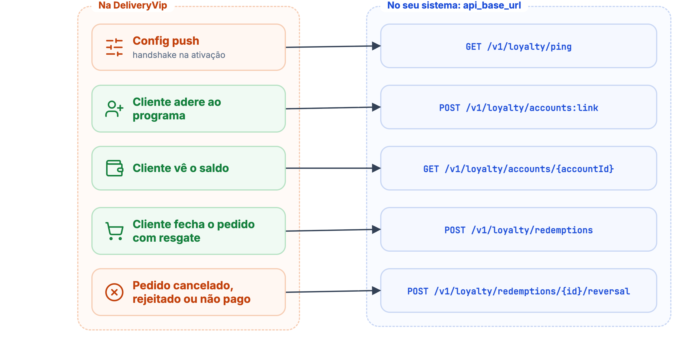
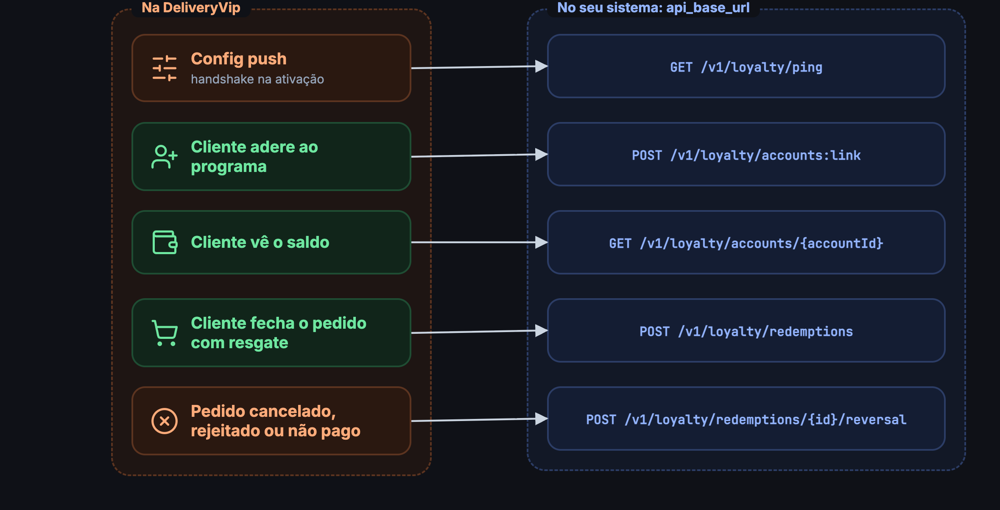

Esta é a metade da integração em que **a DeliveryVip é o cliente e o seu sistema é o servidor**. Você expõe cinco rotas sob a `api_base_url` declarada na extensão do app, e a DeliveryVip as chama durante o checkout, sempre com as requisições [assinadas](#autenticação-das-chamadas).

<Frame caption="Quando a DeliveryVip chama cada rota do contrato">
  
  
</Frame>

## As cinco rotas

| Método | Rota | Quando a DeliveryVip chama | Sucesso |
| ------ | ---- | -------------------------- | ------- |
| `GET` | `/v1/loyalty/ping` | No [config push](/guides/merchant/loyalty/ativando-o-programa), antes de gravar a configuração. | `204` |
| `POST` | `/v1/loyalty/accounts:link` | Quando o cliente [adere ao programa](/guides/merchant/loyalty/contrato-do-operador/vinculo-e-pin) no checkout. | `200` |
| `GET` | `/v1/loyalty/accounts/{accountId}` | Para exibir o [saldo da conta](/guides/merchant/loyalty/contrato-do-operador/vinculo-e-pin#saldo-da-conta) no checkout. | `200` |
| `POST` | `/v1/loyalty/redemptions` | No [débito síncrono](/guides/merchant/loyalty/contrato-do-operador/resgate-e-estorno), dentro da criação do pedido. | `201` |
| `POST` | `/v1/loyalty/redemptions/{redemptionId}/reversal` | No [estorno](/guides/merchant/loyalty/contrato-do-operador/resgate-e-estorno#estorno-reversal), quando o pedido termina sem ser pago. | `2xx` |

A spec OpenAPI completa do contrato está em [loyalty\_operator.yaml](https://app.deliveryvip.com.br/swaggers/loyalty_operator.yaml) e na aba de referência.

<Info>
O prefixo `/v1` é a **versão do contrato**, definida pela DeliveryVip. Ele é acrescentado à sua `api_base_url`, que pode ter um prefixo próprio: com `https://operador.example.com/dv`, o ping chega em `https://operador.example.com/dv/v1/loyalty/ping`. Um futuro contrato v2 será chamado em `/v2` sob a mesma `api_base_url`. A rota `accounts:link` usa **dois-pontos** (método customizado, no mesmo estilo do `events:polling` da API Merchant).
</Info>

## Autenticação das chamadas

As chamadas do contrato **não usam OAuth**. Cada requisição carrega estes headers:

| Header | Conteúdo |
| ------ | -------- |
| `X-App-Id` | O `client_id` (`uid`) da sua aplicação OAuth na DeliveryVip. |
| `X-App-MerchantId` | O UUID do merchant (loja) a que a chamada se refere. |
| `X-App-Signature` | **HMAC-SHA256 do corpo bruto** da requisição, em hexadecimal minúsculo, usando o **Client Secret** do seu app como chave. Requisições **sem corpo** (`ping` e `reversal`) são assinadas sobre a **string vazia**. |
| `User-Agent` | `DeliveryVip` |
| `Content-Type` | `application/json`, inclusive nas requisições sem corpo. |

<Note>
Os [webhooks de pedido](/guides/merchant/webhooks) usam os mesmos nomes de header, mas lá o `X-App-Id` é um identificador fixo da plataforma, não o `client_id` do seu app. A assinatura segue a mesma regra nos dois casos.
</Note>

Para validar, recompute o HMAC sobre os bytes recebidos e compare com o header em tempo constante:

<CodeGroup>
```js Node.js (Express)
import crypto from 'node:crypto'
import express from 'express'

const app = express()
const CLIENT_SECRET = process.env.DV_CLIENT_SECRET

// Guarda o corpo como Buffer, sem parse, em todas as rotas do contrato
app.use('/v1/loyalty', express.raw({ type: '*/*' }))

function verifySignature(req, res, next) {
  // Sem corpo (ping, reversal), o Express não entrega um Buffer: assine a string vazia
  const raw = Buffer.isBuffer(req.body) ? req.body : Buffer.alloc(0)
  const expected = crypto.createHmac('sha256', CLIENT_SECRET).update(raw).digest('hex')
  const received = req.get('X-App-Signature') ?? ''

  const valid =
    received.length === expected.length &&
    crypto.timingSafeEqual(Buffer.from(expected), Buffer.from(received))
  if (!valid) return res.status(401).end()

  req.json = raw.length > 0 ? JSON.parse(raw) : null // parse só depois de validar
  next()
}

app.get('/v1/loyalty/ping', verifySignature, (req, res) => res.status(204).end())

app.listen(4001)
```

```python Python (Flask)
import hashlib
import hmac
import os

from flask import Flask, abort, request

app = Flask(__name__)
CLIENT_SECRET = os.environ["DV_CLIENT_SECRET"].encode()


def verify_signature():
    raw = request.get_data()  # bytes exatamente como chegaram; b"" sem corpo
    expected = hmac.new(CLIENT_SECRET, raw, hashlib.sha256).hexdigest()
    received = request.headers.get("X-App-Signature", "")
    if not hmac.compare_digest(expected, received):
        abort(401)


@app.get("/v1/loyalty/ping")
def ping():
    verify_signature()
    return "", 204
```

```ruby Ruby (Rails)
expected = OpenSSL::HMAC.hexdigest("SHA256", client_secret, request.raw_post)
valid = ActiveSupport::SecurityUtils.secure_compare(expected, request.headers["X-App-Signature"].to_s)
head :unauthorized unless valid
```
</CodeGroup>

<Danger>
Verifique a assinatura sobre os **bytes exatamente como recebidos**, antes de qualquer parse ou re-serialização do JSON. Fazer parse e re-encodar muda os bytes: escapes `\uXXXX` viram UTF-8, espaçamento e ordem de chaves mudam, `25.00` vira `25`, e o digest **não bate**. Esse é o erro de integração mais comum.
</Danger>

<Warning>
A chave é o Client Secret **atual** do app. Se você renovar o secret no painel de developers, as chamadas seguintes já chegam assinadas com o novo valor: atualize o seu lado na mesma hora, ou o próximo ping, link ou débito falha.
</Warning>

Rejeite qualquer requisição cuja assinatura não confira: ela é a única prova de que a chamada veio da DeliveryVip. Use o `X-App-MerchantId` para saber de qual loja é a chamada, se o seu programa diferencia lojas.

## Timeouts e circuit breaker

* A DeliveryVip usa timeouts curtos: **3 s para conectar, 5 s para ler**. Responda rápido, em especial no [débito](/guides/merchant/loyalty/contrato-do-operador/resgate-e-estorno), que roda dentro da criação do pedido.
* **5 falhas** em 5 minutos abrem um **circuit breaker de 5 minutos** para a extensão inteira: o card do programa some do checkout até o circuito fechar. Qualquer resposta esperada zera a contagem de falhas.
* Conta como falha: timeout, erro de conexão, `5xx`, um código que a rota não prevê e um corpo malformado (JSON inválido, ou `201` sem `redemptionId` no débito).
* **Não** conta como falha: as respostas de negócio que cada rota prevê, como `403` e `404` no link, `404` na consulta de saldo, `409` e `422` no débito.

<Tip>
Responda só os códigos documentados em cada rota. Um `400` ou `401` no débito, por exemplo, não é lido como recusa de negócio: conta para o breaker e o cliente vê uma indisponibilidade genérica.
</Tip>

## Compatibilidade

Campos desconhecidos que você emitir nas respostas (ex.: `expiresAt`, `metadata`) são **ignorados** pela DeliveryVip, então é seguro incluí-los. Do outro lado, trate campos novos que apareçam nas requisições futuras da mesma forma: ignore o que não conhece.

## Próximos passos

<CardGroup cols={2}>
<Card title="Vínculo e PIN" icon="link" href="/guides/merchant/loyalty/contrato-do-operador/vinculo-e-pin">
`accounts:link`, o desafio de PIN e a consulta de saldo.
</Card>
<Card title="Resgate e estorno" icon="money-bill-transfer" href="/guides/merchant/loyalty/contrato-do-operador/resgate-e-estorno">
O débito síncrono no checkout e o estorno idempotente.
</Card>
</CardGroup>
