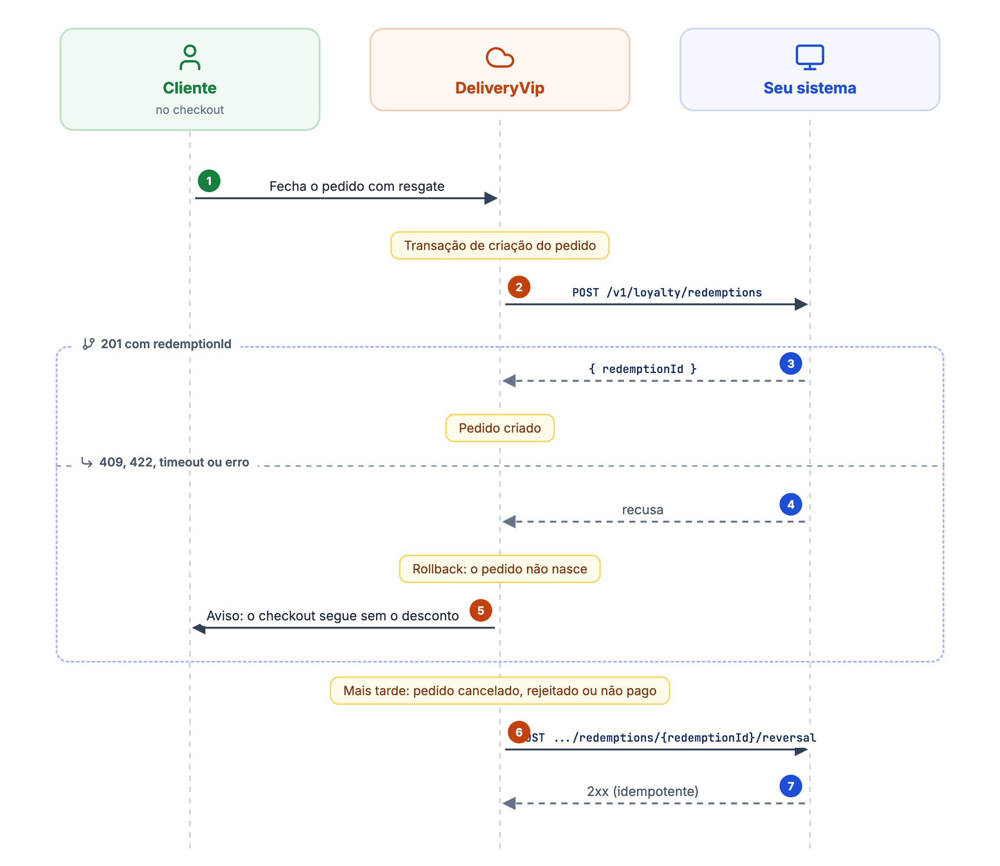
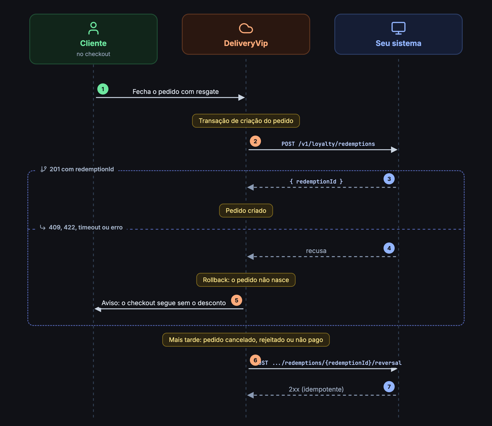

O resgate tem duas pontas: o **débito**, que a DeliveryVip pede enquanto cria o pedido e que decide se o pedido nasce, e o **estorno**, que devolve o saldo quando o pedido termina cancelado, rejeitado ou sem pagamento.

<Frame caption="Resgate dentro da criação do pedido e estorno depois">
  
  
</Frame>

## Débito síncrono (`redemptions`)

```
POST {api_base_url}/v1/loyalty/redemptions
```

Este é o **débito autoritativo** do saldo, chamado como **última etapa dentro da transação de criação do pedido**. Se você responder qualquer coisa diferente de `201`, ou estourar o timeout, o pedido inteiro sofre rollback: **o pedido não nasce**, o cliente vê um aviso e o checkout continua sem o desconto.

### Corpo da requisição

<ParamField body="accountId" type="string" required>
A conta do cliente, o `id` que você devolveu no [link](/guides/merchant/loyalty/contrato-do-operador/vinculo-e-pin).
</ParamField>

<ParamField body="relatedOrderId" type="string" required>
O UUID do pedido na DeliveryVip. É a **chave de idempotência**: um débito por pedido.
</ParamField>

<ParamField body="kind" type="string" required>
Sempre `balance` na v1.
</ParamField>

<ParamField body="amount" type="number" required>
Valor a debitar do saldo, como **número JSON** (até 2 casas; `25.0` e `25.00` são o mesmo número). É sempre o valor efetivamente descontado no pedido: pode ser **menor** do que o cliente reservou, se o carrinho encolheu. Já respeita os [limites de resgate](#limites-já-aplicados) que você declarou.
</ParamField>

<ParamField body="order" type="object" required>
Resumo do pedido para o seu extrato.

<Expandable title="propriedades">
<ParamField body="subtotal" type="number">
Subtotal do pedido.
</ParamField>
<ParamField body="total" type="number">
Total do pedido.
</ParamField>
<ParamField body="items" type="object[]">
Itens do pedido, cada um com `name`, `quantity`, `totalPrice` e, quando o produto tem código PDV/ERP, `externalCode`. A chave `externalCode` **só aparece quando existe**: nunca vem `null`.
</ParamField>
</Expandable>
</ParamField>

```json Exemplo
{
  "accountId": "acc-1",
  "relatedOrderId": "6f1b2f4e-0000-0000-0000-000000000001",
  "kind": "balance",
  "amount": 25.0,
  "order": {
    "subtotal": 100.0,
    "total": 75.0,
    "items": [
      { "name": "Pizza", "externalCode": "1001", "quantity": 1, "totalPrice": 100.0 }
    ]
  }
}
```

### Limites já aplicados

Se você declarou [`redemptionLimits`](/guides/merchant/loyalty/ativando-o-programa#limites-de-resgate-redemptionlimits) no programa, ou [na conta](/guides/merchant/loyalty/contrato-do-operador/vinculo-e-pin#limites-por-conta), o `amount` que chega aqui **já os respeita**: nunca abaixo do mínimo, nunca acima do máximo. A aplicação acontece no checkout da DeliveryVip, antes desta chamada.

Tetos percentuais são calculados sobre os **itens** do pedido (subtotal menos os demais descontos de carrinho), nunca sobre o total: frete e taxas não são resgatáveis. Se a sua própria regra incide sobre o total, o valor que chega aqui pode ser **menor** que o seu teto, nunca maior.

<Info>
Isso não dispensa a sua validação: continue rejeitando com `422` e um `code` (ex.: `below_minimum_order`) o que as suas regras recusarem. Os limites declarados reduzem a chance de rejeição no checkout, mas a autoridade sobre o saldo e as regras é sempre sua.
</Info>

### Respostas do débito

| Código | Significado | O que acontece |
| ------ | ----------- | -------------- |
| `201` com `{"redemptionId": "red-1"}` | Saldo debitado. | O pedido é criado. Guarde o `redemptionId`: é por ele que o estorno chega. |
| `201` **sem** `redemptionId` | Resposta malformada. | Rollback, e conta como falha para o [circuit breaker](/guides/merchant/loyalty/contrato-do-operador#timeouts-e-circuit-breaker). |
| `409` | **Saldo insuficiente.** | Rollback; o cliente segue comprando. |
| `422` com `{"code": "..."}` | Rejeição de negócio (ex.: `below_minimum_order`, `idempotency_conflict`). | Rollback, com mensagem genérica ao cliente. |
| Outro código ou timeout | Indisponibilidade. | Rollback, e conta como falha para o breaker. |

```json Resposta (201)
{ "redemptionId": "red-1" }
```

### Idempotência

* O mesmo `relatedOrderId` com o **mesmo** `amount` deve responder `201` de novo, com o **mesmo** `redemptionId`.
* O mesmo `relatedOrderId` com `amount` **diferente** deve ser rejeitado com `422` e `code: "idempotency_conflict"`. Reserve o `409` para saldo insuficiente.

<Warning>
**Timeout pós-débito**: se você debitar mas a resposta se perder (timeout), o pedido não nasce do lado da DeliveryVip, e uma nova tentativa de checkout usa um **order id novo**, que a idempotência de `relatedOrderId` não cobre. A reconciliação desses casos é **manual**, pelo seu extrato: um débito cujo `relatedOrderId` não corresponde a nenhum pedido existente é candidato a estorno manual. Minimize a janela respondendo rápido (a chamada tem timeout de leitura de 5 s).
</Warning>

## Estorno (`reversal`)

```
POST {api_base_url}/v1/loyalty/redemptions/{redemptionId}/reversal
```

Devolve ao cliente o saldo do débito, por inteiro. A requisição **não tem corpo**: a assinatura é o HMAC da string vazia.

<ParamField path="redemptionId" type="string" required>
O `redemptionId` que você devolveu no `201` do débito.
</ParamField>

A DeliveryVip dispara o estorno quando o pedido termina sem ser pago:

* **Cancelamento** e **rejeição** do pedido;
* **Não-pagamento**: pedidos que seguem aguardando pagamento 30 minutos depois de criados passam a não pagos, e o resgate é estornado. Falhas de cobrança que ainda podem ser tentadas de novo não disparam estorno, só a desistência definitiva.

### O que o seu lado deve garantir

| Situação | Responda | Para a DeliveryVip |
| -------- | -------- | ------------------ |
| Estorno feito agora | Qualquer `2xx` (ex.: `204`) | Resgate marcado como estornado. |
| Resgate **já estornado** antes | `2xx` de novo, sempre | Idem. O estorno é idempotente. |
| Você **não conhece** o `redemptionId` | `404` | **Terminal**: ela para de tentar e o caso vai para reconciliação manual. |
| Indisponível (timeout, `5xx`, qualquer outro código) | - | Nova tentativa, até **5 tentativas** no total; depois disso, reconciliação manual. |

<Warning>
Não responda `404` para um resgate que você conhece mas já estornou: isso transforma um estorno concluído em caso de reconciliação manual. O `404` é só para "nunca vi este id".
</Warning>

<Info>
No [acúmulo](/guides/merchant/loyalty/acumulo), um resgate estornado aparece no bloco `loyalty` do pedido com `redemption.status: "REVERSED"`. Os totais do pedido continuam mostrando o desconto que ele custeava.
</Info>
