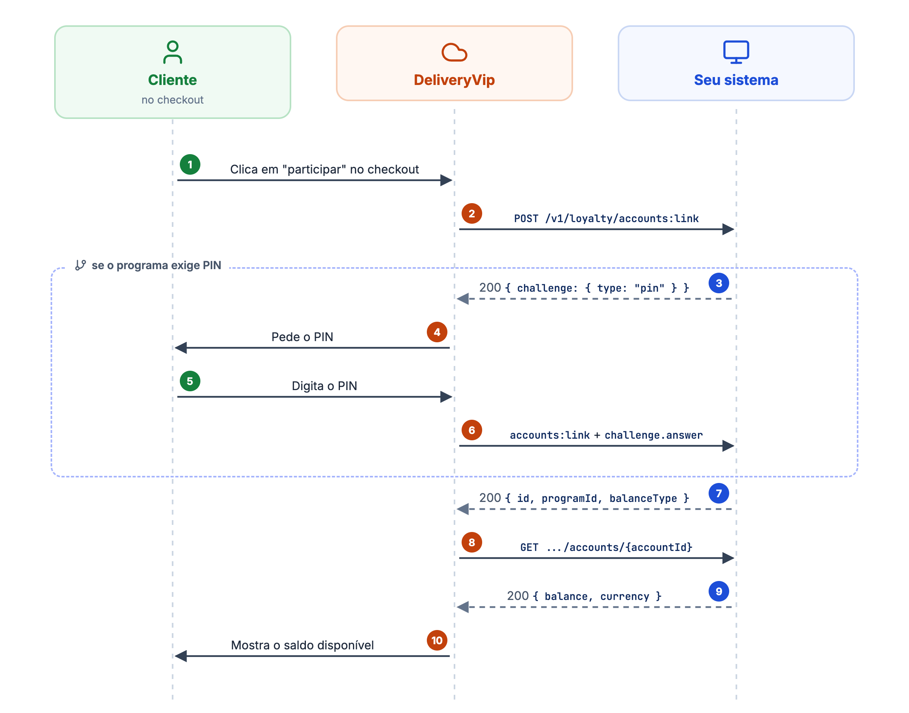
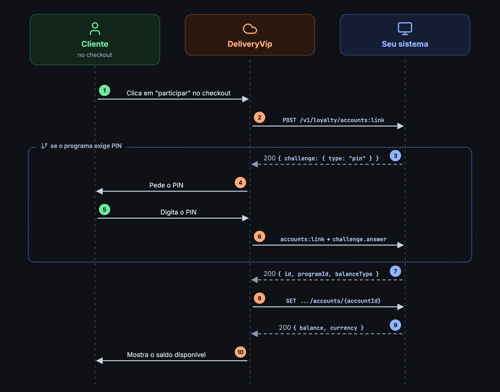

Duas rotas do contrato cuidam da identidade do cliente: o `accounts:link`, chamado uma vez na adesão, e a consulta de saldo, chamada sempre que o checkout precisa mostrar quanto o cliente tem. Depois do vínculo, a DeliveryVip só conhece o cliente pelo `accountId` que você devolveu.

<Frame caption="Vínculo da conta, com PIN opcional">
  
  
</Frame>

## Vincular o cliente (`accounts:link`)

```
POST {api_base_url}/v1/loyalty/accounts:link
```

Chamada quando o cliente **aceita participar** do programa no checkout. O clique **é** o consentimento: `consent.grantedAt` é o momento do clique, com o offset da plataforma (`-03:00`). O perfil do cliente é atestado pela DeliveryVip: nunca chega um convidado nem um cadastro incompleto.

### Corpo da requisição

<ParamField body="programId" type="string" required>
O identificador do programa que você [enviou no config push](/guides/merchant/loyalty/ativando-o-programa) (`program.id`).
</ParamField>

<ParamField body="customer" type="object" required>
Perfil do cliente, completo.

<Expandable title="propriedades">
<ParamField body="document" type="string" required>
CPF, somente dígitos.
</ParamField>
<ParamField body="phone" type="string" required>
Telefone em E.164 (ex.: `+5511999998888`).
</ParamField>
<ParamField body="email" type="string" required>
E-mail do cliente.
</ParamField>
<ParamField body="name" type="string" required>
Nome do cliente.
</ParamField>
<ParamField body="birthDate" type="string" required>
Data de nascimento, `AAAA-MM-DD`.
</ParamField>
</Expandable>
</ParamField>

<ParamField body="consent" type="object" required>
Registro do consentimento (LGPD). Guarde-o no seu lado.

<Expandable title="propriedades">
<ParamField body="purpose" type="string" required>
Sempre `loyalty_program`.
</ParamField>
<ParamField body="status" type="string" required>
Sempre `granted`.
</ParamField>
<ParamField body="grantedAt" type="string" required>
Momento do clique, RFC 3339 com offset.
</ParamField>
</Expandable>
</ParamField>

<ParamField body="enroll" type="boolean" required>
Espelha a capability `enrollment` do programa. Se `true` e o CPF não for membro, **cadastre-o**. Se `false`, um não-membro deve receber `404`.
</ParamField>

<ParamField body="challenge" type="object">
Presente **apenas no reenvio** depois de um desafio de PIN: `{"type": "pin", "answer": "<PIN digitado>"}`.
</ParamField>

```json Exemplo
{
  "programId": "pb-123",
  "customer": {
    "document": "12345678909",
    "phone": "+5511999998888",
    "email": "maria@example.com",
    "name": "Maria",
    "birthDate": "1990-01-01"
  },
  "consent": {
    "purpose": "loyalty_program",
    "status": "granted",
    "grantedAt": "2026-09-04T12:00:00-03:00"
  },
  "enroll": true
}
```

### Respostas do link

<Tabs>
<Tab title="200 conta">
Conta localizada ou criada.

```json
{
  "id": "acc-1",
  "programId": "pb-123",
  "balanceType": "cashback"
}
```

<ResponseField name="id" type="string" required>
A conta do cliente no seu sistema. É por ela que a DeliveryVip consulta saldo e debita resgates.
</ResponseField>
<ResponseField name="programId" type="string">
O programa da conta.
</ResponseField>
<ResponseField name="balanceType" type="string">
`cashback` na v1.
</ResponseField>

<Warning>
O `id` da conta é **opaco e estável**: revincular o mesmo cliente deve devolver **o mesmo id, byte a byte**. É por ele que a DeliveryVip consulta saldo e debita resgates, nunca pelo CPF, que só trafega no link.
</Warning>
</Tab>

<Tab title="200 desafio de PIN">
Quando o seu programa exige confirmação, responda com o desafio no lugar da conta:

```json
{
  "challenge": { "type": "pin" }
}
```

A DeliveryVip pede o PIN ao cliente e **reenvia o mesmo corpo** acrescido de:

```json
"challenge": { "type": "pin", "answer": "1234" }
```

* O PIN é validado **exclusivamente do seu lado**, inclusive o rate limiting. A DeliveryVip nunca armazena nem loga o PIN.
* Nunca responda `id` e `challenge` juntos. Se fizer, a DeliveryVip trata o `challenge` como autoritativo e descarta o `id`.
</Tab>

<Tab title="403 PIN reprovado">
PIN errado. Responda com corpo **genérico**: a resposta não pode revelar se a conta existe.
</Tab>

<Tab title="404 adesão fechada">
O CPF não é membro e o programa não aceita adesão pelo checkout (`enroll: false`). O cliente vê que precisa se cadastrar na loja.
</Tab>
</Tabs>

<Note>
Qualquer outra resposta (outro código, timeout, JSON inválido) conta como [falha para o circuit breaker](/guides/merchant/loyalty/contrato-do-operador#timeouts-e-circuit-breaker) e o cliente vê o programa como indisponível no momento.
</Note>

## Saldo da conta

```
GET {api_base_url}/v1/loyalty/accounts/{accountId}
```

Consulta feita para exibir o saldo no checkout, só com o `accountId` opaco, nunca o CPF.

<ParamField path="accountId" type="string" required>
O `id` que você devolveu no `accounts:link`.
</ParamField>

```json Resposta (200)
{
  "id": "acc-1",
  "programId": "pb-123",
  "balanceType": "cashback",
  "balance": 25.00,
  "currency": "BRL"
}
```

<ResponseField name="balance" type="number" required>
Saldo atual em BRL, como número JSON. Zeros à direita não são significativos: `25.0` e `25.00` são o mesmo número.
</ResponseField>
<ResponseField name="currency" type="string">
`BRL`. Se omitido, a DeliveryVip assume `BRL`.
</ResponseField>
<ResponseField name="redemptionLimits" type="object">
Opcional. Limites de resgate só deste cliente; veja [Limites por conta](#limites-por-conta).
</ResponseField>

* A DeliveryVip **cacheia a resposta por 60 segundos** por conta: o saldo exibido pode atrasar até 1 minuto em relação ao seu ledger.
* `404` significa que a conta **não existe mais** do seu lado: a DeliveryVip desfaz o vínculo e oferece a adesão de novo ao cliente. Nunca conta como falha para o [circuit breaker](/guides/merchant/loyalty/contrato-do-operador#timeouts-e-circuit-breaker).

### Limites por conta

A resposta de saldo aceita, **opcionalmente**, o mesmo objeto `redemptionLimits` dos [limites do programa](/guides/merchant/loyalty/ativando-o-programa#limites-de-resgate-redemptionlimits):

```json
{
  "id": "acc-1",
  "programId": "pb-123",
  "balanceType": "cashback",
  "balance": 25.00,
  "currency": "BRL",
  "redemptionLimits": {
    "min": { "type": "fixed", "value": 10.00 },
    "max": { "type": "percent", "value": 50 }
  }
}
```

<Danger>
**Substituição integral, não merge campo a campo.** Quando presente, o objeto da conta **substitui por inteiro** os limites do programa para aquele cliente.

Declarar só `max` na conta significa que aquele cliente **não tem mínimo**, mesmo que o programa declare um:

| Programa | Conta | Vale para o cliente |
| -------- | ----- | ------------------- |
| `min: fixed 5`, `max: percent 50` | *ausente* | `min: fixed 5`, `max: percent 50` |
| `min: fixed 5`, `max: percent 50` | `max: percent 80` | **só** `max: percent 80`, sem mínimo |
| `min: fixed 5`, `max: percent 50` | `min: fixed 10` | **só** `min: fixed 10`, sem máximo |

O raciocínio: você é a autoridade sobre as suas próprias regras. Um merge produziria uma faixa que **nenhum dos dois lados declarou**. Este é o ponto que mais gera bug de integração: se o cliente deve manter o mínimo do programa, **repita-o** na conta.
</Danger>

Demais regras:

* **Omita o limite ausente; nunca envie `null`.** `null` afirmaria "este cliente não tem mínimo", que é diferente de "não declarei nada".
* Objeto **ausente ou malformado** (tipo fora de `fixed`/`percent`, valor ausente ou não positivo): valem os limites do programa.
* Viaja no **mesmo cache de 60 segundos** do saldo: mudar a regra de um cliente leva até 1 minuto para chegar ao checkout.

<Info>
**Quando usar:** só se as suas regras de fato variam por cliente, como tier, segmento ou acordo individual. Uma regra única para todos pertence ao [programa](/guides/merchant/loyalty/ativando-o-programa#limites-de-resgate-redemptionlimits), não repetida em toda conta.

E um alerta de modelagem que vale generalizar: **o canal em que um dado chega não determina o escopo do dado.** Um limite que chega dentro de uma consulta por cliente não é, por isso, um limite por cliente. Se o valor é o mesmo para todos, ele é do programa, ainda que a sua API o devolva junto do cadastro do portador.
</Info>

## Próximo passo

<Card title="Resgate e estorno" icon="money-bill-transfer" href="/guides/merchant/loyalty/contrato-do-operador/resgate-e-estorno">
Com o cliente vinculado e o saldo na tela, o próximo passo é o débito do resgate no fechamento do pedido.
</Card>
