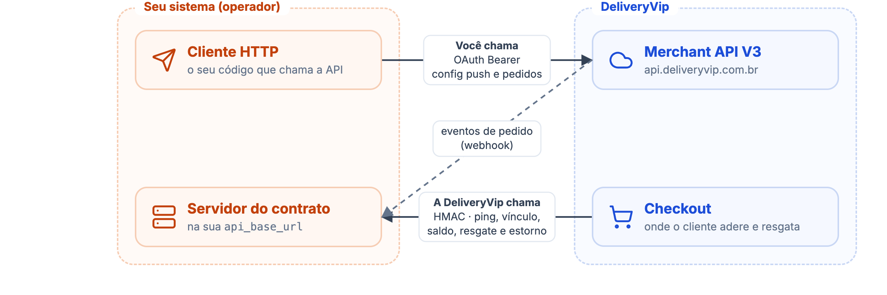
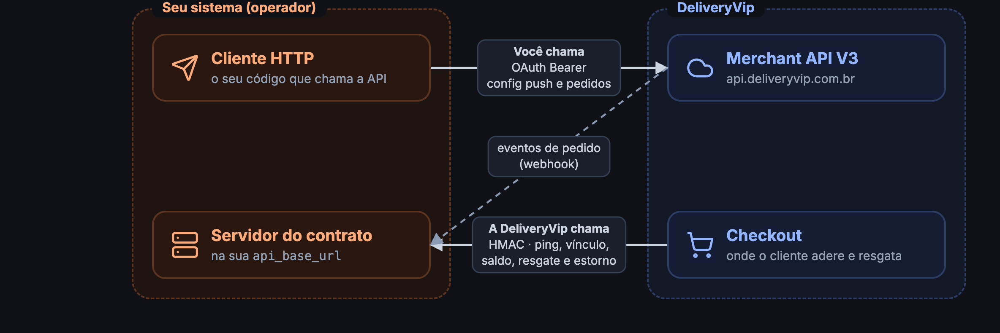
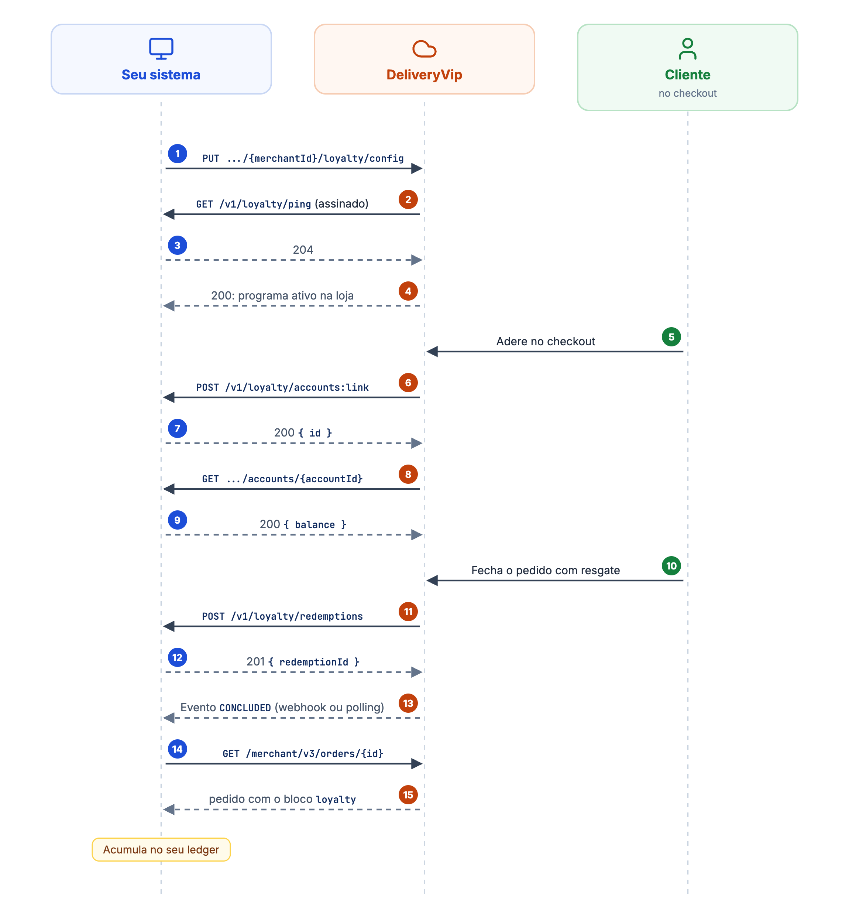
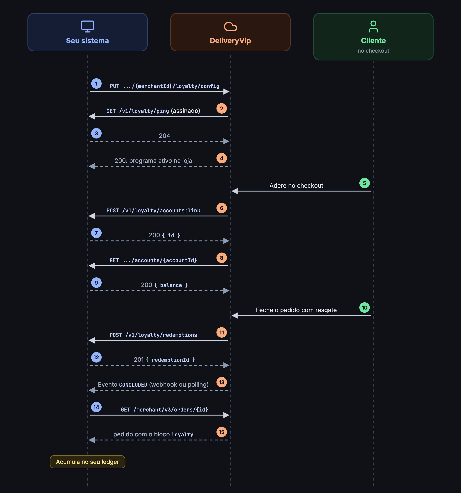

A extensão de **fidelidade** permite que o seu sistema atue como **operador de fidelidade** dentro da DeliveryVip: o cliente adere ao seu programa direto no checkout, resgata saldo (cashback) como desconto no pedido e acumula sobre os pedidos concluídos, tudo sem que o saldo saia do seu lado.

## Papéis

| Papel | Quem | O que faz |
| ----- | ---- | --------- |
| **Ordering Application** | DeliveryVip | Dona do checkout e dos pedidos: apresenta o programa ao cliente, coleta o consentimento, aplica o desconto do resgate e emite os eventos de pedido. |
| **Operador de fidelidade** | Seu app | Dono do programa: hospeda o ledger (saldos, regras de acúmulo, cadastro de membros) e implementa o [contrato HTTP](/guides/merchant/loyalty/contrato-do-operador) que a DeliveryVip chama. |

O dinheiro de fidelidade **nunca vive do lado da DeliveryVip**. A plataforma guarda apenas o vínculo do cliente com o programa (consentimento e um `accountId` opaco que você fornece) e o registro dos resgates. Saldo, extrato e regras de acúmulo são seus.

## As duas metades da integração

A integração tem dois sentidos, com autenticações diferentes. Vale ter isso claro antes de escrever qualquer código.

<Frame caption="As duas metades da integração: o que você chama e o que a DeliveryVip chama">
  
  
</Frame>

<CardGroup cols={2}>
<Card title="1. APIs que você chama" icon="arrow-right-from-bracket" href="/guides/merchant/loyalty/ativando-o-programa">
Autenticação **OAuth2** (client credentials) e a API Merchant V3:

* `PUT`/`DELETE /merchant/v3/{merchantId}/loyalty/config`: o **config push** que ativa o programa por loja;
* `GET /merchant/v3/orders/{orderId}`: a leitura do pedido para o [acúmulo](/guides/merchant/loyalty/acumulo).
</Card>
<Card title="2. O contrato que você implementa" icon="arrow-right-to-bracket" href="/guides/merchant/loyalty/contrato-do-operador">
Cinco rotas sob a `api_base_url` do seu app, chamadas pela DeliveryVip com **assinatura HMAC**:

* `ping`, `accounts:link` e a consulta de saldo;
* o débito do resgate e o estorno.
</Card>
</CardGroup>

## O que o cliente vê

No checkout (tanto na loja própria quanto no marketplace: o programa acompanha a loja), o cliente vê um **card do seu programa**:

* **Só para clientes identificados**: a adesão é oferecida a clientes logados (nunca convidados) com cadastro completo: nome, telefone, e-mail, CPF e data de nascimento. Se faltar CPF ou data de nascimento, o checkout pede para completar.
* **Opt-in com consentimento**: o clique de adesão é o consentimento (LGPD). Se o seu programa exigir, um **PIN** é solicitado e validado por você.
* **Resgate com limite**: o cliente escolhe quanto do saldo usar. O resgate se aplica **somente à soma dos itens**: frete e taxas nunca entram.
* **1 resgate por pedido**. Um resgate que cobre 100% do pedido vira o pagamento `REDEEM`.

## A jornada de ponta a ponta

<Frame caption="A jornada de ponta a ponta">
  
  
</Frame>

## Escopo da v1

* Tipo de saldo: **cashback** (valor em BRL). Outros tipos de saldo poderão ser adicionados em versões futuras do contrato.
* O programa pode ser de loja (`store`), rede (`chain`) ou coalizão (`coalition`).

## Comece por aqui

<CardGroup cols={2}>
<Card title="Primeiros passos" icon="rocket" href="/guides/merchant/loyalty/primeiros-passos">
Crie o app com o scope `dv.loyalty`, declare a extensão de fidelidade e obtenha o token com os dois scopes necessários.
</Card>
<Card title="Ativando o programa" icon="toggle-on" href="/guides/merchant/loyalty/ativando-o-programa">
Ative o programa por loja com o config push, verificado na hora por um ping assinado no seu endpoint.
</Card>
<Card title="Contrato do operador" icon="file-signature" href="/guides/merchant/loyalty/contrato-do-operador">
As cinco rotas HTTP que o seu sistema implementa e a DeliveryVip chama, todas assinadas com HMAC-SHA256 do corpo bruto.
</Card>
<Card title="Acúmulo" icon="coins" href="/guides/merchant/loyalty/acumulo">
Receba o evento, busque o pedido com `od.all` e leia o bloco `loyalty`. A base de cálculo é sua.
</Card>
<Card title="Operador mínimo" icon="rocket" href="/guides/merchant/loyalty/operador-minimo">
Um operador completo em Node.js ou Python, ativo em uma loja de teste: adesão, saldo, resgate e estorno.
</Card>
</CardGroup>
