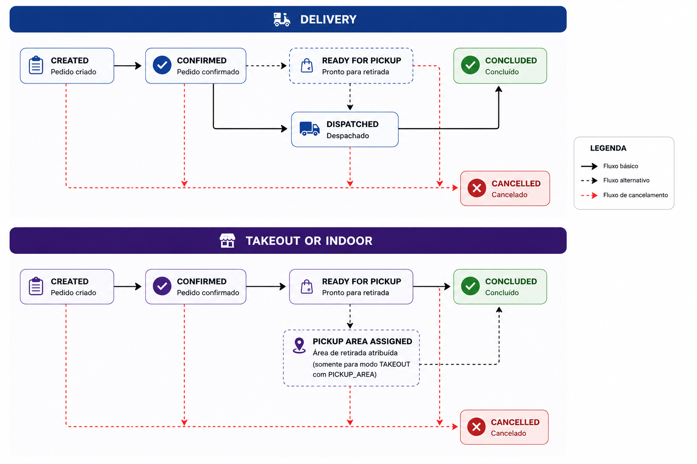

O tipo do pedido e o momento em que ele deve ser preparado mudam o que o seu PDV faz com ele. Entenda essas definições antes de implementar as ações.

## Tipos de pedido

O campo `type` do pedido (e o `orderType` do evento) diz como o pedido chega ao cliente.

<CardGroup cols={3}>
<Card title="DELIVERY" icon="motorcycle">
Entregue no **endereço escolhido pelo cliente**.
</Card>
<Card title="TAKEOUT" icon="bag-shopping">
O **cliente retira** no estabelecimento.
</Card>
<Card title="INDOOR" icon="utensils">
Feito **dentro do restaurante**, para consumir no local.
</Card>
</CardGroup>

## Momento do pedido

Nem todo pedido deve ser preparado na hora: o cliente pode agendar a entrega. O campo `orderTiming` indica qual é o caso.

| `orderTiming` | O que fazer |
| --- | --- |
| `INSTANT` | Preparar imediatamente e enviar o quanto antes. |
| `SCHEDULED` | Não preparar agora. Respeite o horário agendado para a entrega. |

## Ciclo de vida do pedido

Cada mudança de status gera um [evento](/guides/merchant/order/fluxo-de-integracao/eventos-de-pedidos). O caminho até `CONCLUDED` depende do tipo do pedido.

<Frame caption="Ciclo de vida por tipo de pedido">
  
</Frame>

**DELIVERY**

* `DISPATCHED` é **obrigatório**: informe quando o pedido sair para entrega.
* `READY_FOR_PICKUP` é opcional.

**TAKEOUT e INDOOR**

* `READY_FOR_PICKUP` é **obrigatório**: avise quando o pedido estiver pronto.
* `PICKUP_AREA_ASSIGNED` está previsto para pedidos `TAKEOUT` no modo `PICKUP_AREA`, mas [ainda não é emitido](/guides/merchant/order/fluxo-de-integracao/eventos-de-pedidos#previstos-na-especificação).

