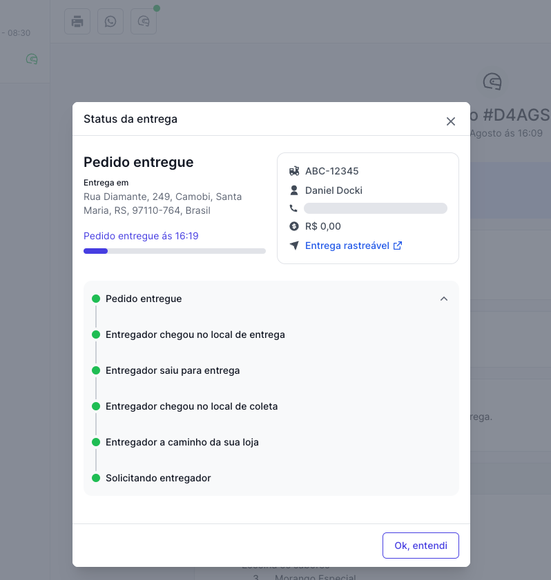

Cada ação é um `POST` sem corpo em `/merchant/v3/orders/{orderId}/<ação>`, com exceção do cancelamento e do rastreio. Todas exigem o token no header `Authorization`.

| Ação | Endpoint | Quando usar |
| --- | --- | --- |
| [Confirmar](#confirmar-um-pedido) | `confirm` | A loja aceitou o pedido. |
| [Preparando](#preparando-um-pedido) | `preparing` | A loja começou o preparo. Opcional. |
| [Pronto para retirada](#pronto-para-pegar-um-pedido) | `readyForPickup` | O pedido está pronto. **Obrigatório** em `TAKEOUT` e `INDOOR`. |
| [Retirado](#pedido-retirado-pelo-cliente) | `pickedUp` | O cliente retirou o pedido (`TAKEOUT`). |
| [Despachar](#despachar-um-pedido) | `dispatch` | O pedido saiu para entrega. **Obrigatório** em `DELIVERY`. |
| [Entregue](#pedido-entregue) | `delivered` | O pedido chegou ao cliente. Fecha o ciclo. |
| [Cancelar](#requisitar-cancelamento-de-um-pedido) | `requestCancellation` | A loja não vai atender o pedido. |
| [Rastreio](#tracking) | `tracking` | Informar entregador, veículo, ETA e localização. |

## Respostas

| Status | Quando |
| --- | --- |
| `202 Accepted` | A ação foi aceita. O corpo traz o `id` do pedido. |
| `422 Unprocessable Content` | O pedido não está num estado que aceita a ação, por exemplo despachar um pedido já cancelado. Veja o [ciclo de vida](/guides/merchant/order/definicoes#ciclo-de-vida-do-pedido). |

```json 202 Accepted
{ "id": "67983761-a469-422c-af8e-b168f1e5ce19" }
```

## Confirmar um pedido

Depois de buscar um pedido com evento `CREATED`, confirme-o quando a loja aceitar.

<CodeGroup>
```bash cURL
curl --request POST 'https://api.deliveryvip.com.br/merchant/v3/orders/{orderId}/confirm' \
  --header 'Authorization: Bearer {token}'
```

```js Node.js
await fetch(`https://api.deliveryvip.com.br/merchant/v3/orders/${orderId}/confirm`, {
  method: 'POST',
  headers: { Authorization: `Bearer ${token}` },
})
```

```python Python
requests.post(
    f"https://api.deliveryvip.com.br/merchant/v3/orders/{order_id}/confirm",
    headers={"Authorization": f"Bearer {token}"},
)
```
</CodeGroup>

As demais ações sem corpo seguem exatamente o mesmo formato: troque `confirm` pelo endpoint da ação.

## Preparando um pedido

Depois de confirmar, sinalize que a loja começou a preparar o pedido.

```bash
curl --request POST 'https://api.deliveryvip.com.br/merchant/v3/orders/{orderId}/preparing' \
  --header 'Authorization: Bearer {token}'
```

## Pronto para pegar um pedido

O pedido está pronto para o cliente retirar ou para o entregador buscar. **Obrigatório** para pedidos `TAKEOUT` e `INDOOR`.

```bash
curl --request POST 'https://api.deliveryvip.com.br/merchant/v3/orders/{orderId}/readyForPickup' \
  --header 'Authorization: Bearer {token}'
```

## Pedido retirado pelo cliente

Em pedidos `TAKEOUT`, informe quando o cliente retirar o pedido no estabelecimento.

```bash
curl --request POST 'https://api.deliveryvip.com.br/merchant/v3/orders/{orderId}/pickedUp' \
  --header 'Authorization: Bearer {token}'
```

## Despachar um pedido

O pedido saiu para entrega. **Obrigatório** para pedidos `DELIVERY`.

```bash
curl --request POST 'https://api.deliveryvip.com.br/merchant/v3/orders/{orderId}/dispatch' \
  --header 'Authorization: Bearer {token}'
```

## Pedido entregue

O pedido chegou ao cliente. Use esta ação para fechar o ciclo de vida do pedido.

```bash
curl --request POST 'https://api.deliveryvip.com.br/merchant/v3/orders/{orderId}/delivered' \
  --header 'Authorization: Bearer {token}'
```

## Requisitar cancelamento de um pedido

Quando a loja não vai atender o pedido, por exemplo por falta de item ou fora da área de entrega. O pedido é **cancelado na hora** e gera o evento `CANCELLED`. A resposta é `200 OK` com o `id` do pedido.

Se o pedido tem uma entrega ativa com parceiro de logística, ela também é cancelada automaticamente, e o pagamento online é estornado. Um pedido já concluído não pode ser cancelado e responde `422`.

<ParamField body="code" type="string">
Motivo padronizado: `SYSTEMIC_ISSUES`, `DUPLICATE_APPLICATION`, `UNAVAILABLE_ITEM`, `RESTAURANT_WITHOUT_DELIVERY_MAN`, `OUTDATED_MENU`, `ORDER_OUTSIDE_THE_DELIVERY_AREA`, `BLOCKED_CUSTOMER`, `OUTSIDE_DELIVERY_HOURS`, `INTERNAL_DIFFICULTIES_OF_THE_RESTAURANT` ou `RISK_AREA`.
</ParamField>

<ParamField body="reason" type="string">
Descrição livre do motivo.
</ParamField>

<ParamField body="mode" type="string">
`AUTO` ou `MANUAL`.
</ParamField>

<ParamField body="outOfStockItems" type="string[]">
Itens em falta.
</ParamField>

<ParamField body="invalidItems" type="string[]">
Itens inválidos.
</ParamField>

```bash
curl --request POST 'https://api.deliveryvip.com.br/merchant/v3/orders/{orderId}/requestCancellation' \
  --header 'Authorization: Bearer {token}' \
  --header 'Content-Type: application/json' \
  --data '{
    "code": "UNAVAILABLE_ITEM",
    "reason": "Produto esgotado",
    "mode": "MANUAL"
  }'
```

## Aceitar cancelamento de um pedido

`POST /merchant/v3/orders/{orderId}/acceptCancellation` e `POST /merchant/v3/orders/{orderId}/denyCancellation` existem por compatibilidade com a especificação Open Delivery e respondem `200 OK`. Hoje a DeliveryVip não emite pedidos de cancelamento para o seu sistema responder (veja os [eventos previstos na especificação](/guides/merchant/order/fluxo-de-integracao/eventos-de-pedidos#previstos-na-especificação)), então você não precisa chamá-los.

## Tracking

Envie dados de rastreio da entrega: o último status, problemas, veículo, previsão de chegada, entregador e localização. No acompanhamento do pedido, o cliente vê o link de rastreio e o painel da loja mostra cada atualização em tempo real.

Os campos vão na raiz do corpo, como na especificação Open Delivery. Um corpo com campo desconhecido ou `type` fora da lista é recusado com `422`.

<Note>
O formato antigo, com os campos dentro de `deliveryTrackingInfo`, continua aceito por compatibilidade. Prefira os campos na raiz.
</Note>

<ParamField body="event" type="object">
Último evento conhecido da entrega. Obrigatório quando não houver `problem`.

<Expandable title="propriedades">
<ParamField body="type" type="string" required>
`PICKUP_ONGOING`, `ARRIVED_AT_MERCHANT`, `ORDER_PICKED`, `DELIVERY_ONGOING`, `ARRIVED_AT_CUSTOMER`, `ORDER_DELIVERED` ou `CANCELLED`.
</ParamField>
<ParamField body="message" type="string">
Mensagem sobre o evento.
</ParamField>
<ParamField body="datetime" type="datetime" required>
Data e hora do evento.
</ParamField>
</Expandable>
</ParamField>

<ParamField body="problem" type="object">
Último problema conhecido da entrega.

<Expandable title="propriedades">
<ParamField body="reason" type="string" required>
`DELIVERYPERSON_OCCURRENCE`, `PAYMENT_PROBLEMS`, `WRONG_PRODUCT_OR_ITEM`, `ORDER_DELAYED`, `ORDER_DAMAGED_OR_VIOLATED`, `CUSTOMER_DID_NOT_PLACE_ORDER`, `CUSTOMER_ADDRESS_UNKNOWN`, `ORDER_MISSING_ITEMS`, `NOBODY_TO_RECEIVE`, `DELIVERYPERSON_WAITING_PAYMENT_FOR_ALREADY_PAID_ORDER`, `ORDER_DELIVERED_WITHOUT_PAYMENT` ou `FRAUD_OR_THEFT`.
</ParamField>
<ParamField body="message" type="string">
Mensagem sobre o problema.
</ParamField>
<ParamField body="datetime" type="datetime" required>
Data e hora do problema.
</ParamField>
</Expandable>
</ParamField>

<ParamField body="vehicle" type="object">
<Expandable title="propriedades">
<ParamField body="type" type="string" required>
`MOTORBIKE_BAG`, `MOTORBIKE_BOX`, `CAR`, `BICYCLE`, `SCOOTER` ou `VUC`.
</ParamField>
<ParamField body="licencePlate" type="string">
Placa do veículo.
</ParamField>
</Expandable>
</ParamField>

<ParamField body="eta" type="object">
<Expandable title="propriedades">
<ParamField body="pickupEtaInMinutes" type="integer">
Minutos até buscar o pedido.
</ParamField>
<ParamField body="pickupEtaDatetime" type="datetime">
Data e hora previstas para buscar o pedido.
</ParamField>
<ParamField body="deliveryEtaInMinutes" type="integer">
Minutos até entregar o pedido.
</ParamField>
<ParamField body="deliveryEtaDatetime" type="datetime">
Data e hora previstas para a entrega.
</ParamField>
<ParamField body="maxDeliveryTime" type="datetime">
Prazo máximo da entrega.
</ParamField>
</Expandable>
</ParamField>

<ParamField body="deliveryPerson" type="object">
<Expandable title="propriedades">
<ParamField body="id" type="uuid">
Identificação do entregador.
</ParamField>
<ParamField body="name" type="string">
Nome do entregador.
</ParamField>
<ParamField body="pictureURL" type="uri">
Foto do entregador.
</ParamField>
</Expandable>
</ParamField>

<ParamField body="geoLocalization" type="object">
Latitude, longitude e último endereço conhecido do entregador (`lastAddress`). Quando enviar `lastAddress`, inclua `distanceToPickup`, `distanceToDelivery` e `timestamp`.
</ParamField>

<ParamField body="externalTrackingURL" type="string">
Link de rastreio que o cliente vê no acompanhamento do pedido.
</ParamField>

<Accordion title="Exemplo completo" icon="code">
```bash
curl --request POST 'https://api.deliveryvip.com.br/merchant/v3/orders/{orderId}/tracking' \
  --header 'Authorization: Bearer {token}' \
  --header 'Content-Type: application/json' \
  --data '{
  "event": {
    "type": "DELIVERY_ONGOING",
    "message": "Entregador a caminho",
    "datetime": "2019-08-24T14:15:22Z"
  },
  "vehicle": {
    "type": "MOTORBIKE_BAG",
    "licencePlate": "ABC1D23"
  },
  "eta": {
    "deliveryEtaInMinutes": 15,
    "deliveryEtaDatetime": "2019-08-24T14:30:22Z"
  },
  "deliveryPerson": {
    "name": "João",
    "pictureURL": "https://exemplo.com/joao.png"
  },
  "geoLocalization": {
    "latitude": -23.54809,
    "longitude": -46.63638,
    "lastAddress": {
      "country": "BR",
      "state": "BR-SP",
      "city": "São Paulo",
      "district": "Moema",
      "street": "Plaza Avenue",
      "postalCode": "20111-000",
      "distanceToPickup": "1200",
      "distanceToDelivery": "3400",
      "timestamp": "2019-08-24T14:15:22Z"
    }
  },
  "externalTrackingURL": "https://exemplo.com/rastreio/123"
}'
```
</Accordion>

<Frame caption="O status da entrega no painel da loja">
  
</Frame>
