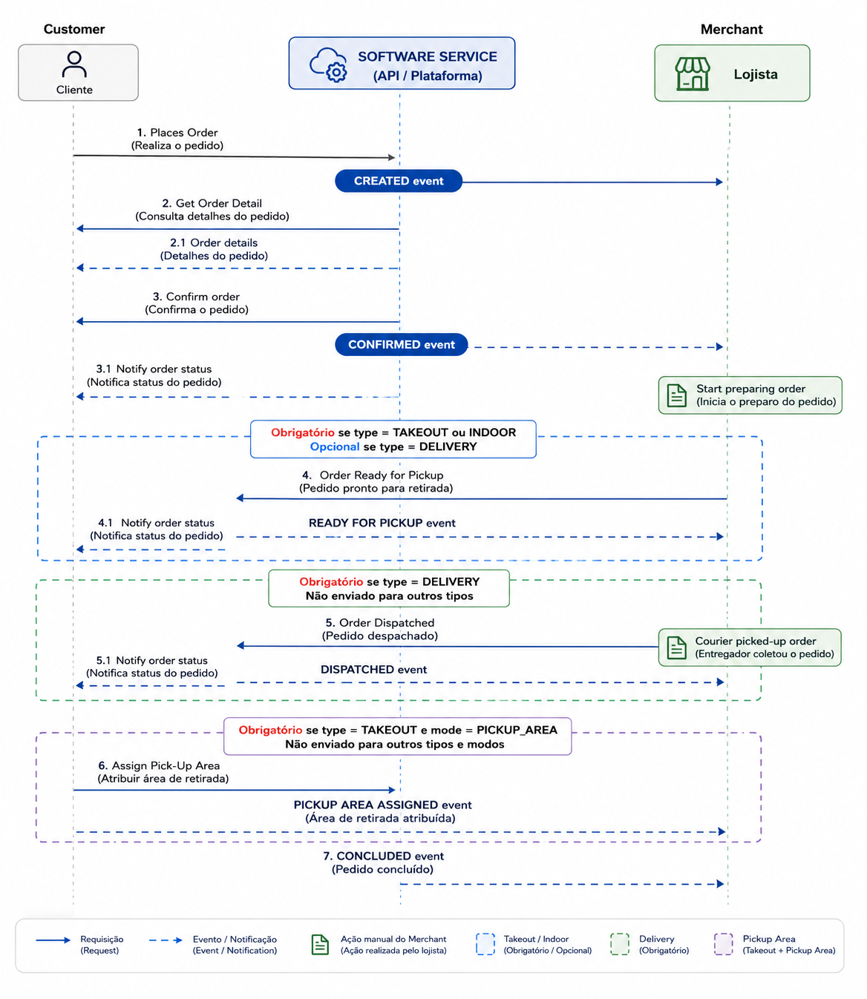

Para receber um pedido novo (evento `CREATED`) você precisa das etapas 1 a 3. A etapa 4 acompanha o pedido até a entrega.

<Steps>
<Step title="Consulte novos eventos" icon="bell">
Polling a cada 30 segundos, com até 100 eventos por chamada. [Consultar novos pedidos](/guides/merchant/order/fluxo-de-integracao/consultar-novos-pedidos)
</Step>
<Step title="Confirme o recebimento" icon="check-double">
Acknowledgment de todos os eventos recebidos. [Acknowledgment de eventos](/guides/merchant/order/fluxo-de-integracao/acknowledgment-de-eventos)
</Step>
<Step title="Busque os detalhes do pedido" icon="magnifying-glass">
Itens, cliente, entrega, pagamento e totais. [Obter detalhes do pedido](/guides/merchant/order/fluxo-de-integracao/obter-detalhes-do-pedido)
</Step>
<Step title="Execute as ações" icon="arrows-rotate">
Confirmar, preparar, despachar, entregar ou cancelar. [Ações de pedidos](/guides/merchant/order/fluxo-de-integracao/acoes-de-pedidos)
</Step>
</Steps>

<Frame caption="Sequência completa entre cliente, plataforma e loja">
  
</Frame>

<CardGroup cols={2}>
<Card title="Seu primeiro pedido" icon="rocket" href="/guides/merchant/order/fluxo-de-integracao/recepcao-de-pedidos">
As quatro etapas num script pronto para rodar.
</Card>
<Card title="Eventos de pedidos" icon="bell" href="/guides/merchant/order/fluxo-de-integracao/eventos-de-pedidos">
A estrutura do evento e todos os tipos.
</Card>
</CardGroup>
