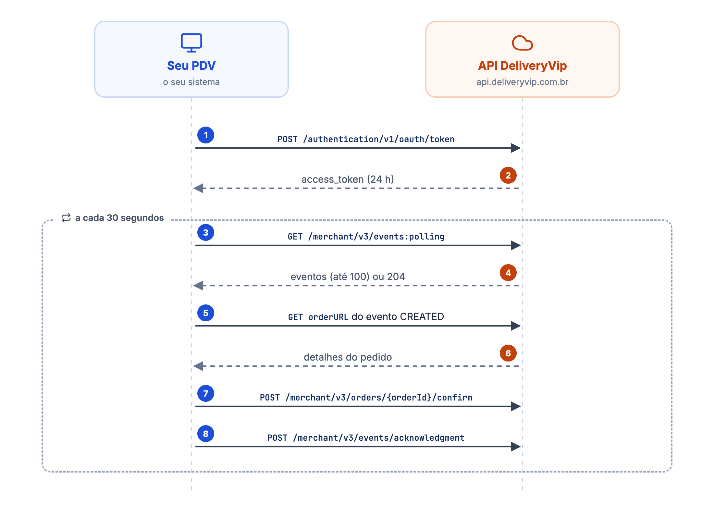
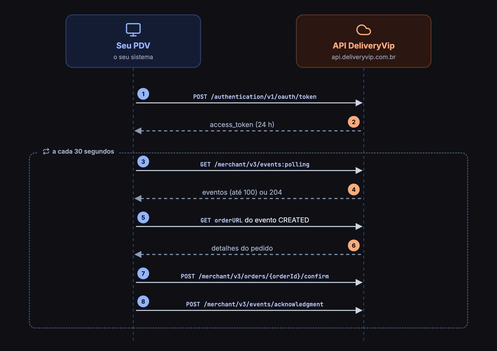

Ao final deste guia você tem um script rodando que recebe os pedidos de uma loja e confirma cada um deles. É o mesmo ciclo que o seu PDV vai executar em produção, sem nada além do essencial.

## Como funciona

<Frame caption="O ciclo do seu PDV: token, polling, detalhes, confirmação e acknowledgment">
  
  
</Frame>

1. **Evento é só um aviso.** O polling diz *o que* mudou (`CREATED`, `CANCELLED`...). Os dados do pedido vêm de uma segunda chamada, na `orderURL` do evento.
2. **Acknowledgment é obrigatório.** Enquanto você não confirmar o recebimento, a API devolve os mesmos eventos em toda chamada.
3. **O mesmo evento pode chegar duas vezes.** Guarde o `eventId` dos eventos processados e ignore repetidos, mas confirme o recebimento deles mesmo assim.

## Antes de começar

<CardGroup cols={3}>
<Card title="Um app com scope od.all" icon="key" href="/inicio/primeiros-passos/jornada-do-developer">
Com `client_id` e `client_secret` em mãos.
</Card>
<Card title="Uma loja com o app instalado" icon="store" href="/inicio/primeiros-passos/instalando-app-na-loja">
Peça uma loja de teste no [Discord](https://discord.gg/AJF8Yha4).
</Card>
<Card title="Node.js 18+ ou Python 3.9+" icon="terminal">
O exemplo existe nas duas linguagens.
</Card>
</CardGroup>

Exporte as credenciais do app como variáveis de ambiente:

```bash
export DV_CLIENT_ID="seu-client-id"
export DV_CLIENT_SECRET="seu-client-secret"
```

## Passo a passo

<Steps>
<Step title="Obtenha o token de acesso">
O token vale **24 horas** e atende todas as lojas que instalaram o seu app.

<CodeGroup>
```bash cURL
curl --request POST 'https://api.deliveryvip.com.br/authentication/v1/oauth/token' \
  --header 'Content-Type: application/x-www-form-urlencoded' \
  --data-urlencode 'grant_type=client_credentials' \
  --data-urlencode "client_id=$DV_CLIENT_ID" \
  --data-urlencode "client_secret=$DV_CLIENT_SECRET" \
  --data-urlencode 'scope=od.all'
```

```js Node.js
const response = await fetch('https://api.deliveryvip.com.br/authentication/v1/oauth/token', {
  method: 'POST',
  headers: { 'Content-Type': 'application/x-www-form-urlencoded' },
  body: new URLSearchParams({
    grant_type: 'client_credentials',
    client_id: process.env.DV_CLIENT_ID,
    client_secret: process.env.DV_CLIENT_SECRET,
    scope: 'od.all',
  }),
})
const { access_token } = await response.json()
```

```python Python
import os
import requests

response = requests.post(
    "https://api.deliveryvip.com.br/authentication/v1/oauth/token",
    data={
        "grant_type": "client_credentials",
        "client_id": os.environ["DV_CLIENT_ID"],
        "client_secret": os.environ["DV_CLIENT_SECRET"],
        "scope": "od.all",
    },
)
access_token = response.json()["access_token"]
```
</CodeGroup>
</Step>

<Step title="Consulte os novos eventos">
Chame o polling com o token. A resposta é **200** com uma lista de até 100 eventos, do mais antigo para o mais recente, ou **204** sem corpo quando não há nada novo.

```bash
curl 'https://api.deliveryvip.com.br/merchant/v3/events:polling' \
  --header "Authorization: Bearer $TOKEN"
```

```json Evento CREATED
[
  {
    "eventId": "9a24ea9e-5743-4957-9b83-7a4b4f2a4597",
    "eventType": "CREATED",
    "orderId": "64939842-b9d7-44d1-a0fd-f68d18d410a6",
    "orderURL": "https://api.deliveryvip.com.br/merchant/v3/orders/64939842-b9d7-44d1-a0fd-f68d18d410a6",
    "orderType": "DELIVERY",
    "merchantId": "8158198a-4bb7-430e-9746-87cd02dfedda",
    "createdAt": "2022-08-16T16:01:21-03:00"
  }
]
```
</Step>

<Step title="Busque os detalhes do pedido">
Para cada evento `CREATED`, faça um `GET` na `orderURL`. A resposta traz itens, cliente, endereço, pagamento e totais. Veja todos os campos em [Obter detalhes do pedido](/guides/merchant/order/fluxo-de-integracao/obter-detalhes-do-pedido).

```bash
curl "$ORDER_URL" --header "Authorization: Bearer $TOKEN"
```
</Step>

<Step title="Confirme o pedido">
Confirmar diz à loja e ao cliente que o pedido foi aceito pelo PDV. A resposta é **202** com o `id` do pedido.

```bash
curl --request POST "https://api.deliveryvip.com.br/merchant/v3/orders/$ORDER_ID/confirm" \
  --header "Authorization: Bearer $TOKEN"
```

<Note>
Neste guia o script confirma todo pedido automaticamente. No seu PDV, confirme quando a loja aceitar o pedido, ou [solicite o cancelamento](/guides/merchant/order/fluxo-de-integracao/acoes-de-pedidos#requisitar-cancelamento-de-um-pedido) se ela recusar.
</Note>
</Step>

<Step title="Confirme o recebimento dos eventos">
Envie um array com o `eventId` de **todos** os eventos recebidos, no campo `id`. Inclua os repetidos e os que o seu sistema ainda não trata: só assim eles saem da fila.

```bash
curl --request POST 'https://api.deliveryvip.com.br/merchant/v3/events/acknowledgment' \
  --header "Authorization: Bearer $TOKEN" \
  --header 'Content-Type: application/json' \
  --data '[{ "id": "9a24ea9e-5743-4957-9b83-7a4b4f2a4597" }]'
```

```json Resposta (202)
{ "total": 1 }
```
</Step>
</Steps>

## O script completo

Junte os passos em um loop. Ele roda a cada 30 segundos e, quando recebe um lote cheio (100 eventos), chama o polling de novo sem esperar, até esvaziar a fila.

<CodeGroup>
```js primeiro-pedido.mjs
const API = 'https://api.deliveryvip.com.br'
const processed = new Set() // em produção, guarde os eventIds no banco

async function getToken() {
  const response = await fetch(`${API}/authentication/v1/oauth/token`, {
    method: 'POST',
    headers: { 'Content-Type': 'application/x-www-form-urlencoded' },
    body: new URLSearchParams({
      grant_type: 'client_credentials',
      client_id: process.env.DV_CLIENT_ID,
      client_secret: process.env.DV_CLIENT_SECRET,
      scope: 'od.all',
    }),
  })
  if (!response.ok) throw new Error(`token: HTTP ${response.status}`)
  return (await response.json()).access_token
}

async function api(token, url, options = {}) {
  const response = await fetch(url.startsWith('http') ? url : `${API}${url}`, {
    ...options,
    headers: { Authorization: `Bearer ${token}`, 'Content-Type': 'application/json', ...options.headers },
  })
  if (response.status === 401) throw new Error('unauthorized')
  if (!response.ok) throw new Error(`${options.method ?? 'GET'} ${url}: HTTP ${response.status}`)
  return response.status === 204 ? null : response.json()
}

async function handle(token, event) {
  if (event.eventType !== 'CREATED') return

  const order = await api(token, event.orderURL)
  console.log(`Pedido ${order.displayId} (${order.type}) de ${order.customer?.name}: R$ ${order.total?.orderAmount?.value}`)
  await api(token, `/merchant/v3/orders/${order.id}/confirm`, { method: 'POST' })
}

let token = await getToken()

while (true) {
  try {
    const events = (await api(token, '/merchant/v3/events:polling')) ?? []

    for (const event of events) {
      if (processed.has(event.eventId)) continue
      await handle(token, event)
      processed.add(event.eventId)
    }

    if (events.length > 0) {
      const ids = events.map(({ eventId }) => ({ id: eventId }))
      await api(token, '/merchant/v3/events/acknowledgment', { method: 'POST', body: JSON.stringify(ids) })
    }

    if (events.length === 100) continue // fila acumulada: busca o próximo lote já
  } catch (error) {
    if (error.message === 'unauthorized') token = await getToken()
    else console.error(error.message)
  }

  await new Promise((resolve) => setTimeout(resolve, 30_000))
}
```

```python primeiro_pedido.py
import os
import time

import requests

API = "https://api.deliveryvip.com.br"
processed = set()  # em produção, guarde os eventIds no banco


class Unauthorized(Exception):
    pass


def get_token():
    response = requests.post(
        f"{API}/authentication/v1/oauth/token",
        data={
            "grant_type": "client_credentials",
            "client_id": os.environ["DV_CLIENT_ID"],
            "client_secret": os.environ["DV_CLIENT_SECRET"],
            "scope": "od.all",
        },
    )
    response.raise_for_status()
    return response.json()["access_token"]


def api(token, url, method="GET", json=None):
    response = requests.request(
        method,
        url if url.startswith("http") else f"{API}{url}",
        headers={"Authorization": f"Bearer {token}"},
        json=json,
    )
    if response.status_code == 401:
        raise Unauthorized()
    response.raise_for_status()
    return None if response.status_code == 204 else response.json()


def handle(token, event):
    if event["eventType"] != "CREATED":
        return

    order = api(token, event["orderURL"])
    customer = (order.get("customer") or {}).get("name")
    amount = order.get("total", {}).get("orderAmount", {}).get("value")
    print(f"Pedido {order['displayId']} ({order['type']}) de {customer}: R$ {amount}")
    api(token, f"/merchant/v3/orders/{order['id']}/confirm", method="POST")


token = get_token()

while True:
    try:
        events = api(token, "/merchant/v3/events:polling") or []

        for event in events:
            if event["eventId"] in processed:
                continue
            handle(token, event)
            processed.add(event["eventId"])

        if events:
            ids = [{"id": event["eventId"]} for event in events]
            api(token, "/merchant/v3/events/acknowledgment", method="POST", json=ids)

        if len(events) == 100:
            continue  # fila acumulada: busca o próximo lote já
    except Unauthorized:
        token = get_token()
    except requests.RequestException as error:
        print(error)

    time.sleep(30)
```
</CodeGroup>

Rode e faça um pedido de teste na loja:

<CodeGroup>
```bash Node.js
node primeiro-pedido.mjs
```

```bash Python
pip install requests
python primeiro_pedido.py
```
</CodeGroup>

```text Saída esperada
Pedido AGNCYO (DELIVERY) de Maria Silva: R$ 107.0
```

<Check>
O pedido aparece como **confirmado** no painel da loja. A partir daqui, o seu PDV acompanha o preparo e a entrega pelas [ações do pedido](/guides/merchant/order/fluxo-de-integracao/acoes-de-pedidos).
</Check>

## Erros comuns

| Sintoma | Causa | Como resolver |
| --- | --- | --- |
| Os mesmos eventos voltam em toda chamada | O acknowledgment não foi enviado, ou foi enviado com o evento inteiro | Envie `[{ "id": "<eventId>" }]` para cada evento recebido. O campo lido é `id`, não `eventId` |
| `401 Unauthorized` | Token expirado (24 h) ou inválido | Gere um novo token e repita a chamada |
| `403 Forbidden` no polling | Filtro com valor inválido, ou um `x-polling-merchants` de loja que não autorizou o app | Veja a mensagem de erro e os [filtros do polling](/guides/merchant/order/fluxo-de-integracao/consultar-novos-pedidos#filtros) |
| `429 Too Many Requests` | Polling mais de uma vez a cada 30 segundos com o mesmo token | Respeite o intervalo; chame sem esperar só quando o lote vier com 100 eventos |
| `422` ao confirmar | O pedido não está num estado que aceita essa ação (por exemplo, já cancelado) | Consulte o pedido e siga o [ciclo de vida](/guides/merchant/order/definicoes#ciclo-de-vida-do-pedido) |

## Próximos passos

<CardGroup cols={2}>
<Card title="Webhooks" icon="bolt" href="/guides/merchant/webhooks">
Receba os eventos na hora, sem polling. Use o polling como reconciliação.
</Card>
<Card title="Ações do pedido" icon="list-check" href="/guides/merchant/order/fluxo-de-integracao/acoes-de-pedidos">
Preparo, pronto para retirada, despacho, entrega e cancelamento.
</Card>
<Card title="Eventos de pedidos" icon="bell" href="/guides/merchant/order/fluxo-de-integracao/eventos-de-pedidos">
Todos os tipos de evento e quando cada um acontece.
</Card>
<Card title="Visão completa do fluxo" icon="diagram-project" href="/guides/merchant/order/definicoes">
Tipos de pedido, agendamento e o ciclo de vida por tipo.
</Card>
</CardGroup>
