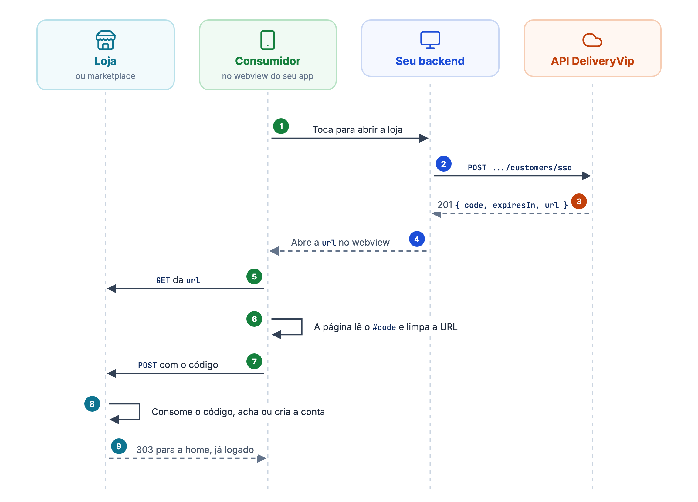
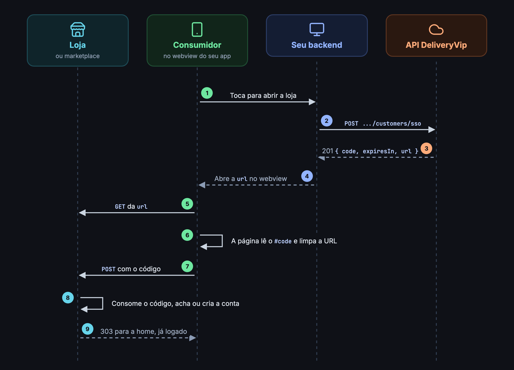

O SSO de consumidores resolve a entrada do cliente que vem do seu app: ele abre a loja (ou o marketplace) no webview e já chega logado. Se ainda não tem conta, ela é criada automaticamente com os dados que o seu app informou, sem tela de cadastro.

Para usar, você precisa de duas coisas:

- o escopo `dv.customer_sso` no seu app, concedido pela DeliveryVip (fale com o nosso time para solicitar);
- o app instalado na loja ou no marketplace de destino.

<Info>
Estas rotas não usam token Bearer. Cada requisição é assinada pelo seu backend com o `client_secret` do app, como mostra a seção [Assinatura da requisição](#assinatura-da-requisição).
</Info>

<Note>
Integra com um marketplace? A Marketplace API tem a [versão deste guia para marketplaces](/guides/marketplace/sso), com os exemplos e o vetor de teste da rota `POST /marketplace/v1/{marketplaceId}/customers/sso`.
</Note>

## Como funciona

<Frame caption="Do toque no seu app à loja já logada">
  
  
</Frame>

<Steps>
<Step title="Peça o consentimento no seu app" icon="hand">
Antes de enviar qualquer dado, o consumidor precisa autorizar, dentro do seu app, o compartilhamento do nome, e-mail e telefone (e do CPF e da data de nascimento, se você enviar) com a loja.
</Step>
<Step title="Assine e emita o código no seu backend" icon="signature">
Seu backend assina e chama `POST /merchant/v3/{merchantId}/customers/sso` (loja) ou `POST /marketplace/v1/{marketplaceId}/customers/sso` (marketplace) com o perfil do consumidor. A resposta traz um código de uso único e a `url` para abrir.
</Step>
<Step title="Abra a url no webview" icon="mobile-screen">
Abra no webview exatamente a `url` devolvida. O código viaja no fragmento (`#code=...`) e nunca chega a servidores intermediários.
</Step>
<Step title="O consumidor está logado" icon="circle-check">
A loja troca o código pela sessão do consumidor e mostra a home já autenticada.
</Step>
</Steps>

## Emitir o código

O corpo é um JSON com o objeto `profile`:

<ParamField body="profile.name" type="string" required>
  Nome do consumidor.
</ParamField>

<ParamField body="profile.email" type="string" required>
  E-mail do consumidor. É a chave que identifica a conta: se já existe uma conta com este e-mail, ela é logada.
</ParamField>

<ParamField body="profile.phone" type="string" required>
  Telefone fixo ou celular válido. Recomendamos o formato E.164, por exemplo `+5531999990000`. Sem o `+`, o número é lido como brasileiro e precisa ter DDD.
</ParamField>

<ParamField body="profile.document" type="string">
  CPF. Opcional; quando enviado, precisa ser válido.
</ParamField>

<ParamField body="profile.birthDate" type="string">
  Data de nascimento no formato `AAAA-MM-DD`, por exemplo `1990-05-21`. Opcional; quando enviada, precisa ser uma data válida e não futura.
</ParamField>

<Tip>
O programa de fidelidade exige CPF e data de nascimento. Envie os dois para o consumidor já entrar apto a usar a fidelidade; se faltar algum, a loja pede o dado na hora de usar o benefício.
</Tip>

<Tabs>
<Tab title="Loja" icon="store">
<CodeGroup>
```bash cURL
curl --request POST 'https://api.deliveryvip.com.br/merchant/v3/{merchantId}/customers/sso' \
  --header 'Content-Type: application/json' \
  --header "X-App-Id: $CLIENT_ID" \
  --header "X-App-Timestamp: $TIMESTAMP" \
  --header "X-App-Nonce: $NONCE" \
  --header "X-App-Signature: $SIGNATURE" \
  --data "$BODY"
```

```javascript Node.js
const body = JSON.stringify({
  profile: { name: "Maria", email: "maria@example.com", phone: "+5531999990000" },
});
const path = `/merchant/v3/${merchantId}/customers/sso`;
const timestamp = String(Math.floor(Date.now() / 1000));
const nonce = crypto.randomUUID();

const response = await fetch(`https://api.deliveryvip.com.br${path}`, {
  method: "POST",
  headers: {
    "Content-Type": "application/json",
    "X-App-Id": clientId,
    "X-App-Timestamp": timestamp,
    "X-App-Nonce": nonce,
    "X-App-Signature": signRequest({ secret, clientId, method: "POST", path, body, timestamp, nonce }),
  },
  body,
});
const { url } = await response.json();
```

```python Python
body = json.dumps({"profile": {"name": "Maria", "email": "maria@example.com", "phone": "+5531999990000"}}, separators=(",", ":"))
path = f"/merchant/v3/{merchant_id}/customers/sso"
timestamp = str(int(time.time()))
nonce = str(uuid.uuid4())

response = requests.post(
    f"https://api.deliveryvip.com.br{path}",
    data=body.encode(),
    headers={
        "Content-Type": "application/json",
        "X-App-Id": client_id,
        "X-App-Timestamp": timestamp,
        "X-App-Nonce": nonce,
        "X-App-Signature": sign_request(secret, client_id, "POST", path, body, timestamp, nonce),
    },
)
url = response.json()["url"]
```
</CodeGroup>
</Tab>
<Tab title="Marketplace" icon="shop">
O guia completo para marketplaces está em [Login de consumidores no marketplace](/guides/marketplace/sso).

<CodeGroup>
```bash cURL
curl --request POST 'https://api.deliveryvip.com.br/marketplace/v1/{marketplaceId}/customers/sso' \
  --header 'Content-Type: application/json' \
  --header "X-App-Id: $CLIENT_ID" \
  --header "X-App-Timestamp: $TIMESTAMP" \
  --header "X-App-Nonce: $NONCE" \
  --header "X-App-Signature: $SIGNATURE" \
  --data "$BODY"
```

```javascript Node.js
const body = JSON.stringify({
  profile: { name: "Maria", email: "maria@example.com", phone: "+5531999990000" },
});
const path = `/marketplace/v1/${marketplaceId}/customers/sso`;
const timestamp = String(Math.floor(Date.now() / 1000));
const nonce = crypto.randomUUID();

const response = await fetch(`https://api.deliveryvip.com.br${path}`, {
  method: "POST",
  headers: {
    "Content-Type": "application/json",
    "X-App-Id": clientId,
    "X-App-Timestamp": timestamp,
    "X-App-Nonce": nonce,
    "X-App-Signature": signRequest({ secret, clientId, method: "POST", path, body, timestamp, nonce }),
  },
  body,
});
const { url } = await response.json();
```

```python Python
body = json.dumps({"profile": {"name": "Maria", "email": "maria@example.com", "phone": "+5531999990000"}}, separators=(",", ":"))
path = f"/marketplace/v1/{marketplace_id}/customers/sso"
timestamp = str(int(time.time()))
nonce = str(uuid.uuid4())

response = requests.post(
    f"https://api.deliveryvip.com.br{path}",
    data=body.encode(),
    headers={
        "Content-Type": "application/json",
        "X-App-Id": client_id,
        "X-App-Timestamp": timestamp,
        "X-App-Nonce": nonce,
        "X-App-Signature": sign_request(secret, client_id, "POST", path, body, timestamp, nonce),
    },
)
url = response.json()["url"]
```
</CodeGroup>
</Tab>
</Tabs>

Resposta `201 Created`:

```json
{
  "code": "2f9c...",
  "expiresIn": 300,
  "url": "https://loja.exemplo.com.br/accounts/sso/{client_id}#code=2f9c..."
}
```

<ResponseField name="code" type="string">
  Código de uso único.
</ResponseField>

<ResponseField name="expiresIn" type="integer">
  Validade do código, em segundos (300).
</ResponseField>

<ResponseField name="url" type="string">
  Endereço para abrir no webview. Aponta para o domínio principal da loja (ou do marketplace).
</ResponseField>

A resposta é a mesma nas duas rotas; no marketplace, a `url` aponta para o domínio do marketplace. Os detalhes de cada rota estão na Referência: [Emitir código de SSO para uma loja](/api-reference/sso-de-consumidores/emitir-código-de-sso-para-uma-loja) e [Emitir código de SSO para um marketplace](/api-reference/sso-de-consumidores/emitir-código-de-sso-para-um-marketplace).

## Assinatura da requisição

Cada requisição leva quatro cabeçalhos:

| Cabeçalho | Valor |
| --- | --- |
| `X-App-Id` | O `client_id` do app. |
| `X-App-Timestamp` | Segundos desde a época Unix (até 10 dígitos). |
| `X-App-Nonce` | UUID v4, novo a cada requisição. |
| `X-App-Signature` | `v1=` seguido do HMAC-SHA256 hexadecimal minúsculo da string canônica, com o `client_secret` como chave. |

A string canônica tem seis linhas unidas por `\n`, sem quebra no final:

```text
MÉTODO EM MAIÚSCULAS
path da requisição (sem host e sem query)
SHA-256 hexadecimal do corpo bruto (do corpo vazio, se não houver)
timestamp
nonce
client_id
```

<CodeGroup>
```javascript Node.js
import crypto from "node:crypto";

function signRequest({ secret, clientId, method, path, body, timestamp, nonce }) {
  const bodyHash = crypto.createHash("sha256").update(body).digest("hex");
  const canonical = [method.toUpperCase(), path, bodyHash, timestamp, nonce, clientId].join("\n");
  return "v1=" + crypto.createHmac("sha256", secret).update(canonical).digest("hex");
}
```

```python Python
import hashlib
import hmac


def sign_request(secret, client_id, method, path, body, timestamp, nonce):
    body_hash = hashlib.sha256(body.encode()).hexdigest()
    canonical = "\n".join([method.upper(), path, body_hash, timestamp, nonce, client_id])
    digest = hmac.new(secret.encode(), canonical.encode(), hashlib.sha256).hexdigest()
    return f"v1={digest}"
```
</CodeGroup>

### Vetor de teste

Confira a sua implementação com estes valores. Se a assinatura não bater, o problema está na string canônica.

| Item | Valor |
| --- | --- |
| Segredo | `test-secret-0123456789abcdef0123456789abcdef` |
| `client_id` | `client-abc` |
| Método | `POST` |
| Path | `/merchant/v3/7b1f2c3d-0000-4000-8000-000000000001/customers/sso` |
| Corpo | `{"profile":{"name":"Maria Silva","email":"maria@example.com","phone":"+5531999990000"}}` |
| SHA-256 do corpo | `752f9f654982fa1147c774f7e370ec6c64ca344190d911db920bf80226ef8e58` |
| Timestamp | `1763300000` |
| Nonce | `9f2c8a1e-4b7d-4c21-9f3a-2e5d8c1b7a04` |

A assinatura resultante é:

```text
v1=3886debc43ba58468c6476e7e7f4a55d29513cca88fbde47b59728e015bb4a26
```

<Warning>
- **Assine os bytes exatos do corpo que você envia.** Se reserializar o JSON depois de assinar (espaços, ordem das chaves), a assinatura deixa de bater.
- **O timestamp é em segundos**, não em milissegundos, e precisa estar a até 300 segundos do horário do servidor.
- **Gere um nonce novo a cada tentativa, inclusive nas novas tentativas após erro.** Cada nonce só vale uma vez, por 600 segundos.
- **Parâmetros extras na url** (por exemplo `?mode=delivery`, `takeout` ou `dine_in`) vão **antes** do `#`: `https://loja.exemplo.com.br/accounts/sso/{client_id}?mode=delivery#code=...`.
- **O código vale 300 segundos e só pode ser usado uma vez.**
- **Nunca coloque o código em query string nem em logs.** Ele só deve existir no fragmento da url.
</Warning>

## O que o consumidor vê

<AccordionGroup>
<Accordion title="E-mail ainda sem conta">
Uma conta nova é criada com o nome, e-mail, telefone, CPF e data de nascimento (os dois últimos, se enviados) do perfil, e o consumidor entra logado.
</Accordion>
<Accordion title="E-mail com conta existente">
A conta existente é logada. O e-mail é a chave. Só os campos vazios da conta são preenchidos com o perfil: dados que o consumidor já informou nunca são sobrescritos.
</Accordion>
<Accordion title="Código expirado ou já usado">
O consumidor vê uma tela pedindo para abrir a loja novamente a partir do seu app. Emita um código novo e reabra o webview.
</Accordion>
<Accordion title="Conta bloqueada">
O consumidor não entra logado e vê a tela "Sua conta está bloqueada", que orienta a entrar em contato com a loja para desbloquear a conta. Um código novo não resolve: a conta precisa ser desbloqueada antes.
</Accordion>
</AccordionGroup>

## Erros comuns

O corpo do erro é `{"status": "<código>", "title": "<mensagem>"}`. O `422` por perfil inválido acrescenta `errors`, com a lista de mensagens por campo.

| Status | Causa |
| --- | --- |
| `401` | Qualquer problema na assinatura (cabeçalho ausente ou malformado, assinatura inválida, timestamp fora da janela, nonce repetido). A resposta não diz qual verificação falhou. |
| `403` | O app não tem o escopo `dv.customer_sso`, não tem instalação ativa na loja ou no marketplace, ou o destino não existe. A resposta não diz qual dos casos ocorreu. |
| `422` | Perfil inválido (nome, e-mail, telefone, CPF ou data de nascimento) ou corpo que não é um JSON com `profile`. |
| `429` | Mais de 120 requisições por minuto por app, somando os dois endpoints. |
| `503` | O código não pôde ser gravado, ou o destino não tem domínio. Tente de novo com um nonce novo. |

<Check>
Ao seguir o vetor de teste, a sua assinatura bate caractere por caractere com a da documentação. Faça isso antes da primeira chamada real.
</Check>
