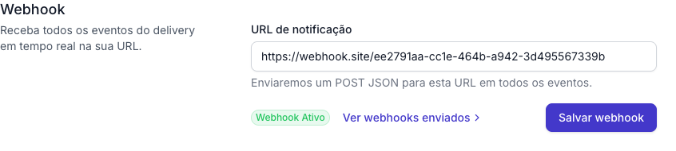
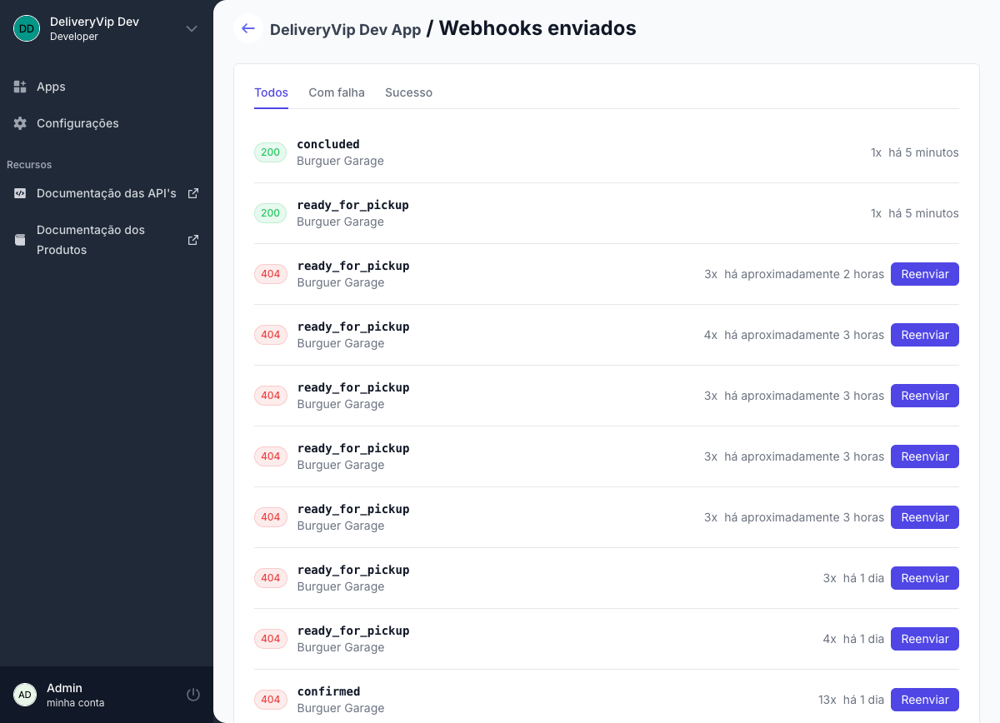

Com o webhook, a DeliveryVip faz um `POST` com o evento em JSON na sua URL assim que ele acontece. Você recebe eventos de pedido e de indoor (chamar garçom, pedir a conta) sem fila para drenar, sem limite de 100 eventos e sem intervalo de consulta.

<Info>
Webhook e [polling](/guides/merchant/events) são independentes: receber um evento por webhook **não** o remove do polling, e vice-versa. Eventos entregues por webhook não precisam de acknowledgment.

Use o **webhook como canal principal** e o **polling como reconciliação**: se o seu endpoint ficar fora do ar, os eventos das últimas 24 horas continuam disponíveis no polling.
</Info>

## Como configurar

<Steps>
<Step title="Abra a sua aplicação">
No painel do desenvolvedor, abra a aplicação que integra com as lojas.
</Step>
<Step title="Informe a URL de notificação">
Na seção **Webhook**, preencha a **URL de notificação** com o endpoint do seu sistema que vai receber os eventos e salve.

<Frame caption="Seção Webhook: informe a URL de notificação e salve">
  
</Frame>
</Step>
<Step title="Responda 2xx">
O seu endpoint precisa aceitar `POST` e responder com um status **2xx** para confirmar o recebimento.
</Step>
</Steps>

A aplicação tem **uma única URL** de webhook. Os eventos de todas as lojas que instalaram o seu app chegam nela; identifique a loja pelo header `X-App-MerchantId` ou pelo campo `merchantId` do corpo.

<Note>
Apps com a extensão Open Delivery podem ter uma URL e um secret **por loja**. Veja [Recebendo eventos](/guides/open-delivery/recebendo-eventos) no guia Open Delivery.
</Note>

## A requisição

Cada evento chega numa requisição própria:

```http
POST {sua URL de notificação}
Content-Type: application/json
User-Agent: DeliveryVip
X-App-Id: 019efa90-dcd1-7846-983d-6bab871b2f6b
X-App-MerchantId: 8158198a-4bb7-430e-9746-87cd02dfedda
X-App-Signature: 5d41402abc4b2a76b9719d911017c592...
```

<ParamField header="X-App-Signature" type="string" required>
HMAC-SHA256 do corpo bruto da requisição, em hexadecimal minúsculo. Veja [Validando a origem](#validando-a-origem).
</ParamField>

<ParamField header="X-App-MerchantId" type="string" required>
A loja do evento: o `merchantId` que você configurou para ela, quando houver, ou o id da loja na DeliveryVip. É o mesmo valor do campo `merchantId` do corpo.
</ParamField>

<ParamField header="X-App-Id" type="string" required>
Identificador **fixo** da DeliveryVip como plataforma emissora: `019efa90-dcd1-7846-983d-6bab871b2f6b`. É o mesmo em todas as entregas, para todos os apps, e **não** é o id do seu app. Serve como checagem simples de origem; quem garante a autenticidade é a assinatura.
</ParamField>

## Validando a origem

O header `X-App-Signature` é o **HMAC-SHA256 do corpo bruto**, em hexadecimal minúsculo, usando o **Client Secret** da sua aplicação como chave. Recalcule a assinatura sobre o corpo recebido e compare com o header usando comparação de tempo constante.

<CodeGroup>
```js Node.js
import crypto from 'node:crypto'
import express from 'express'

const app = express()

// express.raw mantém o corpo exatamente como chegou
app.post('/webhooks/deliveryvip', express.raw({ type: 'application/json' }), (req, res) => {
  const expected = crypto.createHmac('sha256', process.env.CLIENT_SECRET).update(req.body).digest('hex')
  const received = req.get('X-App-Signature') ?? ''

  const valid =
    received.length === expected.length &&
    crypto.timingSafeEqual(Buffer.from(received), Buffer.from(expected))

  if (!valid) return res.sendStatus(401)

  const event = JSON.parse(req.body)
  queue.push(event) // processe depois, fora da requisição
  res.sendStatus(200)
})
```

```python Python
import hashlib
import hmac
import os

from flask import Flask, abort, request

app = Flask(__name__)

@app.post("/webhooks/deliveryvip")
def deliveryvip_webhook():
    raw_body = request.get_data()  # bytes exatamente como chegaram
    expected = hmac.new(os.environ["CLIENT_SECRET"].encode(), raw_body, hashlib.sha256).hexdigest()

    if not hmac.compare_digest(expected, request.headers.get("X-App-Signature", "")):
        abort(401)

    queue.put(request.get_json())  # processe depois, fora da requisição
    return "", 200
```

```ruby Ruby
expected = OpenSSL::HMAC.hexdigest("SHA256", client_secret, request.raw_post)
valid = ActiveSupport::SecurityUtils.secure_compare(expected, request.headers["X-App-Signature"].to_s)
```
</CodeGroup>

<Warning>
Calcule a assinatura sobre o **corpo exato recebido**, antes de qualquer parse. Fazer parse e serializar de novo muda os bytes, e a assinatura deixa de bater.
</Warning>

<Danger>
Rejeite toda requisição cuja assinatura não confere. A assinatura é a única prova de que o evento veio da DeliveryVip; sem ela, qualquer um consegue forjar eventos de pedido no seu endpoint.
</Danger>

<Info>
Ao renovar o Client Secret, a troca vale na hora: toda entrega enviada depois, incluindo tentativas automáticas e reenvios manuais, já é assinada com o novo secret.
</Info>

## O corpo do evento

O corpo é **um único evento**, no mesmo formato que o polling devolve.

<ResponseField name="eventId" type="uuid" required>
Identificador único do evento. Use-o para descartar entregas repetidas.
</ResponseField>

<ResponseField name="eventType" type="string" required>
Tipo do evento, em maiúsculas. Veja [os tipos](#tipos-de-evento).
</ResponseField>

<ResponseField name="merchantId" type="string" required>
A loja do evento.
</ResponseField>

<ResponseField name="createdAt" type="datetime" required>
Quando o evento aconteceu, em RFC 3339 com o fuso de Brasília (`-03:00`). Para lojas integradas pelo [Open Delivery](/guides/open-delivery), vem em UTC (sufixo `Z`).
</ResponseField>

<ResponseField name="metadata" type="object">
Dados extras de alguns eventos, como o motivo de um cancelamento. Chaves em camelCase. Só vem quando há conteúdo.
</ResponseField>

<ResponseField name="orderId" type="uuid">
Eventos de pedido. O pedido ao qual o evento pertence.
</ResponseField>

<ResponseField name="orderURL" type="string">
Eventos de pedido. URL para [buscar os detalhes do pedido](/guides/merchant/order/fluxo-de-integracao/obter-detalhes-do-pedido).
</ResponseField>

<ResponseField name="orderType" type="string">
Eventos de pedido. `DELIVERY`, `TAKEOUT` ou `INDOOR`.
</ResponseField>

<ResponseField name="placeName, placeId, tab, tabId, tabCode, tabName" type="string">
Eventos de indoor. A mesa ou a comanda que gerou o evento. Cada campo só vem quando está preenchido.
</ResponseField>

<CodeGroup>
```json Pedido
{
  "eventId": "209c060f-41f2-4420-81ab-15f2b5559c58",
  "createdAt": "2026-06-30T12:00:00-03:00",
  "merchantId": "8158198a-4bb7-430e-9746-87cd02dfedda",
  "eventType": "CREATED",
  "orderId": "52122852-6626-11ed-9022-0242ac120002",
  "orderURL": "https://api.deliveryvip.com.br/merchant/v3/orders/52122852-6626-11ed-9022-0242ac120002",
  "orderType": "DELIVERY"
}
```

```json Indoor
{
  "eventId": "6f1d2c3b-8a4e-4b5f-9c6d-7e8f9a0b1c2d",
  "createdAt": "2026-06-30T20:15:00-03:00",
  "merchantId": "8158198a-4bb7-430e-9746-87cd02dfedda",
  "eventType": "CALL_WAITER",
  "placeName": "Mesa 10",
  "placeId": "a3c1e5f7-2b4d-4f6a-8c0e-1d3f5a7b9c2e"
}
```
</CodeGroup>

### Tipos de evento

| Grupo | `eventType` | Detalhes |
| --- | --- | --- |
| Pedido | `CREATED`, `CONFIRMED`, `PREPARING`, `READY_FOR_PICKUP`, `PICKED_UP`, `DISPATCHED`, `DELIVERED`, `CONCLUDED`, `CANCELLED` | [Eventos de pedidos](/guides/merchant/order/fluxo-de-integracao/eventos-de-pedidos) |
| Indoor | `CALL_WAITER`, `CLOSE_ACCOUNT` | [Eventos de indoor](/guides/merchant/indoor/fluxo-de-integracao/eventos-de-indoor) |

`PICKUP_AREA_ASSIGNED`, `CANCELLATION_REQUESTED`, `CANCELLATION_REQUEST_DENIED` e `ORDER_CANCELLATION_REQUEST` estão previstos na especificação, mas [ainda não são emitidos](/guides/merchant/order/fluxo-de-integracao/eventos-de-pedidos#previstos-na-especificação). Se chegar um tipo que você não conhece, responda `2xx` e ignore.

## O que o seu endpoint deve fazer

<Check>
- **Validar a assinatura** antes de qualquer processamento.
- **Responder 2xx rápido.** Grave o evento e processe de forma assíncrona: a DeliveryVip desiste após **3 segundos** para conectar e **5 segundos** para receber a resposta, e conta isso como falha.
- **Descartar repetidos pelo `eventId`.** A assinatura não tem timestamp e o mesmo evento pode chegar de novo numa nova tentativa ou num reenvio manual.
</Check>

## Tentativas e reenvio

| Resposta do seu endpoint | O que a DeliveryVip faz |
| --- | --- |
| `2xx` | Entrega concluída. |
| `408`, `429`, timeout ou erro de conexão | Tenta de novo automaticamente, até **3 tentativas** no total. Se todas falharem, a entrega fica como falha. |
| Qualquer outro status, **inclusive `5xx`** | Marca a entrega como falha na hora, sem nova tentativa automática. |

Entregas com falha podem ser **reenviadas manualmente** no painel. Enquanto ainda há tentativas automáticas em curso, o reenvio manual fica indisponível para evitar entregas duplicadas.

<Tip>
Se o seu servidor estiver sobrecarregado e quiser que a DeliveryVip tente de novo, responda `429` ou `408`, não `500` ou `503`.
</Tip>

## Suspensão automática

<Warning>
Após **30 falhas consecutivas**, a DeliveryVip **suspende** o envio de webhooks da sua aplicação e avisa por e-mail, com o motivo da última falha. Cada tentativa que falha conta; uma entrega bem-sucedida zera o contador.
</Warning>

Antes da suspensão, o e-mail de contato da aplicação recebe um alerta **Falhas no envio de webhooks** ao atingir **10, 20 e 25 falhas consecutivas**. O alerta informa quantas falhas já houve, quantas faltam para a suspensão e o motivo da última. Corrija o endpoint assim que ele chegar: a próxima entrega bem-sucedida zera o contador e nada mais precisa ser feito.

Enquanto o envio está suspenso, os eventos continuam disponíveis no [polling](/guides/merchant/events). Para retomar:

<Steps>
<Step title="Corrija o endpoint">
Confirme que a URL responde `2xx` para um `POST` com corpo JSON.
</Step>
<Step title="Reative o envio">
No painel do desenvolvedor, abra a aplicação e entre em **Ver webhooks enviados**. No aviso **Envio de webhooks suspenso**, clique em **Reativar envios**.
</Step>
<Step title="Reenvie o que falhou">
Na mesma tela, filtre por **Com falha** e reenvie as entregas que você precisa. As entregas que ainda estavam em nova tentativa quando o envio foi suspenso também aparecem como falha, com o erro `Webhook suspended`.
</Step>
</Steps>

## Acompanhamento

A tela **Webhooks enviados** (painel do desenvolvedor, sua aplicação, **Ver webhooks enviados**) mostra o histórico de entregas: tipo do evento, loja, status HTTP e número de tentativas. Filtre por **Com falha** ou **Sucesso** e reenvie as entregas que falharam.

<Frame caption="Tela Webhooks enviados: histórico, status HTTP, tentativas e reenvio">
  
</Frame>

## Erros comuns

<AccordionGroup>
<Accordion title="A assinatura nunca confere" icon="signature">
Quase sempre o corpo foi transformado antes do cálculo: o framework fez parse do JSON e você serializou de novo. Leia o corpo bruto (`express.raw`, `request.get_data()`, `request.raw_post`) e calcule o HMAC sobre esses bytes. Confira também se está usando o **Client Secret** da aplicação, e não o Client ID.
</Accordion>
<Accordion title="Recebo o mesmo evento duas vezes" icon="clone">
É esperado: novas tentativas e reenvios manuais repetem o mesmo `eventId`, e o mesmo evento também aparece no polling. Guarde os `eventId` processados e descarte os repetidos.
</Accordion>
<Accordion title="Recebi o e-mail Falhas no envio de webhooks" icon="triangle-exclamation">
O seu endpoint acumulou 10, 20 ou 25 falhas seguidas, e o envio será suspenso na 30ª. O e-mail traz o motivo da última falha. Corrija o endpoint: a próxima entrega bem-sucedida zera o contador. Depois, reenvie pelo painel as entregas com falha.
</Accordion>
<Accordion title="O envio foi suspenso" icon="circle-pause">
O seu endpoint acumulou 30 falhas seguidas. Corrija o endpoint, clique em **Reativar envios** na tela **Webhooks enviados** e reenvie as entregas com falha. Enquanto isso, recupere os eventos pelo polling.
</Accordion>
<Accordion title="Meu endpoint retornou 500 e o evento não voltou" icon="rotate">
Respostas `5xx` não são tentadas de novo automaticamente. Reenvie pelo painel ou recupere o evento pelo polling. Para pedir uma nova tentativa automática, responda `429` ou `408`.
</Accordion>
</AccordionGroup>
