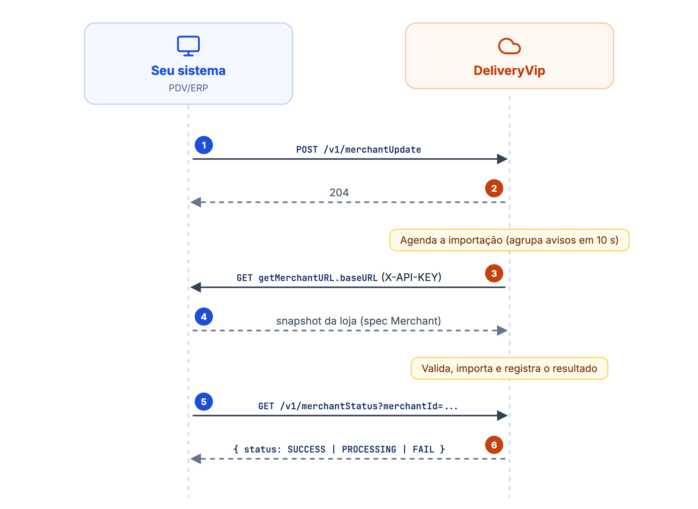
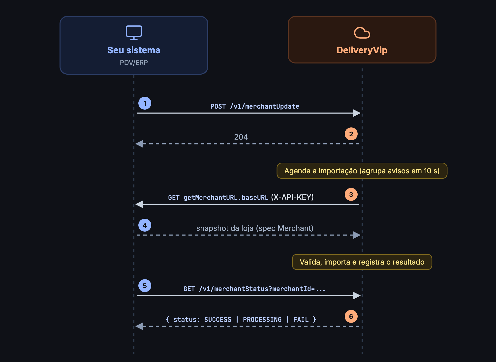

No padrão Open Delivery, o fluxo de catálogo é invertido em relação a uma API tradicional: **você expõe** os dados da loja no formato da spec **Merchant** e **a DeliveryVip consome** esse endpoint para importar.

<Frame caption="Importação do catálogo via merchantUpdate">
  
  
</Frame>

## Quem expõe o quê

| Endpoint | Lado | Descrição |
| -------- | ---- | --------- |
| `GET {getMerchantURL.baseURL}` | **Seu sistema** | Retorna os dados da loja no formato da spec Merchant. A DeliveryVip chama esta URL para importar. |
| `POST /v1/merchantUpdate` | **DeliveryVip** (`od.deliveryvip.com.br`) | Você avisa que os dados da loja mudaram (ou abre/fecha a loja). |
| `GET /v1/merchantStatus` | **DeliveryVip** (`od.deliveryvip.com.br`) | Você consulta o resultado do último processamento dos dados da loja. |

## O seu endpoint Merchant

A DeliveryVip faz um `GET` **exatamente** na `getMerchantURL.baseURL` informada no [onboarding](/guides/open-delivery/onboarding-de-lojas), sem acrescentar caminho. Se você informou uma `apiKey`, ela vai no header `X-API-KEY`.

```http
GET /opendelivery/merchant HTTP/1.1
Host: pdv.exemplo.com.br
X-API-KEY: {sua api key}
```

A resposta é o snapshot completo da loja no formato da spec **Merchant `1.0.0`** do [Open Delivery](https://www.opendelivery.com.br). Consulte a spec oficial para o schema; a DeliveryVip importa:

* **informações básicas** e **endereço** da loja;
* **horários de funcionamento**;
* **área de atendimento** e preços de entrega;
* **catálogo**: categorias, itens, grupos de opções e opções, com as imagens dos itens.

Regras da importação:

* **Snapshot completo.** Itens, categorias e opções que vieram de uma importação anterior e não estão mais no snapshot são **removidos** da loja.
* **Tudo ou nada.** Se qualquer etapa falhar, nada da importação é aplicado.
* **`lastUpdate` decide se há o que importar.** Se o `lastUpdate` do snapshot não for mais recente que o da última importação bem-sucedida, nada é reimportado e o resultado é `SUCCESS`. Atualize o `lastUpdate` sempre que os dados mudarem.
* **Catálogo vazio falha.** Um snapshot sem nenhum item termina em `FAIL`.
* O snapshot é validado contra o schema da spec antes de qualquer gravação.

## Re-sincronização (merchantUpdate)

Quando o catálogo, os horários ou qualquer dado da loja mudarem no seu sistema, avise a plataforma:

```
POST https://od.deliveryvip.com.br/v1/merchantUpdate
```

O corpo é opcional e define o que acontece:

| Corpo | Efeito |
| ----- | ------ |
| Vazio | Reimporta a loja inteira do seu endpoint. |
| `merchantStatus` | Só abre (`AVAILABLE`) ou fecha (`UNAVAILABLE`) a loja. **Não** reimporta. |
| `entityType` + `updatedObjects` | Reimporta a loja inteira (a importação por entidade ainda não é parcial). |
| `merchantStatus` + `entityType` + `updatedObjects` | Os dois: abre/fecha e reimporta. |

<ParamField body="merchantStatus" type="string">
`AVAILABLE` ou `UNAVAILABLE`.
</ParamField>

<ParamField body="entityType" type="string">
`MERCHANT`, `BASIC_INFO`, `SERVICE`, `MENU`, `CATEGORY`, `ITEM`, `ITEM_OFFER`, `OPTION_GROUP`, `OPTION` ou `AVAILABILITY`. Exige `updatedObjects` não vazio.
</ParamField>

<ParamField body="updatedObjects" type="object[]">
Os objetos alterados, conforme a spec.
</ParamField>

<CodeGroup>
```bash cURL
curl --request POST 'https://od.deliveryvip.com.br/v1/merchantUpdate' \
  --header 'Authorization: Bearer {token}' \
  --header 'Content-Type: application/json'
```

```js Node.js
await fetch('https://od.deliveryvip.com.br/v1/merchantUpdate', {
  method: 'POST',
  headers: { Authorization: `Bearer ${token}`, 'Content-Type': 'application/json' },
})
```

```python Python
requests.post(
    "https://od.deliveryvip.com.br/v1/merchantUpdate",
    headers={"Authorization": f"Bearer {token}"},
)
```
</CodeGroup>

```bash Fechar a loja
curl --request POST 'https://od.deliveryvip.com.br/v1/merchantUpdate' \
  --header 'Authorization: Bearer {token}' \
  --header 'Content-Type: application/json' \
  --data '{ "merchantStatus": "UNAVAILABLE" }'
```

A resposta é **`204 No Content`**. O processamento é **assíncrono**: o `merchantUpdate` apenas agenda a importação, e avisos repetidos em sequência são agrupados em uma só (janela de 10 segundos). Para saber como terminou, consulte o [`merchantStatus`](#acompanhando-o-processamento-merchantstatus).

| Código | Quando |
| ------ | ------ |
| `204` | Aviso aceito. |
| `422` `objects_empty` | `entityType` enviado sem `updatedObjects`. |
| `422` `api_info_missing` | Pediu reimportação, mas a loja não tem `getMerchantURL.baseURL` configurada no onboarding. |
| `422` | `merchantStatus` ou `entityType` com valor fora da lista. |

<Note>
O onboarding não importa o catálogo sozinho. Depois de registrar a `getMerchantURL`, chame o `merchantUpdate` para a primeira importação.
</Note>

## Acompanhando o processamento (merchantStatus)

Consulte o resultado do último processamento dos dados de uma loja:

<ParamField query="merchantId" type="string" required>
O `merchantId` informado no [onboarding](/guides/open-delivery/onboarding-de-lojas).
</ParamField>

<CodeGroup>
```bash cURL
curl --request GET 'https://od.deliveryvip.com.br/v1/merchantStatus?merchantId=loja-centro-001' \
  --header 'Authorization: Bearer {token}'
```

```js Node.js
const response = await fetch(
  'https://od.deliveryvip.com.br/v1/merchantStatus?merchantId=loja-centro-001',
  { headers: { Authorization: `Bearer ${token}` } },
)
const { status, moreInfo } = await response.json()
```

```python Python
response = requests.get(
    "https://od.deliveryvip.com.br/v1/merchantStatus",
    params={"merchantId": "loja-centro-001"},
    headers={"Authorization": f"Bearer {token}"},
)
print(response.json())
```
</CodeGroup>

```json Resposta (200)
{
  "lastRead": "2026-09-23T12:00:00Z",
  "status": "FAIL",
  "moreInfo": "invalid_schema"
}
```

<ResponseField name="lastRead" type="string">
Quando a plataforma registrou o último processamento (UTC). Num `PROCESSING`, é o momento em que o aviso foi recebido.
</ResponseField>
<ResponseField name="status" type="string">
`SUCCESS`, `PROCESSING` ou `FAIL`.
</ResponseField>
<ResponseField name="moreInfo" type="string">
Código curto da falha, quando `status` é `FAIL` (ex.: `fetch_failed`, `invalid_schema`, `empty_catalog`). Omitido nos demais casos.
</ResponseField>

| Status | Significado |
| ------ | ----------- |
| `PROCESSING` | A importação foi agendada e ainda está em andamento. |
| `SUCCESS` | Os dados da loja foram importados, ou não havia nada novo (`lastUpdate` igual ao anterior). |
| `FAIL` | A importação falhou. Veja `moreInfo` e corrija o seu endpoint OD Merchant. |

Respostas de erro:

* **400 Bad Request**: `merchantId` ausente.
* **404 Not Found**: loja desconhecida para este app, fora do alcance do token, ou ainda **sem nenhum processamento** registrado.

<Info>
Como o token é vinculado a uma loja, ele só enxerga a própria loja: consultar o `merchantId` de outra loja retorna **404**.
</Info>

## Erros comuns

| `moreInfo` | Causa provável | Como resolver |
| --- | --- | --- |
| `fetch_failed` | O seu endpoint respondeu não-2xx ou ficou inacessível | Confira a `baseURL` (é chamada sem caminho extra) e a `apiKey` no header `X-API-KEY` |
| `invalid_schema` | O snapshot não segue o schema da spec Merchant | Valide o JSON contra a spec oficial |
| `empty_catalog` | O snapshot não tem nenhum item | Publique ao menos um item no menu |
