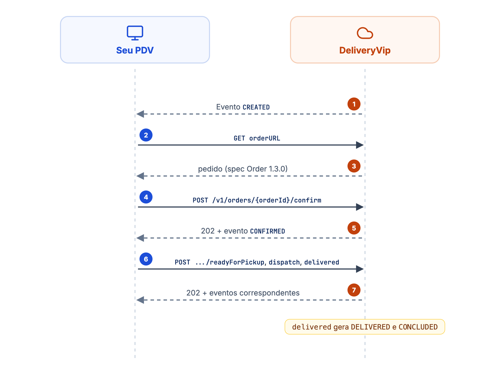
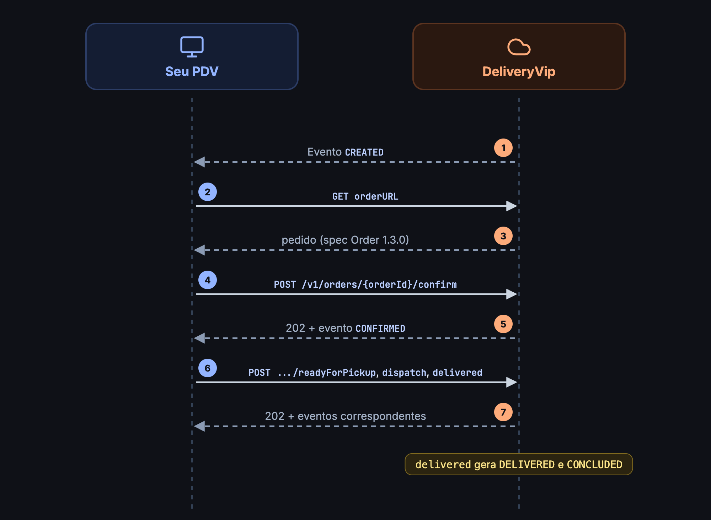

O fluxo típico: você recebe um evento `CREATED` (via [webhook ou polling](/guides/open-delivery/recebendo-eventos)), busca os detalhes do pedido pela `orderURL` do evento e vai transicionando o status conforme o pedido avança no seu PDV. Cada transição gera um evento, que chega pelo mesmo canal.

<Frame caption="O pedido do evento CREATED à entrega">
  
  
</Frame>

## Obter detalhes do pedido

<CodeGroup>
```bash cURL
curl --request GET 'https://od.deliveryvip.com.br/v1/orders/{orderId}' \
  --header 'Authorization: Bearer {token}'
```

```js Node.js
const response = await fetch(event.orderURL, {
  headers: { Authorization: `Bearer ${token}` },
})
const order = await response.json()
```

```python Python
response = requests.get(event["orderURL"], headers={"Authorization": f"Bearer {token}"})
order = response.json()
```
</CodeGroup>

O formato do objeto de pedido segue a spec **Order `1.3.0`** do [Open Delivery](https://www.opendelivery.com.br); consulte a spec oficial para o schema completo. As datas vêm em UTC.

<Info>
Prefira usar a `orderURL` que chega no evento em vez de montar a URL manualmente. Pedidos ainda aguardando pagamento online (ou que expiraram sem pagamento) não são expostos: a API responde `404` para eles.
</Info>

## Ciclo por tipo de pedido

O ciclo segue a spec Order `1.3.0` e muda conforme o `orderType`. Um pedido pode ser cancelado em qualquer etapa antes de `CONCLUDED`.

<Tabs>
  <Tab title="Entrega (DELIVERY)">
    <Steps>
      <Step title="Confirmar">
        `confirm` gera `CONFIRMED`.
      </Step>
      <Step title="Pronto para retirada (opcional)">
        `readyForPickup` gera `READY_FOR_PICKUP`: o pedido está pronto e aguarda o entregador. Você pode pular esta etapa e despachar direto.
      </Step>
      <Step title="Despachar">
        `dispatch` gera `DISPATCHED`.
      </Step>
      <Step title="Concluir">
        `delivered` gera `DELIVERED` e `CONCLUDED`. Pela spec, essa chamada é opcional e só cabe quando a entrega é feita pela própria loja. Sem ela, o pedido é concluído quando a loja finaliza a entrega no painel ou quando o parceiro de logística confirma a entrega, com os mesmos eventos.
      </Step>
    </Steps>
  </Tab>
  <Tab title="Retirada e consumo no local (TAKEOUT, INDOOR)">
    <Steps>
      <Step title="Confirmar">
        `confirm` gera `CONFIRMED`.
      </Step>
      <Step title="Pronto para retirada">
        `readyForPickup` gera `READY_FOR_PICKUP`: o pedido aguarda o cliente.
      </Step>
      <Step title="Concluir">
        O pedido é concluído (`CONCLUDED`) quando o cliente retira. A spec `1.3.0` não tem uma ação de retirada: normalmente quem conclui é a loja, no painel. Se o seu PDV controla a retirada, chame `delivered`. Nesses tipos de pedido, ele conclui o pedido.
      </Step>
    </Steps>
  </Tab>
</Tabs>

<Warning>
Na conclusão de retirada e consumo no local, a DeliveryVip emite `PICKED_UP` antes de `CONCLUDED`. `PICKED_UP` não faz parte da spec `1.3.0`: se o seu sistema não conhece o tipo, confirme o recebimento e ignore. O que marca o fim do ciclo é o `CONCLUDED`.
</Warning>

`PICKUP_AREA_ASSIGNED`, previsto na spec para retirada com área designada, ainda não é emitido pela DeliveryVip.

## Transicionar o status

As transições são feitas via `POST /v1/orders/{orderId}/{ação}`, sem corpo (exceto o rastreio):

<CodeGroup>
```bash cURL
curl --request POST 'https://od.deliveryvip.com.br/v1/orders/{orderId}/confirm' \
  --header 'Authorization: Bearer {token}'
```

```js Node.js
const response = await fetch(`https://od.deliveryvip.com.br/v1/orders/${orderId}/confirm`, {
  method: 'POST',
  headers: { Authorization: `Bearer ${token}` },
})
console.log(response.status) // 202; 422 se o pedido não aceita a ação
```

```python Python
response = requests.post(
    f"https://od.deliveryvip.com.br/v1/orders/{order_id}/confirm",
    headers={"Authorization": f"Bearer {token}"},
)
print(response.status_code)  # 202; 422 se o pedido não aceita a ação
```
</CodeGroup>

| Ação | Descrição | Resposta | Evento gerado |
| ---- | --------- | -------- | ------------- |
| `confirm` | Confirma o pedido. | `202` | `CONFIRMED` |
| `readyForPickup` | Pedido pronto: aguardando o entregador (entrega) ou o cliente (retirada e consumo no local). | `202` | `READY_FOR_PICKUP` |
| `dispatch` | Pedido de entrega saiu para entrega. Pode ser chamado direto após `confirm`; `readyForPickup` antes é opcional. Se o pedido já foi despachado, responde `422`. Nos demais tipos, conclui o pedido, como o `delivered`. | `202` | `DISPATCHED` (nos demais tipos, os mesmos eventos do `delivered`) |
| `delivered` | Pedido concluído. Em entrega: se o pedido ainda não tinha sido despachado, o despacho é registrado antes. Em retirada e consumo no local: se o pedido ainda estava em preparo, ele é marcado como pronto antes. | `202` | Entrega: `DELIVERED` e `CONCLUDED`, precedidos de `DISPATCHED` se faltava o despacho. Demais tipos: `PICKED_UP` e `CONCLUDED`, precedidos de `READY_FOR_PICKUP` se o pedido ainda estava em preparo |
| `requestCancellation` | Cancela o pedido. Se houver entrega ativa com parceiro de logística, ela é cancelada automaticamente. Pedido concluído não pode ser cancelado e responde `422`. | `200` | `CANCELLED` |
| `acceptCancellation` | Compatibilidade com a spec. | `200` | - |
| `denyCancellation` | Compatibilidade com a spec. | `200` | - |
| `tracking` | Envia dados de rastreio da entrega. | `202` | - |

As respostas de sucesso trazem o `id` do pedido: `{"id": "64939842-..."}`. Uma ação que o estado atual do pedido não aceita (por exemplo, despachar um pedido já cancelado) responde `422`.

<Note>
A API também aceita `preparing` e `pickedUp`, que vêm de versões mais novas do Open Delivery e não fazem parte da spec `1.3.0`. Você não precisa deles: depois do `confirm`, o pedido já está em preparo, e a retirada se conclui com `delivered`.
</Note>

## Fluxo de cancelamento

* **Você quer cancelar**: envie `requestCancellation`. O pedido é **cancelado na hora**, a resposta é `200` e o evento `CANCELLED` é emitido. Não há etapa de aprovação.
* **Cancelamento do lado da plataforma**: quando a loja ou a plataforma cancela, você recebe direto o evento `CANCELLED`.

<Note>
`acceptCancellation` e `denyCancellation` existem por compatibilidade com a spec e respondem `200` sem alterar o pedido. Hoje a DeliveryVip não emite `ORDER_CANCELLATION_REQUEST`, então você não precisa chamá-los.
</Note>

## Rastreio da entrega

O `tracking` recebe os dados de rastreio no formato da spec: último evento da entrega, problemas, veículo, previsão de chegada, entregador e localização. É o mesmo formato da API Merchant V3; veja os campos em [Tracking](/guides/merchant/order/fluxo-de-integracao/acoes-de-pedidos#tracking). Um corpo fora do schema responde `422`.

## Eventos emitidos pela plataforma

Além dos eventos que refletem as suas ações, a plataforma emite eventos originados do lado dela, como `CREATED` (novo pedido), `CONCLUDED` e `CANCELLED`. A lista completa de tipos está em [Recebendo eventos](/guides/open-delivery/recebendo-eventos#tipos-de-evento). Confirme cada um com o [acknowledgment](/guides/open-delivery/recebendo-eventos#acknowledgment) se você também usa o polling.
