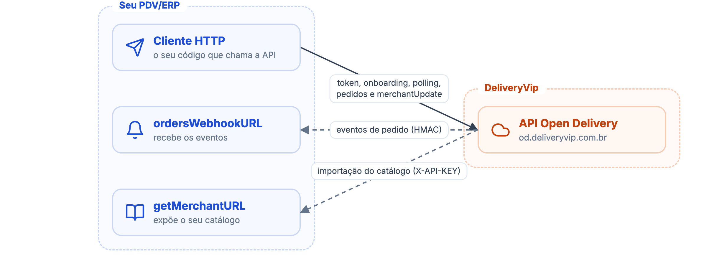
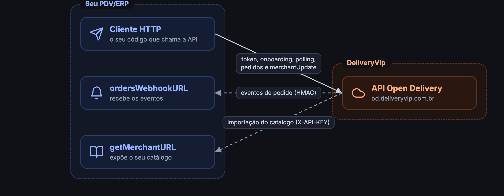

O [**Open Delivery**](https://www.opendelivery.com.br) é uma especificação aberta brasileira que padroniza a integração entre plataformas de pedidos e sistemas de PDV/gestão. Se o seu sistema já fala Open Delivery, você integra com a DeliveryVip sem escrever código específico da nossa API proprietária.

## Papéis

Na terminologia do Open Delivery:

| Papel | Quem | O que faz |
| ----- | ---- | --------- |
| **Ordering App** | DeliveryVip | Origem dos pedidos: emite eventos, expõe os pedidos e recebe as transições de status. |
| **Merchant** | Seu PDV/ERP | Recebe eventos, consulta pedidos, transiciona status e pode expor seu catálogo no padrão OD para a plataforma importar. |

## Quem chama quem

As chamadas acontecem nos dois sentidos. Você chama a API OD da DeliveryVip com um token OAuth por loja; a DeliveryVip chama o seu webhook e o seu endpoint de catálogo.

<Frame caption="Quem chama quem no Open Delivery">
  
  
</Frame>

## Versões suportadas

| Spec | Versão |
| ---- | ------ |
| Order | `1.3.0` |
| Merchant | `1.0.0` |

Os métodos de entrega de eventos disponíveis são **WEBHOOK** e **POLLING**. Recomendamos webhook como canal principal e polling como reconciliação; veja [Recebendo eventos](/guides/open-delivery/recebendo-eventos).

Você pode consultar as versões em tempo de execução pelos endpoints de versão; veja [Primeiros passos](/guides/open-delivery/primeiros-passos).

## Um app, várias lojas

Você cadastra **um único app** com a extensão Open Delivery e ele atende todas as lojas que o instalarem. Cada loja instalada recebe:

* um **`client_secret` próprio** (o `client_id` é o do app): o token emitido com ele vale só para aquela loja, e é com ele que os webhooks da loja são assinados;
* a **própria configuração**: `merchantId`, URL de webhook e endpoint de catálogo, definidos no [onboarding](/guides/open-delivery/onboarding-de-lojas);
* o **próprio circuito de webhooks**: uma loja com endpoint fora do ar não interrompe as entregas das demais.

## Host da API

A API Open Delivery da DeliveryVip roda em um host dedicado:

```
https://od.deliveryvip.com.br
```

Os endpoints da spec ficam sob o prefixo `/v1`. O endpoint de token OAuth fica na **raiz** desse host (`POST /oauth/token`), fora do `/v1`, porque a spec OD pede uma baseURL de autenticação separada.

<Tip>
Se o seu sistema monta as rotas direto na URL base, sem o `/v1` (padrão das primeiras versões do Open Delivery), configure a URL base da API como `https://od.deliveryvip.com.br/v1` e mantenha a URL de login em `https://od.deliveryvip.com.br`. Um `404` em todas as chamadas costuma ser esse caso.
</Tip>

## Datas em UTC

As datas da API Open Delivery são em **UTC** (RFC 3339, sufixo `Z`, ex.: `2026-08-10T17:39:28Z`), conforme exigido pela spec OD. Note a diferença para a API Merchant V3, que usa UTC-3; veja [Datas e horários](/inicio/conceitos/datas-e-horarios). Isso vale também para o `createdAt` dos eventos entregues por webhook.

## Open Delivery ou API Merchant V3?

<CardGroup cols={2}>
<Card title="Open Delivery" icon="right-left">
Para quando o seu sistema já implementa (ou vai implementar) o padrão para integrar com múltiplas plataformas. Você reaproveita a mesma integração.
</Card>
<Card title="API Merchant V3" icon="store" href="/guides/merchant">
Para acessar os recursos proprietários da plataforma que vão além da spec, como Indoor (comandas e places), descontos e a API de catálogo própria.
</Card>
</CardGroup>

Os dois caminhos são independentes: o formato dos objetos (pedido, catálogo) no Open Delivery segue a [spec oficial](https://www.opendelivery.com.br), e esta seção documenta apenas o que é específico da DeliveryVip.

## Comece por aqui

<CardGroup cols={2}>
<Card title="Primeiros passos" icon="rocket" href="/guides/open-delivery/primeiros-passos">
Crie o app, receba a credencial da loja e obtenha o token.
</Card>
<Card title="Onboarding de lojas" icon="store" href="/guides/open-delivery/onboarding-de-lojas">
Registre `merchantId`, webhook e endpoint de catálogo de cada loja.
</Card>
<Card title="Recebendo eventos" icon="bell" href="/guides/open-delivery/recebendo-eventos">
Webhook assinado como canal principal e polling como reconciliação.
</Card>
<Card title="Ciclo de vida do pedido" icon="arrows-rotate" href="/guides/open-delivery/ciclo-de-vida-do-pedido">
Detalhes do pedido e as transições de status.
</Card>
<Card title="Seu primeiro pedido" icon="rocket" href="/guides/open-delivery/primeiro-pedido">
Um programa completo: webhook assinado, confirmação do pedido e reconciliação pelo polling.
</Card>
</CardGroup>
