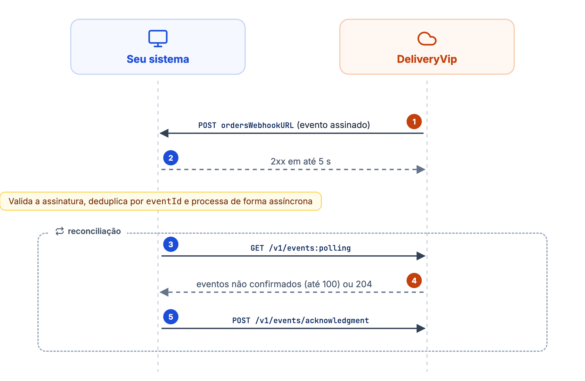
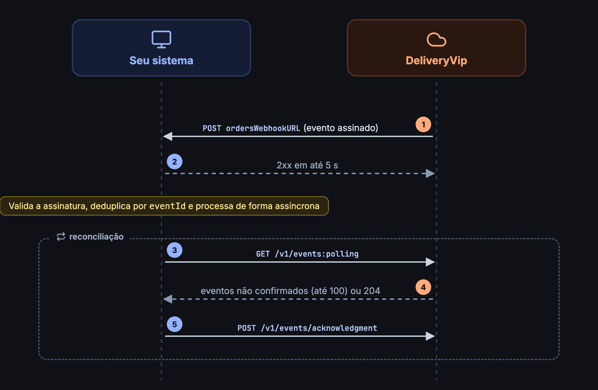

A DeliveryVip entrega eventos de pedido pelos dois métodos previstos na spec Order `1.3.0`: **WEBHOOK** e **POLLING**. Recomendamos o **webhook como canal principal** e o **polling como reconciliação**: se o seu endpoint ficar fora do ar, os eventos das últimas 24 horas seguem consultáveis no polling.

<Frame caption="Webhook como canal principal e polling como reconciliação">
  
  
</Frame>

## Estrutura do evento

```json
{
  "eventId": "9a24ea9e-5743-4957-9b83-7a4b4f2a4597",
  "eventType": "CREATED",
  "orderId": "64939842-b9d7-44d1-a0fd-f68d18d410a6",
  "orderURL": "https://od.deliveryvip.com.br/v1/orders/64939842-b9d7-44d1-a0fd-f68d18d410a6",
  "orderType": "DELIVERY",
  "merchantId": "loja-centro-001",
  "createdAt": "2026-08-07T15:00:00Z"
}
```

<ResponseField name="eventId" type="string">
Identificador único do evento. Use para deduplicação e no acknowledgment.
</ResponseField>
<ResponseField name="eventType" type="string">
Tipo do evento; veja a lista abaixo.
</ResponseField>
<ResponseField name="orderId" type="string">
Identificador do pedido.
</ResponseField>
<ResponseField name="orderURL" type="string">
URL do pedido na API OD. Use-a para [obter os detalhes](/guides/open-delivery/ciclo-de-vida-do-pedido).
</ResponseField>
<ResponseField name="orderType" type="string">
`DELIVERY`, `TAKEOUT` ou `INDOOR`.
</ResponseField>
<ResponseField name="merchantId" type="string">
O `merchantId` configurado no [onboarding](/guides/open-delivery/onboarding-de-lojas), ou o id interno da loja, se não configurado.
</ResponseField>
<ResponseField name="createdAt" type="string">
Data e hora do evento em RFC 3339, em **UTC** (sufixo `Z`), tanto no polling quanto no webhook. Veja [Datas e horários](/inicio/conceitos/datas-e-horarios).
</ResponseField>
<ResponseField name="metadata" type="object">
Dados extras de alguns eventos, como o motivo de um cancelamento. Só vem quando há conteúdo.
</ResponseField>

### Tipos de evento

| Evento | Quando |
| ------ | ------ |
| `CREATED` | Novo pedido. |
| `CONFIRMED` | Pedido confirmado. |
| `PREPARING` | Pedido em preparo. Fora da spec `1.3.0`; veja abaixo. |
| `READY_FOR_PICKUP` | Pedido pronto para retirada. |
| `DISPATCHED` | Pedido despachado para entrega. |
| `PICKED_UP` | Pedido de retirada ou consumo no local retirado pelo cliente; vem logo antes do `CONCLUDED`. Fora da spec `1.3.0`; veja abaixo. |
| `DELIVERED` | Pedido entregue. |
| `CONCLUDED` | Pedido concluído. Fim do ciclo. |
| `CANCELLED` | Pedido cancelado, pela loja, pelo seu sistema ou pela plataforma. |

`PREPARING` e `PICKED_UP` vêm de versões mais novas do Open Delivery e não estão no enum da spec `1.3.0`. A DeliveryVip pode emiti-los mesmo que você nunca chame `preparing` ou `pickedUp`: basta que a loja ou outra integração faça essa transição. O fim do ciclo é sempre marcado pelo `CONCLUDED`.

`PICKUP_AREA_ASSIGNED`, `CANCELLATION_REQUESTED`, `CANCELLATION_REQUEST_DENIED` e `ORDER_CANCELLATION_REQUEST` existem na spec e são aceitos no filtro `eventType`, mas **a DeliveryVip ainda não os emite**. Trate tipos desconhecidos confirmando o recebimento e seguindo em frente.

## Webhook (canal principal)

A URL de webhook é configurada **por loja**, no [onboarding](/guides/open-delivery/onboarding-de-lojas) (`ordersWebhookURL`) ou pelo formulário do painel de developers. Lojas sem URL própria caem na URL de webhook geral do app, se você tiver configurado uma.

Cada evento é enviado **individualmente** via `POST` na URL da loja, com o mesmo JSON dos eventos do polling e os headers:

| Header | Descrição |
| ------ | --------- |
| `X-App-Id` | Identificador **fixo** da DeliveryVip como plataforma emissora: `019efa90-dcd1-7846-983d-6bab871b2f6b`. É o mesmo valor em todas as entregas, para todos os apps, e **não** é o id do seu app. Use-o como checagem simples de origem; a validação que importa é a assinatura. |
| `X-App-MerchantId` | O `merchantId` da loja do evento. |
| `X-App-Signature` | **HMAC-SHA256** (hex minúsculo) do corpo bruto da requisição, assinado com o **`client_secret` da loja** (`ods_...`). |
| `User-Agent` | `DeliveryVip` |
| `Content-Type` | `application/json` |

### Validando a assinatura

A chave é o `client_secret` **da loja** que você recebeu na instalação, o mesmo que você usa para pedir o token dela. Use o `X-App-MerchantId` para descobrir de qual loja é o evento e escolher o secret certo. Só lojas sem credencial própria (integrações antigas, anteriores à extensão Open Delivery) são assinadas com o `client_secret` do app.

Recompute o HMAC sobre o **corpo bruto** recebido, antes de qualquer parse, e compare com o header em tempo constante:

<CodeGroup>
```js Node.js (Express)
import crypto from 'node:crypto'
import express from 'express'

const app = express()

app.post('/webhooks/deliveryvip', express.raw({ type: 'application/json' }), (req, res) => {
  const secret = storeSecretFor(req.get('X-App-MerchantId')) // o ods_... da loja, do seu banco
  const expected = crypto.createHmac('sha256', secret).update(req.body).digest('hex')
  const received = req.get('X-App-Signature') ?? ''

  const valid =
    received.length === expected.length &&
    crypto.timingSafeEqual(Buffer.from(expected), Buffer.from(received))
  if (!valid) return res.status(401).end()

  const event = JSON.parse(req.body) // parse só depois de validar
  enqueue(event) // processe de forma assíncrona
  res.status(200).end()
})
```

```python Python (Flask)
import hashlib
import hmac

from flask import Flask, abort, request

app = Flask(__name__)


@app.post("/webhooks/deliveryvip")
def webhook():
    secret = store_secret_for(request.headers.get("X-App-MerchantId"))  # o ods_... da loja
    raw = request.get_data()  # bytes exatamente como chegaram
    expected = hmac.new(secret.encode(), raw, hashlib.sha256).hexdigest()
    if not hmac.compare_digest(expected, request.headers.get("X-App-Signature", "")):
        abort(401)

    enqueue(request.get_json())  # processe de forma assíncrona
    return "", 200
```

```ruby Ruby (Rails)
secret = store_secret_for(request.headers["X-App-MerchantId"])
expected = OpenSSL::HMAC.hexdigest("SHA256", secret, request.raw_post)
valid = ActiveSupport::SecurityUtils.secure_compare(expected, request.headers["X-App-Signature"].to_s)
```
</CodeGroup>

<Danger>
Valide sobre os **bytes como chegaram**. Fazer parse e re-serializar o JSON muda espaçamento, escapes e números, e o digest não bate. A assinatura cobre só o corpo e não tem timestamp: um reenvio repete o mesmo `eventId`, por isso a deduplicação é obrigatória.
</Danger>

### O que seu endpoint deve fazer

* Responder **2xx em até 5 segundos** (3 s para conectar, 5 s para ler). Se o processamento for demorado, processe de forma **assíncrona**.
* Validar a assinatura antes de processar.
* Deduplicar por `eventId`.

### Reentrega e suspensão

| Resposta do seu endpoint | O que a DeliveryVip faz |
| ------------------------ | ----------------------- |
| Qualquer `2xx` | Entrega concluída. |
| `408` ou `429` | Tenta de novo, até **3 tentativas** no total. |
| Timeout ou erro de conexão | Tenta de novo, até **3 tentativas** no total. |
| Qualquer outro código, **inclusive `5xx`** | Falha definitiva na primeira tentativa. Reenvio manual pelo painel de developers. |

* **Toda tentativa que falha conta** para a suspensão, inclusive as retentativas. Uma entrega bem-sucedida zera a contagem.
* Ao atingir **10, 20 e 25 falhas consecutivas** em uma loja, o e-mail de contato do app recebe um alerta com o nome da loja e o motivo da última falha.
* Na **30ª falha consecutiva**, as entregas daquela **loja** são **suspensas**, e chega um e-mail de suspensão. As demais lojas continuam recebendo normalmente.
* Entregas que ainda estavam em nova tentativa quando a loja foi suspensa passam a falha (`Webhook suspended`) e podem ser reenviadas pelo painel.

Para religar as entregas de uma loja suspensa, depois de corrigir o endpoint:

* reenvie o [onboarding](/guides/open-delivery/onboarding-de-lojas) da loja; **ou**
* use o botão **"Reativar envio de webhooks"** no painel de developers; **ou**
* salve novamente os dados da loja no formulário do painel.

<Tip>
Enquanto as entregas estiverem suspensas, os eventos continuam disponíveis no polling por 24 horas. Use-o para recuperar o que ficou para trás.
</Tip>

## Polling (reconciliação)

### Consultar eventos

<CodeGroup>
```bash cURL
curl --request GET 'https://od.deliveryvip.com.br/v1/events:polling' \
  --header 'Authorization: Bearer {token}'
```

```js Node.js
const response = await fetch('https://od.deliveryvip.com.br/v1/events:polling', {
  headers: { Authorization: `Bearer ${token}` },
})
const events = response.status === 204 ? [] : await response.json()
```

```python Python
response = requests.get(
    "https://od.deliveryvip.com.br/v1/events:polling",
    headers={"Authorization": f"Bearer {token}"},
)
events = [] if response.status_code == 204 else response.json()
```
</CodeGroup>

Retorna os eventos das **últimas 24 horas** ainda não confirmados pelo seu app, no máximo **100 por chamada**, sempre do mais antigo para o mais recente. Quando não há eventos, a resposta é **204 No Content**.

<Warning>
**Fila com mais de 100 eventos.** Se a resposta vier com 100 eventos, há mais eventos pendentes na fila: envie o acknowledgment e consulte novamente **imediatamente**, até receber menos de 100 eventos (ou 204).
</Warning>

### Filtros

Os filtros podem ser combinados, e um valor inválido em qualquer filtro retorna **403 Forbidden**. Os parâmetros de array seguem a serialização padrão da spec OpenAPI (`style: form`, `explode: true`): repita o parâmetro na query, uma vez por valor, sem colchetes.

<ParamField query="eventType" type="string[]">
Tipos de evento: `?eventType=CREATED&eventType=CANCELLED`.
</ParamField>

<ParamField query="orderType" type="string[]">
Tipos de pedido, `DELIVERY`, `TAKEOUT` ou `INDOOR`: `?orderType=DELIVERY&orderType=TAKEOUT`.
</ParamField>

<Note>
O token por loja já restringe o polling àquela loja, então não é preciso filtrar por loja. O header `x-polling-merchants` da spec só tem efeito em integrações antigas, com um token para várias lojas.
</Note>

### Acknowledgment

Confirme os eventos processados para que saiam das próximas consultas. Envie um array com o `eventId` de cada evento no campo `id`.

<CodeGroup>
```bash cURL
curl --request POST 'https://od.deliveryvip.com.br/v1/events/acknowledgment' \
  --header 'Authorization: Bearer {token}' \
  --header 'Content-Type: application/json' \
  --data '[{ "id": "9a24ea9e-5743-4957-9b83-7a4b4f2a4597" }]'
```

```js Node.js
await fetch('https://od.deliveryvip.com.br/v1/events/acknowledgment', {
  method: 'POST',
  headers: { Authorization: `Bearer ${token}`, 'Content-Type': 'application/json' },
  body: JSON.stringify(events.map(({ eventId }) => ({ id: eventId }))),
})
```

```python Python
requests.post(
    "https://od.deliveryvip.com.br/v1/events/acknowledgment",
    headers={"Authorization": f"Bearer {token}"},
    json=[{"id": event["eventId"]} for event in events],
)
```
</CodeGroup>

```json Resposta (202)
{ "total": 1 }
```

A operação é **idempotente**: confirmar o mesmo evento duas vezes não causa erro. Eventos não confirmados continuam sendo retornados (os mais antigos primeiro) até serem confirmados ou saírem da janela de 24 horas.

<Danger>
Eventos entregues por webhook **também** aparecem no polling até serem confirmados. Se você usa os dois canais, envie o acknowledgment dos eventos já processados via webhook, ou trate o polling como reconciliação deduplicando por `eventId`.
</Danger>

## Erros comuns

| Sintoma | Causa | Como resolver |
| --- | --- | --- |
| Assinatura nunca confere | Validando com o secret do app, ou sobre o JSON re-serializado | Use o `client_secret` da loja (`ods_...`) e o corpo bruto |
| Os mesmos eventos voltam em toda chamada do polling | Acknowledgment não enviado, ou enviado com `eventId` em vez de `id` | Envie `[{ "id": "<eventId>" }]` para cada evento |
| Entregas pararam de chegar | Loja suspensa após 30 falhas consecutivas | Corrija o endpoint e reative (onboarding, botão ou formulário) |
| `5xx` do seu lado e o evento não voltou | `5xx` é falha definitiva, sem retentativa | Recupere pelo polling ou pelo reenvio manual no painel |
| `403` no polling | Valor inválido em `eventType` ou `orderType` | Use só os valores da lista |
