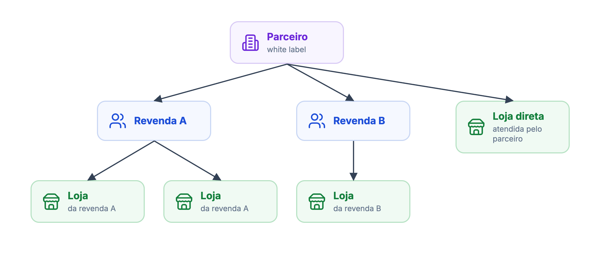
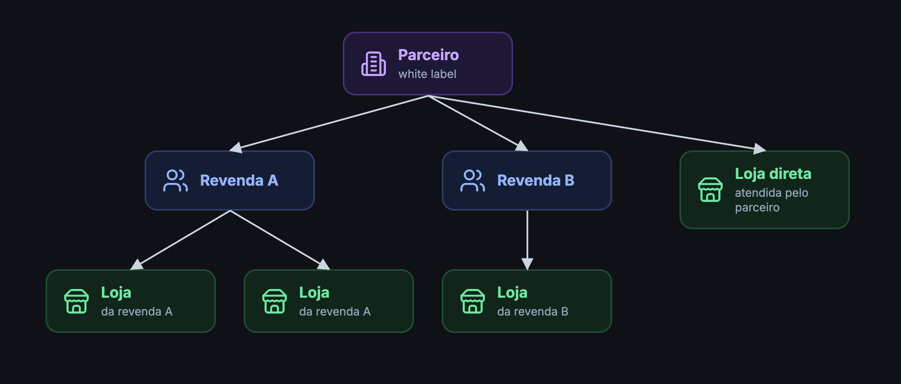

A Partner API é para quem administra uma rede de lojas na DeliveryVip: **parceiros** (white label) e as **revendas** deles. Com ela você cadastra lojas, controla assinaturas e recursos contratados, gerencia quem acessa cada painel e consulta vendas e faturas, tudo a partir do seu próprio sistema.

<Info>
Vai integrar um PDV para receber pedidos de uma loja? Esse é o papel da [Merchant API](/guides/merchant). A Partner API cuida da gestão comercial da rede, não da operação de pedidos.
</Info>

## Hierarquia

Toda loja (merchant) pertence a um parceiro. Ela pode ser atendida **diretamente** pelo parceiro ou por uma **revenda** dele. A revenda também tem assinatura própria e só existe abaixo de um parceiro.

<Frame caption="A hierarquia de parceiro, revendas e lojas">
  
  
</Frame>

O token alcança tudo o que está abaixo de quem autorizou o seu app:

| Quem autorizou o app | Lojas | Revendas | Planos | Faturas |
| --- | --- | --- | --- | --- |
| **Parceiro** | Todas: diretas e das revendas | Lista, cria e gerencia | Todos os planos com visibilidade `PUBLIC`, `RESALE` ou `DIRECT_MERCHANT` | Todas, com preços do parceiro |
| **Revenda** | Só as lojas da revenda | Não acessa | Planos do parceiro com visibilidade `PUBLIC` ou `RESALE` | Só as das suas lojas |

## Autenticação

A Partner API usa OAuth2 com o scope **`dv.partner`**. O parceiro ou a revenda autoriza o seu app pelo token de autorização (veja [distribuição direta](/inicio/primeiros-passos/distribuicao-direta)) e você troca as credenciais por um token de acesso:

```bash
curl 'https://api.deliveryvip.com.br/authentication/v1/oauth/token' \
  --header 'Content-Type: application/x-www-form-urlencoded' \
  --data-urlencode 'grant_type=client_credentials' \
  --data-urlencode 'client_id={clientId}' \
  --data-urlencode 'client_secret={clientSecret}' \
  --data-urlencode 'scope=dv.partner'
```

Envie o token em todas as chamadas, no header `Authorization: Bearer {token}`. Todas as rotas ficam em `https://api.deliveryvip.com.br/partner/v2`. Detalhes de expiração e renovação em [Autenticação](/inicio/conceitos/autenticacao).

<Warning>
Um mesmo token pode representar mais de um parceiro ou revenda, se todos autorizaram o seu app. Nas listagens, use o header `x-partners` para receber dados de um só. Veja [Filtrar por Partners](/guides/partner/merchant/utilizando-a-api/listar-merchants#filtrar-por-partners).
</Warning>

## Primeira chamada: liste suas lojas

<Steps>
<Step title="Gere o token" icon="key">
Use o `client_credentials` acima com o scope `dv.partner`.
</Step>
<Step title="Liste as lojas" icon="store">
Chame `GET /partner/v2/merchants`. A resposta traz até as lojas das suas revendas.

<CodeGroup>
```bash cURL
curl 'https://api.deliveryvip.com.br/partner/v2/merchants' \
  --header 'Authorization: Bearer {token}'
```

```js Node.js
const response = await fetch('https://api.deliveryvip.com.br/partner/v2/merchants', {
  headers: { Authorization: `Bearer ${token}` },
})
const merchants = response.status === 204 ? [] : await response.json()
```

```python Python
response = requests.get(
    "https://api.deliveryvip.com.br/partner/v2/merchants",
    headers={"Authorization": f"Bearer {token}"},
)
merchants = [] if response.status_code == 204 else response.json()
```
</CodeGroup>
</Step>
<Step title="Guarde o seu partnerId" icon="id-card">
Cada loja traz `partnerId` (o parceiro) e, quando for de revenda, `resaleId`. As rotas de cadastro, planos e faturas usam esse ID no caminho: `/partner/v2/{partnerId}/...`.
</Step>
</Steps>

<Check>
`200 OK` com a lista de lojas, da mais recente para a mais antiga. `204 No Content` quer dizer que o token ainda não alcança nenhuma loja.
</Check>

## O que você pode fazer

<CardGroup cols={2}>
<Card title="Lojas" icon="store" href="/guides/partner/merchant">
Cadastre lojas, gerencie assinatura, recursos, membros e apps autorizados. Consulte vendas.
</Card>
<Card title="Revendas" icon="people-group" href="/guides/partner/resale">
Cadastre revendas e gerencie assinatura, membros e apps autorizados.
</Card>
<Card title="Planos" icon="layer-group" href="/guides/partner/plans">
Consulte os planos de cobrança que você usa nas assinaturas das lojas.
</Card>
<Card title="Faturas" icon="file-invoice-dollar" href="/guides/partner/invoices">
Consulte o fechamento mensal de cada loja e o resumo por revenda.
</Card>
<Card title="Cadastro" icon="user-plus" href="/guides/partner/signup">
Cadastre loja e proprietário a partir de uma landing page pública.
</Card>
<Card title="Referência" icon="code" href="/reference/partner/v2">
Todos os endpoints da Partner API V2.
</Card>
</CardGroup>

## Erros comuns

Os erros seguem o formato `{"status": "422", "title": "..."}`. Veja [Erros](/inicio/conceitos/erros).

| Status | Quando |
| --- | --- |
| `401 Unauthorized` | Token ausente, expirado ou revogado. |
| `403 Forbidden` | Token sem o scope `dv.partner`, `x-partners` ou `partnerId` fora do alcance do token, ou filtro de assinatura inválido. |
| `404 Not Found` | A loja, revenda, membro ou plano não existe ou não está abaixo de quem autorizou o app. |
| `422 Unprocessable Content` | Dados inválidos ou transição de assinatura não permitida. |

<Note>
A Partner API V1 foi descontinuada e suas rotas foram removidas. Use apenas a V2. Veja [Deprecações](/deprecations).
</Note>
