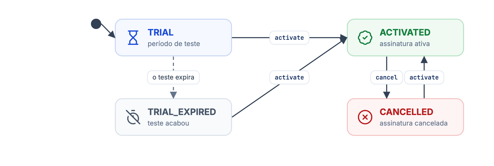
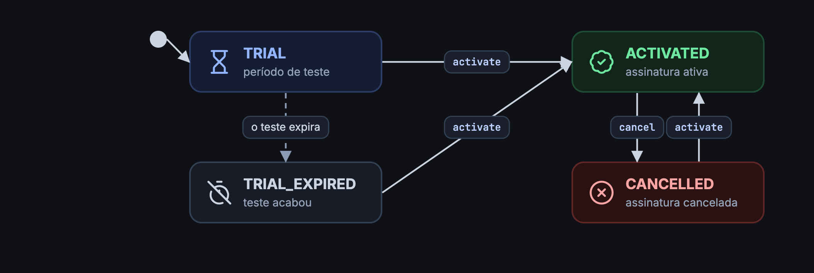

Os conceitos abaixo aparecem nas respostas da API de lojas e decidem quais ações são aceitas em cada momento.

## Tipos de Assinaturas

O campo `subscription.status` diz em que ponto da vida comercial a loja está.

| status | Descrição |
| --- | --- |
| `TRIAL` | Status inicial de toda loja nova. A loja usa a plataforma sem custo até `trialExpiresAt` (10 dias após o cadastro). |
| `TRIAL_EXPIRED` | O período de teste acabou sem ativação. A loja perde o acesso à plataforma. |
| `ACTIVATED` | Assinatura ativa e faturada. |
| `CANCELLED` | Assinatura cancelada. |
| `DEMO` | Loja de demonstração. É criada automaticamente junto com cada nova revenda e não pode ser ativada. |

## Ciclo de vida da assinatura

<Frame caption="Status da assinatura de uma loja">
  
  
</Frame>

<Info>
A expiração do teste é automática. Todas as outras transições são feitas pela API de [assinatura](/guides/partner/merchant/utilizando-a-api/gerenciar-assinatura-dos-merchants).
</Info>

## Aviso e bloqueio

Enquanto a assinatura está `ACTIVATED`, ela pode ter uma de duas sinalizações. Elas são exclusivas: ativar uma desliga a outra.

| Campo | Ação | Uso |
| --- | --- | --- |
| `warning` | `warning` / `unwarning` | Avisar a loja sobre um possível bloqueio, por exemplo por atraso de pagamento. |
| `blocked` | `block` / `unblock` | Bloquear o uso da loja. A assinatura continua `ACTIVATED` e continua sendo cobrada. |

`warning`, `blocked`, `lastWarningAt` e `lastBlockedAt` só aparecem na resposta quando o status é `ACTIVATED`.

## Status dos recursos

Cada item de `features` mostra um recurso da loja e se ele está contratado.

| status | Descrição |
| --- | --- |
| `AVAILABLE` | O recurso pode ser contratado. |
| `ACTIVATED` | O recurso está contratado. |
| `CANCELLED` | O recurso foi cancelado há menos de 24 horas ou no mês corrente. Depois disso volta a `AVAILABLE`. Em lojas `TRIAL` ou `DEMO`, um recurso cancelado aparece direto como `AVAILABLE`. |

Os tipos de recurso estão em [Gerenciar recursos](/guides/partner/merchant/utilizando-a-api/gerenciar-recursos-dos-merchants#sobre-os-recursos).

## Papéis de membros

| Papel | Envio | Resposta |
| --- | --- | --- |
| Proprietário | `owner` | `OWNER` |
| Gerente | `manager` | `MANAGER` |
| Operador | `operator` | `OPERATOR` |

O papel é enviado em minúsculas e volta em maiúsculas. Veja [Membros da loja](/guides/partner/merchant/utilizando-a-api/membros-do-merchant).
