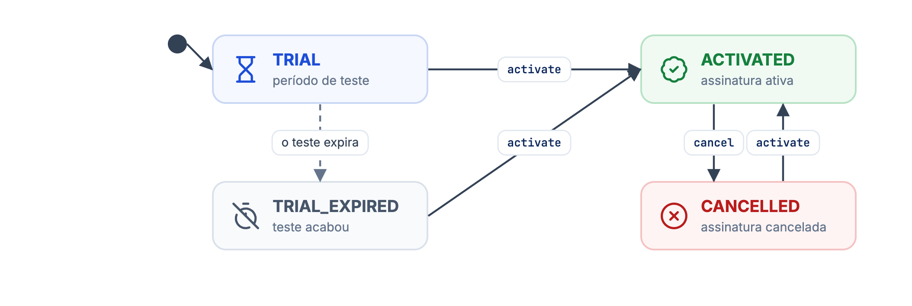
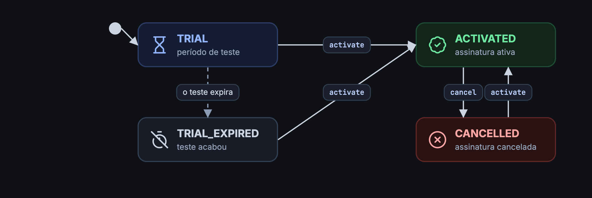

A assinatura da revenda usa os mesmos status e transições da assinatura das lojas, mas **não tem plano**: a cobrança da revenda vem dos preços que o parceiro define para ela.

## Tipos de Assinaturas

| status | Descrição |
| --- | --- |
| `TRIAL` | Status inicial de toda revenda nova. Dura 10 dias (`trialExpiresAt`). |
| `TRIAL_EXPIRED` | O período de teste acabou sem ativação. A revenda perde o acesso à plataforma. |
| `ACTIVATED` | Assinatura ativa. |
| `CANCELLED` | Assinatura cancelada. |
| `DEMO` | Assinatura de demonstração. Não pode ser ativada. |

## Ciclo de Vida da Assinatura

<Frame caption="Status da assinatura de uma revenda">
  
  
</Frame>

Enquanto `ACTIVATED`, a revenda pode estar em aviso (`warning`) ou bloqueada (`blocked`), exatamente como uma loja. Veja [Aviso e bloqueio](/guides/partner/merchant/definicoes#aviso-e-bloqueio).

## Efeito sobre as lojas da revenda

| Situação da revenda | Efeito nas lojas dela |
| --- | --- |
| Fora de `ACTIVATED` | Nenhuma loja da revenda pode ser ativada (`Partner subscription is not activated`). |
| Teste expirado, bloqueada ou cancelada | As lojas perdem a licença e não contratam recursos. |
| Cancelada pela API | Todas as lojas `ACTIVATED` da revenda são canceladas também. |
