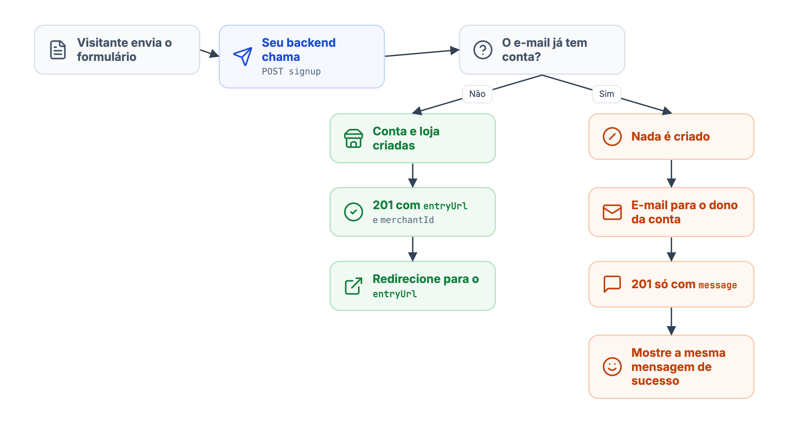
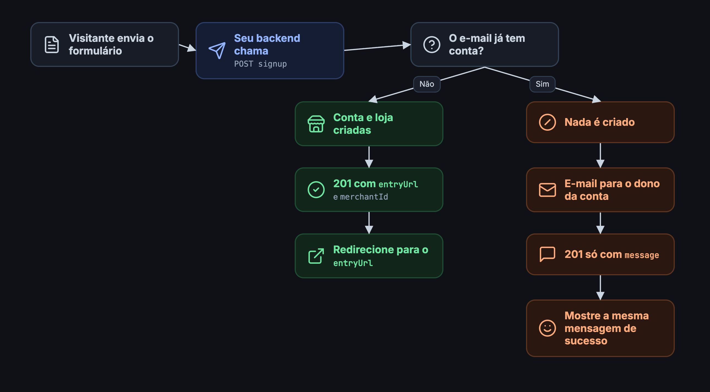

`POST /partner/v2/{partnerId}/signup` cria uma loja e a conta do proprietário a partir de uma **página pública** (landing page). A diferença para [Cadastrar uma loja](/guides/partner/merchant/utilizando-a-api/adicionar-um-merchant) é quem preenche o formulário: aqui é um visitante anônimo, não o seu backend. Por isso o endpoint nunca revela se um e-mail já tem conta e nunca dá acesso a uma conta existente.

<Warning>
O token `dv.partner` não pode ir para o navegador. A landing page envia o formulário ao **seu backend**, e é ele que chama este endpoint.
</Warning>

## Como funciona

<Frame caption="O fluxo do signup">
  
  
</Frame>

* **E-mail novo**: a conta e a loja são criadas (a loja nasce em `TRIAL`, no plano padrão do parceiro, com o visitante como `OWNER`). A resposta traz o `merchantId` e o `entryUrl`, um link de **uso único**, válido por **5 minutos**, que autentica o novo proprietário no painel.
* **E-mail já cadastrado**: nada é criado e nenhum acesso é concedido. O dono real da conta recebe um e-mail com os próximos passos. Uma conta existente nunca é vinculada a uma loja nova sem prova de posse.

<Warning>
A resposta é **intencionalmente a mesma** (`201`, mesma `message`) nos dois casos. **Não diferencie a interface**: use só a presença de `entryUrl` para decidir se redireciona o visitante.
</Warning>

## Corpo

<ParamField path="partnerId" type="uuid" required>
ID do parceiro ou de uma revenda. Com o ID de uma revenda, a loja nasce nela.
</ParamField>

<ParamField body="user" type="object" required>
Proprietário.

<Expandable title="propriedades">
<ParamField body="name" type="string" required>Nome.</ParamField>
<ParamField body="email" type="string" required>E-mail.</ParamField>
<ParamField body="password" type="string" required>Senha escolhida pelo proprietário, com no mínimo 6 caracteres. É com ela que ele acessa o painel depois.</ParamField>
<ParamField body="phone.number" type="string">Telefone.</ParamField>
</Expandable>
</ParamField>

<ParamField body="store" type="object" required>
Loja.

<Expandable title="propriedades">
<ParamField body="name" type="string" required>Nome fantasia.</ParamField>
<ParamField body="corporateName" type="string">Razão social. Sem ela, usa o nome fantasia.</ParamField>
<ParamField body="identifier" type="string" required>CNPJ ou CPF válido.</ParamField>
<ParamField body="email" type="string">E-mail da loja. Sem ele, usa o e-mail do proprietário.</ParamField>
<ParamField body="address" type="object" required>Endereço completo: `postalCode`, `street`, `number`, `district`, `city` e `state`, todos obrigatórios.</ParamField>
</Expandable>
</ParamField>

## Requisição

<CodeGroup>
```bash cURL
curl --request POST 'https://api.deliveryvip.com.br/partner/v2/{partnerId}/signup' \
  --header 'Authorization: Bearer {token}' \
  --header 'Content-Type: application/json' \
  --data '{
    "user": {
      "name": "Maria Silva",
      "email": "maria@exemplo.com.br",
      "password": "segredo123",
      "phone": { "number": "11999998888" }
    },
    "store": {
      "name": "Cantina da Maria",
      "corporateName": "Cantina da Maria LTDA",
      "identifier": "11222333000144",
      "email": "contato@cantinadamaria.com.br",
      "address": {
        "postalCode": "01310100",
        "street": "Avenida Paulista",
        "number": "1000",
        "district": "Bela Vista",
        "city": "São Paulo",
        "state": "SP"
      }
    }
  }'
```

```js Node.js
const response = await fetch(`https://api.deliveryvip.com.br/partner/v2/${partnerId}/signup`, {
  method: 'POST',
  headers: { Authorization: `Bearer ${token}`, 'Content-Type': 'application/json' },
  body: JSON.stringify({ user: form.user, store: form.store }),
})
const result = await response.json()

if (response.status === 201 && result.entryUrl) {
  // Redirect the visitor's browser to result.entryUrl
}
```

```python Python
response = requests.post(
    f"https://api.deliveryvip.com.br/partner/v2/{partner_id}/signup",
    headers={"Authorization": f"Bearer {token}"},
    json={"user": form["user"], "store": form["store"]},
)
result = response.json()

if response.status_code == 201 and result.get("entryUrl"):
    redirect_url = result["entryUrl"]
```
</CodeGroup>

## Respostas

<Tabs>
<Tab title="201 · e-mail novo">
Conta e loja criadas. Redirecione o visitante para o `entryUrl`.

```json
{
  "message": "Recebemos seu cadastro. Enviamos um e-mail com os próximos passos.",
  "entryUrl": "https://painel.seudominio.com.br/signup/entry?token=...",
  "merchantId": "261c2c8f-9b6a-4ce3-88ef-10b49d7d716d"
}
```

O host do `entryUrl` é o domínio do painel configurado para o parceiro, não um host fixo.
</Tab>
<Tab title="201 · e-mail cadastrado">
Nada foi criado. Mostre a mesma mensagem de sucesso; o dono da conta recebe um e-mail.

```json
{
  "message": "Recebemos seu cadastro. Enviamos um e-mail com os próximos passos."
}
```
</Tab>
<Tab title="403 · sem domínio">
O parceiro não tem domínio de painel configurado. Nada é criado.

```json
{ "status": "403", "title": "partner must be setup a domain to user access" }
```
</Tab>
<Tab title="422 · validação">
O `title` traz os erros por campo, com os nomes internos em snake\_case.

```json
{ "status": "422", "title": { "password": ["is too short (minimum is 6 characters)"] } }
```
</Tab>
</Tabs>

<Warning>
Configure o domínio do painel **antes** de publicar a landing page. Sem ele, todo cadastro é recusado com `403`.
</Warning>
