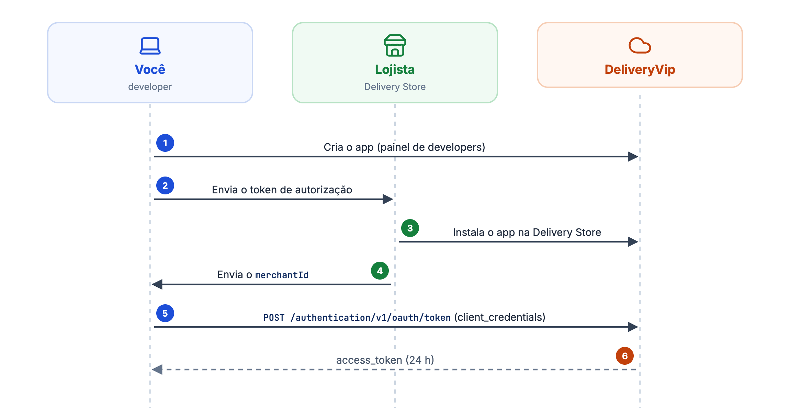
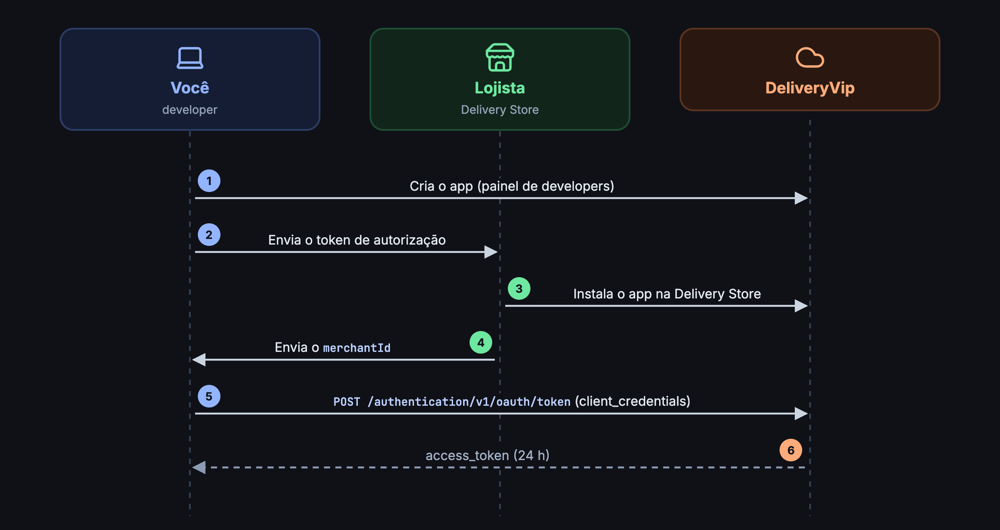
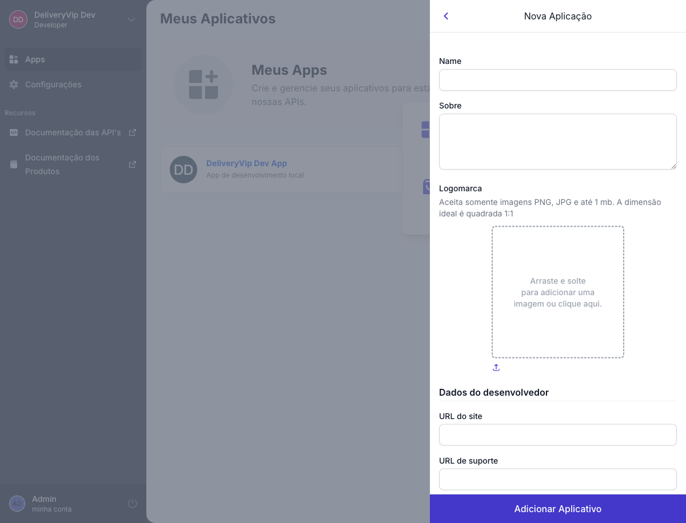
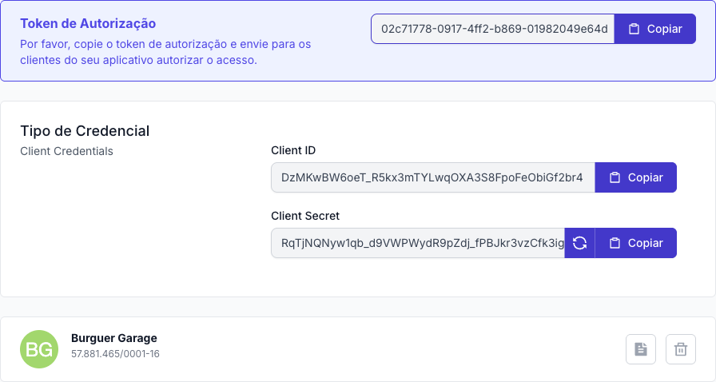

Na distribuição direta, você envia um **token de autorização** para o lojista (ou parceiro), ele instala o seu app pela Delivery Store e, a partir daí, o seu sistema obtém o token de acesso com o fluxo OAuth2 **client credentials**. Um único token atende todas as lojas que instalaram o app.

O app **não tem tela** para o lojista: ele conversa só com a API. É o caminho de PDVs, ERPs e integrações de servidor. Se o lojista vai usar uma interface do seu app, dentro ou fora do painel, veja a [distribuição interativa](/inicio/primeiros-passos/distribuicao-interativa).

<Frame caption="Distribuição direta">
  
  
</Frame>

## Criando o app

No painel de developers, clique em **Novo Aplicativo**, escolha **Distribuição direta** e preencha o formulário.

<Frame caption="Formulário de novo aplicativo com distribuição direta">
  
</Frame>

<AccordionGroup>
<Accordion title="Dados básicos" icon="id-card" defaultOpen>
| Campo | Descrição |
| --- | --- |
| **Nome** | Nome do app, exibido para o lojista na instalação. |
| **Sobre** | Descrição breve do que o app faz. |
| **Logomarca** | PNG ou JPG com menos de 1 MB. Prefira imagem quadrada (1:1). |
</Accordion>

<Accordion title="Dados do desenvolvedor" icon="building">
| Campo | Descrição |
| --- | --- |
| **URL do site** | Site da sua empresa. |
| **URL de suporte** | Página de suporte do app. |
| **E-mail de contato** | Para a DeliveryVip falar com você sobre o app e a API. Também recebe o aviso de cada nova instalação. |
</Accordion>

<Accordion title="Permissões" icon="shield-check">
Marque só as APIs que a integração usa. Elas viram os scopes que a loja autoriza na instalação.

| Permissão | Scope | Acesso |
| --- | --- | --- |
| Merchant API | `od.all` | Eventos, pedidos, catálogo, indoor, descontos e tools. |
| Fidelidade | `dv.loyalty` | Configuração do programa de fidelidade. Use junto com `od.all`. |
| Partner API | `dv.partner` | Lojas, revendas, assinaturas, recursos e faturas. |
| Marketplace API | `dv.marketplace` | API de marketplace. |
</Accordion>
</AccordionGroup>

## Credenciais

Ao salvar, o painel gera as credenciais. Abra o app para vê-las.

<Frame caption="Token de autorização e credenciais do app">
  
</Frame>

| Credencial | Para quê | Quem vê |
| --- | --- | --- |
| **Token de autorização** | O lojista cola esse valor na Delivery Store para encontrar e instalar o seu app. | Você envia para o lojista. |
| **Client ID** | Identifica o seu app. | Só o seu sistema. |
| **Client Secret** | Prova que a chamada vem do seu app ao pedir o token de acesso. | Só o seu sistema. |

<Danger>
Nunca exponha o **Client Secret** em código de front-end, app mobile, repositório ou mensagem. Se ele vazar, gere um novo no painel: o anterior deixa de funcionar.
</Danger>

## Instalando o app na loja

Envie o **token de autorização** para o lojista. Ele instala o app pela Delivery Store e, ao final, envia o **`merchantId`** da loja, que você usa nas chamadas por loja (`/merchant/v3/{merchantId}/...`).

<Card title="Instalando o app na loja" icon="download" href="/inicio/primeiros-passos/instalando-app-na-loja">
O passo a passo que o lojista segue, com as telas.
</Card>

## Obtendo o token de acesso

Com o app instalado, peça o token com as credenciais do app. Envie em `scope` os scopes do app de que você precisa, separados por espaço; sem `scope`, a API usa `od.all`.

<CodeGroup>
```bash cURL
curl --request POST 'https://api.deliveryvip.com.br/authentication/v1/oauth/token' \
  --header 'Content-Type: application/x-www-form-urlencoded' \
  --data-urlencode 'grant_type=client_credentials' \
  --data-urlencode 'client_id=<clientId>' \
  --data-urlencode 'client_secret=<clientSecret>' \
  --data-urlencode 'scope=od.all'
```

```js Node.js
const response = await fetch('https://api.deliveryvip.com.br/authentication/v1/oauth/token', {
  method: 'POST',
  headers: { 'Content-Type': 'application/x-www-form-urlencoded' },
  body: new URLSearchParams({
    grant_type: 'client_credentials',
    client_id: process.env.DV_CLIENT_ID,
    client_secret: process.env.DV_CLIENT_SECRET,
    scope: 'od.all',
  }),
})
const { access_token, expires_in } = await response.json()
```

```python Python
import os
import requests

response = requests.post(
    "https://api.deliveryvip.com.br/authentication/v1/oauth/token",
    data={
        "grant_type": "client_credentials",
        "client_id": os.environ["DV_CLIENT_ID"],
        "client_secret": os.environ["DV_CLIENT_SECRET"],
        "scope": "od.all",
    },
)
access_token = response.json()["access_token"]
```
</CodeGroup>

```json Resposta (200)
{
  "access_token": "{token}",
  "token_type": "Bearer",
  "expires_in": 86400,
  "scope": "od.all",
  "created_at": 1761750000
}
```

<Info>
O token vale **24 horas** e **não vem com `refresh_token`**: o fluxo client credentials não usa refresh. Quando ele expirar, peça um novo da mesma forma. Detalhes em [Autenticação](/inicio/conceitos/autenticacao).
</Info>

<AccordionGroup>
<Accordion title="Recebi invalid_scope" icon="triangle-exclamation">
O `scope` pedido inclui uma permissão que o app não tem. Peça só os scopes marcados no app, ou edite as permissões no painel.
</Accordion>
<Accordion title="O token funciona, mas não vejo a loja" icon="store-slash">
O token só alcança lojas que **instalaram** o app. Confira com o lojista se a instalação foi concluída na Delivery Store.
</Accordion>
</AccordionGroup>
