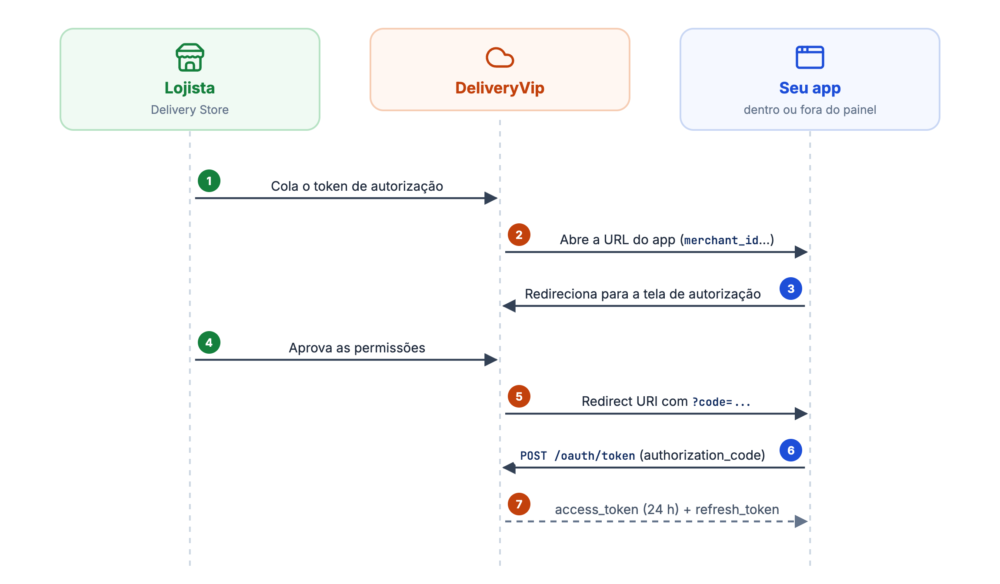
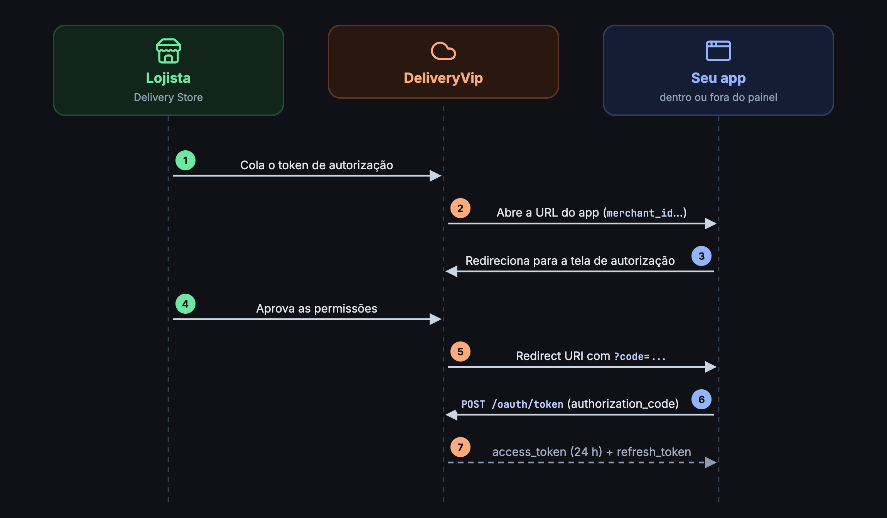
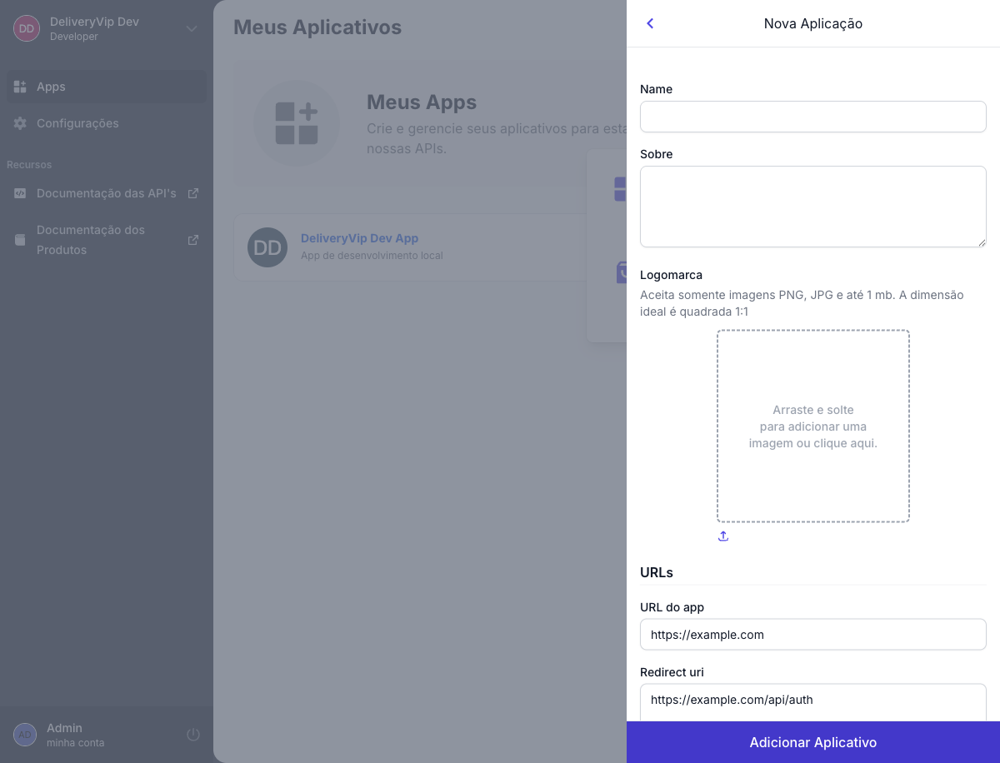
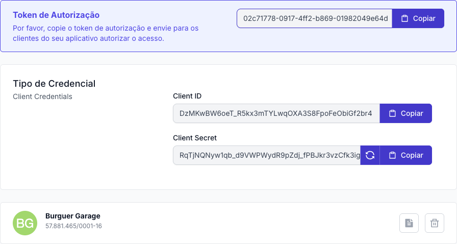

A instalação começa como na [distribuição direta](/inicio/primeiros-passos/distribuicao-direta): o lojista (ou o parceiro, ou o marketplace) cola o **token de autorização** do seu app na Delivery Store. A diferença vem depois:

* A loja é levada para a **URL do app**, que pode abrir **incorporada ao painel** da loja ou fora dele.
* O acesso é liberado pelo OAuth2 **authorization code**: a loja aprova as permissões e o seu sistema recebe um `code` na **Redirect URI**, que troca por um token de acesso.

## Como funciona

<Frame caption="Distribuição interativa">
  
  
</Frame>

## Criando o app

No painel de developers, clique em **Novo Aplicativo**, escolha **Distribuição interativa** e preencha o formulário.

<Frame caption="Formulário de novo aplicativo com distribuição interativa">
  
</Frame>

<AccordionGroup>
<Accordion title="Dados básicos" icon="id-card" defaultOpen>
| Campo | Descrição |
| --- | --- |
| **Nome** | Nome do app, exibido para o lojista. |
| **Sobre** | Descrição breve do que o app faz. |
| **Logomarca** | PNG ou JPG com menos de 1 MB. Prefira imagem quadrada (1:1). |
</Accordion>

<Accordion title="URLs" icon="link" defaultOpen>
| Campo | Descrição |
| --- | --- |
| **URL do app** | Para onde a Delivery Store leva o lojista ao abrir o seu app. Obrigatória na distribuição interativa. |
| **Redirect URI** | Para onde a DeliveryVip redireciona depois da autorização, com o `code` na query. Precisa usar `https://`. |
</Accordion>

<Accordion title="Dados do desenvolvedor" icon="building">
| Campo | Descrição |
| --- | --- |
| **URL do site** | Site da sua empresa. |
| **URL de suporte** | Página de suporte do app. |
| **E-mail de contato** | Para a DeliveryVip falar com você sobre o app e a API. |
</Accordion>

<Accordion title="Permissões" icon="shield-check">
| Permissão | Scope | Acesso |
| --- | --- | --- |
| Merchant API | `od.all` | Eventos, pedidos, catálogo, indoor, descontos e tools. |
| Fidelidade | `dv.loyalty` | Configuração do programa de fidelidade. Use junto com `od.all`. |
| Partner API | `dv.partner` | Lojas, revendas, assinaturas, recursos e faturas. |
| Marketplace API | `dv.marketplace` | API de marketplace. |
</Accordion>

<Accordion title="Incorporação e visibilidade" icon="eye">
| Opção | Descrição |
| --- | --- |
| **Incorporar o app ao painel** | O app abre dentro do painel do lojista, em um iframe. |
| **Não incorporar** (padrão) | O app abre fora do painel, numa página própria. |
</Accordion>
</AccordionGroup>

<Warning>
Cadastre a **Redirect URI** antes de tornar o app público. Sem ela, o lojista autoriza mas o seu sistema nunca recebe o `code`.
</Warning>

## Credenciais

Ao salvar, o painel gera o **token de autorização** (que você envia para a loja instalar, como na distribuição direta), o **Client ID** (identifica o app) e o **Client Secret** (prova que a chamada vem do seu app). Abra o app para vê-los.

<Frame caption="Credenciais do app">
  
</Frame>

<Danger>
Use o **Client Secret** só no seu servidor. Nunca o coloque no front-end, em app mobile ou no repositório. Se ele vazar, gere um novo no painel.
</Danger>

## Fluxo de autorização

<Steps>
<Step title="A loja abre o seu app">
Depois de colar o token de autorização na Delivery Store, o lojista é levado para a **URL do app**, incorporada ao painel ou não, com estes parâmetros na query:

<ParamField query="merchant_id" type="uuid">
ID da loja (ou do parceiro, ou do marketplace) que está abrindo o app.
</ParamField>
<ParamField query="site_url" type="string">
URL do painel daquela loja, codificada em **Base64**. É a base da tela de autorização.
</ParamField>
<ParamField query="embedded" type="0 | 1">
`1` quando o app abre incorporado ao painel.
</ParamField>
<ParamField query="embedded_url" type="string">
URL do app dentro do painel, em Base64. Enviado na instalação.
</ParamField>
</Step>

<Step title="Redirecione para a tela de autorização">
Decodifique o `site_url` e leve o lojista para `{site_url}/oauth/authorize` com os parâmetros OAuth2 padrão:

```text
{site_url}/oauth/authorize?response_type=code&client_id=<clientId>&redirect_uri=<redirectUri>&scope=od.all&state=<state>
```

O `redirect_uri` precisa ser exatamente uma das Redirect URIs cadastradas no app. Use `state` para amarrar a volta à sessão que iniciou o fluxo.
</Step>

<Step title="Receba o code">
Depois que o lojista aprova, a DeliveryVip redireciona para a sua Redirect URI com `code` (e o `state` que você enviou) na query.
</Step>

<Step title="Troque o code pelo token">
<CodeGroup>
```bash cURL
curl --request POST 'https://api.deliveryvip.com.br/authentication/v1/oauth/token' \
  --header 'Content-Type: application/x-www-form-urlencoded' \
  --data-urlencode 'grant_type=authorization_code' \
  --data-urlencode 'client_id=<clientId>' \
  --data-urlencode 'client_secret=<clientSecret>' \
  --data-urlencode 'code=<authorizationCode>' \
  --data-urlencode 'redirect_uri=<redirectUri>'
```

```js Node.js
const response = await fetch('https://api.deliveryvip.com.br/authentication/v1/oauth/token', {
  method: 'POST',
  headers: { 'Content-Type': 'application/x-www-form-urlencoded' },
  body: new URLSearchParams({
    grant_type: 'authorization_code',
    client_id: process.env.DV_CLIENT_ID,
    client_secret: process.env.DV_CLIENT_SECRET,
    code,
    redirect_uri: process.env.DV_REDIRECT_URI,
  }),
})
const { access_token, refresh_token } = await response.json()
```

```python Python
response = requests.post(
    "https://api.deliveryvip.com.br/authentication/v1/oauth/token",
    data={
        "grant_type": "authorization_code",
        "client_id": os.environ["DV_CLIENT_ID"],
        "client_secret": os.environ["DV_CLIENT_SECRET"],
        "code": code,
        "redirect_uri": os.environ["DV_REDIRECT_URI"],
    },
)
tokens = response.json()
```
</CodeGroup>

```json Resposta (200)
{
  "access_token": "{token}",
  "token_type": "Bearer",
  "expires_in": 86400,
  "refresh_token": "{refreshToken}",
  "scope": "od.all",
  "created_at": 1761750000
}
```

O `code` é de uso único. Guarde o `access_token` e o `refresh_token` associados à loja que autorizou.
</Step>
</Steps>

<Info>
O token de acesso vale **24 horas**. Para renovar sem pedir nova autorização ao lojista, use o `refresh_token`. Veja [Autenticação](/inicio/conceitos/autenticacao#renovando-com-refresh_token).
</Info>

<AccordionGroup>
<Accordion title="Recebi invalid_grant" icon="triangle-exclamation">
O `code` já foi usado, expirou, ou o `redirect_uri` enviado na troca é diferente do usado na autorização. Reinicie o fluxo de autorização.
</Accordion>
<Accordion title="A tela de autorização mostra erro de redirect_uri" icon="link-slash">
O `redirect_uri` não bate exatamente com nenhuma Redirect URI cadastrada no app (protocolo, host, caminho e barra final contam). Corrija no painel ou na URL.
</Accordion>
<Accordion title="Qual a diferença para a distribuição direta?" icon="circle-question">
Os dois tipos começam pelo token de autorização na Delivery Store. Na direta, a loja clica em **Instalar** e o seu sistema usa `client_credentials`, sem tela. Na interativa, a loja é levada para o seu app (dentro ou fora do painel) e o acesso vem pelo `authorization_code` na Redirect URI.
</Accordion>
</AccordionGroup>
