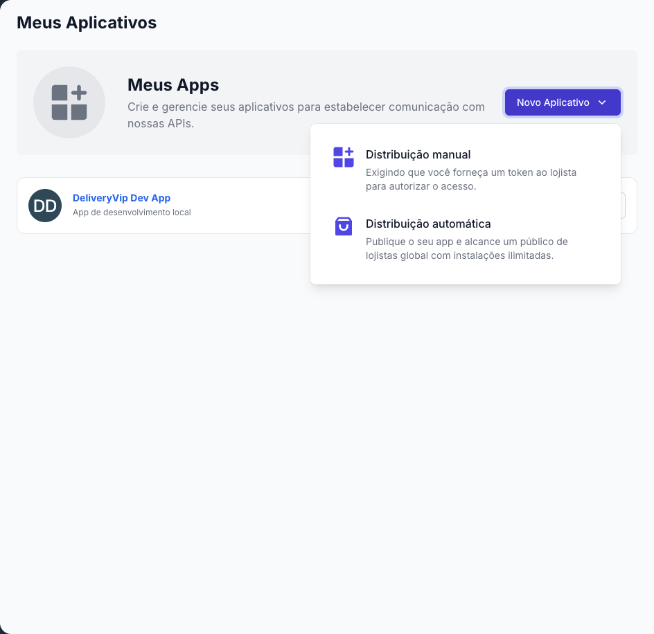

Para chamar qualquer API da DeliveryVip você precisa de um **app** no painel de developers. É ele que tem as credenciais (`client_id` e `client_secret`) e as permissões que as lojas, parceiros e marketplaces vão autorizar.

<Steps>
<Step title="Crie seu usuário" icon="user-plus">
Cadastre-se na [plataforma](https://developer.deliveryvip.com.br/users/sign_up).

<Info>
Já tem um usuário na DeliveryVip? Use o mesmo e pule este passo.
</Info>
</Step>

<Step title="Crie a conta de desenvolvedor" icon="id-card">
Acesse o [painel de developers](https://developer.deliveryvip.com.br), entre com o seu usuário e, se ainda não tiver uma conta de desenvolvedor, clique em **Criar nova conta de Desenvolvedor**.
</Step>

<Step title="Crie um aplicativo" icon="grid-2-plus">
No painel, clique em **Novo Aplicativo** e escolha o tipo de distribuição.

<Frame caption="Escolha do tipo de distribuição ao criar o app">
  
</Frame>
</Step>
</Steps>

## Direta ou interativa?

Nos dois tipos a instalação começa igual: o lojista (ou parceiro) cola na Delivery Store o **token de autorização** que você enviou. A diferença está no que acontece depois e no fluxo OAuth que o seu sistema usa para obter o token.

| | Distribuição direta | Distribuição interativa |
| --- | --- | --- |
| **Fluxo OAuth** | `client_credentials` | `authorization_code` |
| **Como a loja instala** | Cola o **token de autorização** na Delivery Store e clica em **Instalar** | Cola o **token de autorização** na Delivery Store, é levada para o seu app e autoriza o acesso |
| **Interface do app** | Não tem: o app conversa só com a API | Abre a **URL do app**, dentro do painel da loja (incorporado) ou fora dele |
| **Como você obtém o token** | `client_id` + `client_secret` | Troca o `code` recebido na sua **Redirect URI** |
| **Um token atende** | Todas as lojas que instalaram o app | O dono que autorizou (renovável com `refresh_token`) |
| **Ideal para** | PDVs, ERPs e integrações de servidor | Apps com tela própria, que a loja usa no dia a dia |

<CardGroup cols={2}>
<Card title="Distribuição direta" icon="plug" href="/inicio/primeiros-passos/distribuicao-direta">
Formulário do app, token de autorização e token via `client_credentials`.
</Card>
<Card title="Distribuição interativa" icon="window-maximize" href="/inicio/primeiros-passos/distribuicao-interativa">
URL do app, incorporação ao painel, Redirect URI e token via `authorization_code`.
</Card>
</CardGroup>

## Próximos passos

<CardGroup cols={2}>
<Card title="Jornada do Developer" icon="route" href="/inicio/primeiros-passos/jornada-do-developer">
O caminho completo, da conta até a primeira chamada à API.
</Card>
<Card title="Instalando o app na loja" icon="download" href="/inicio/primeiros-passos/instalando-app-na-loja">
O passo a passo que o lojista segue para autorizar o seu app.
</Card>
</CardGroup>
