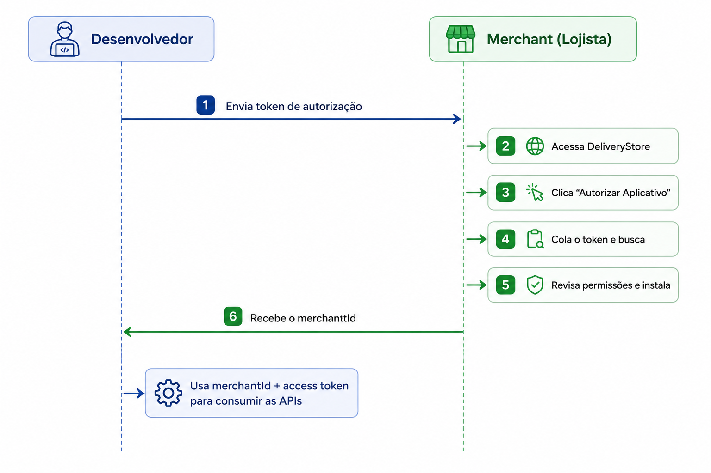
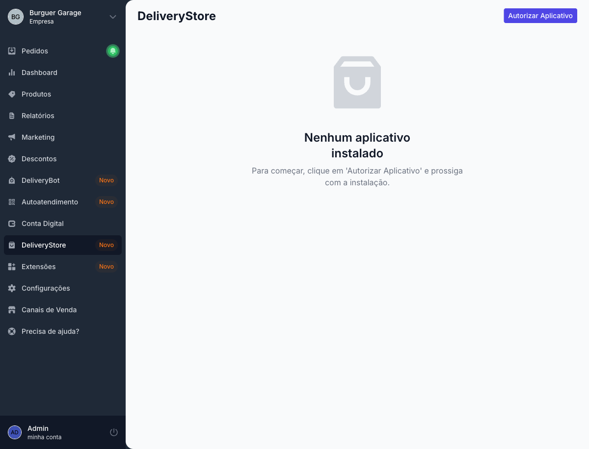
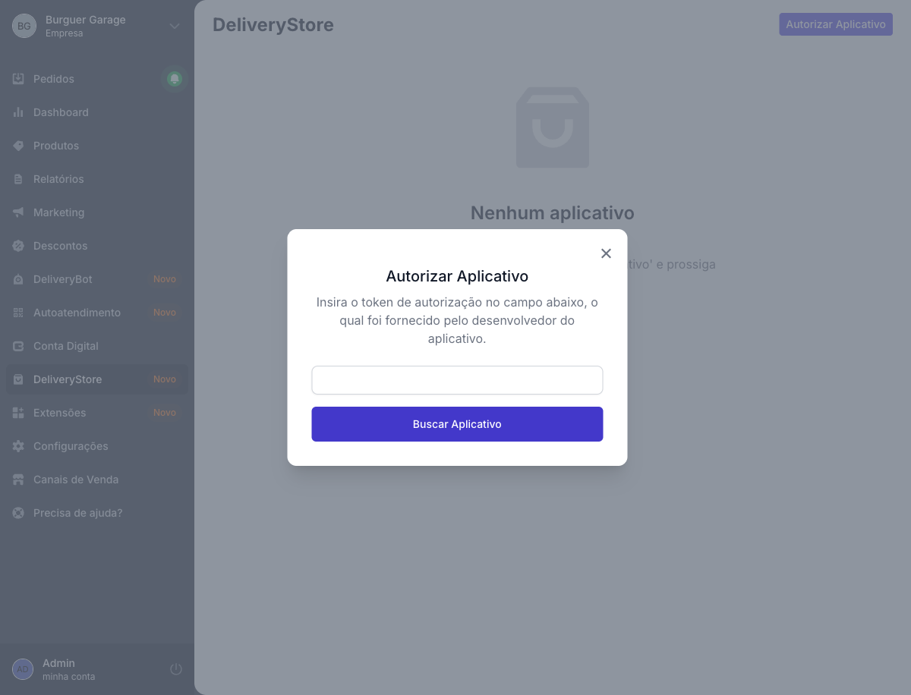
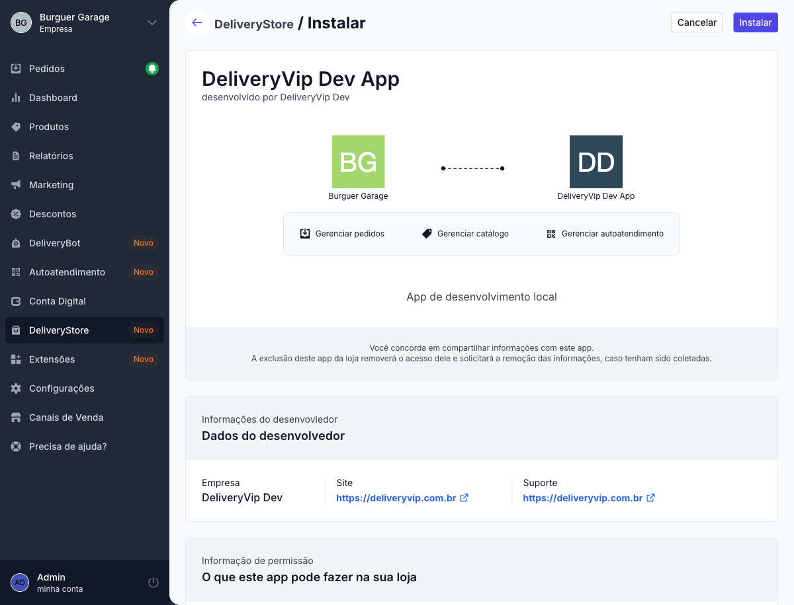
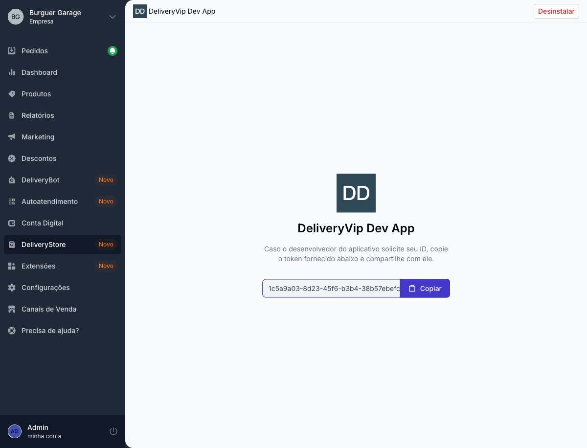

Sem instalação, o seu token não alcança a loja. Este guia mostra o que o **lojista** faz para instalar o seu app. Envie esta página para ele junto com o token de autorização.

<Info>
Os passos abaixo valem para os dois tipos de distribuição. Na [distribuição interativa](/inicio/primeiros-passos/distribuicao-interativa), depois de colar o token o lojista é levado para o seu app e autoriza o acesso por lá, em vez de clicar em **Instalar**.
</Info>

<Frame caption="Fluxo de instalação do app na loja">
  
</Frame>

<Steps>
<Step title="Abra a Delivery Store">
No painel da loja, o lojista abre o menu **Delivery Store** e clica em **Autorizar Aplicativo**.

<Frame caption="Delivery Store no painel da loja">
  
</Frame>
</Step>

<Step title="Cole o token de autorização">
Ele cola o **token de autorização** que você enviou e clica em **Buscar Aplicativo**.

<Frame caption="Campo do token de autorização">
  
</Frame>

<Tip>
O token de autorização fica na tela de detalhes do app, no painel de developers.
</Tip>
</Step>

<Step title="Revise as permissões e instale">
A tela mostra o app e as permissões que ele pede, como pedidos, catálogo ou autoatendimento. Se concordar, o lojista clica em **Instalar**.

<Frame caption="Revisão das permissões">
  
</Frame>

O e-mail de contato do app recebe um aviso de cada nova instalação.
</Step>

<Step title="Copie o merchantId">
Depois de instalar, o lojista vê a tela do app instalado com o **`merchantId`**. Ele copia esse valor e envia para você.

<Frame caption="App instalado, com o merchantId">
  
</Frame>
</Step>
</Steps>

<Check>
Com o app instalado e o `merchantId` em mãos, [obtenha o token de acesso](/inicio/primeiros-passos/distribuicao-direta#obtendo-o-token-de-acesso). O mesmo token atende esta e todas as outras lojas que instalaram o app.
</Check>

<Warning>
Guarde o `merchantId` associado à loja no seu sistema. É ele que identifica a loja nas rotas por loja (`/merchant/v3/{merchantId}/...`) e no header `x-polling-merchants` do polling.
</Warning>

## Desinstalação

O lojista pode remover o app a qualquer momento pela Delivery Store. A partir daí, o seu token deixa de alcançar a loja. Para voltar, ela precisa instalar de novo.
