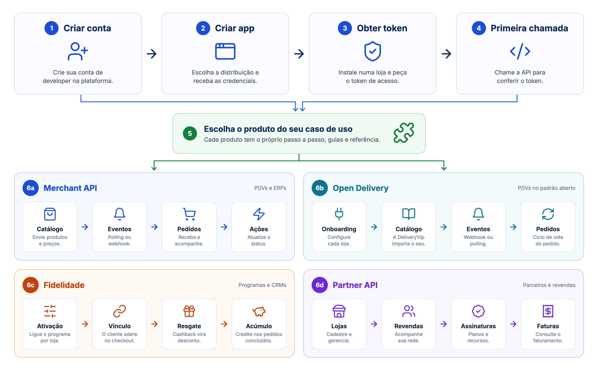
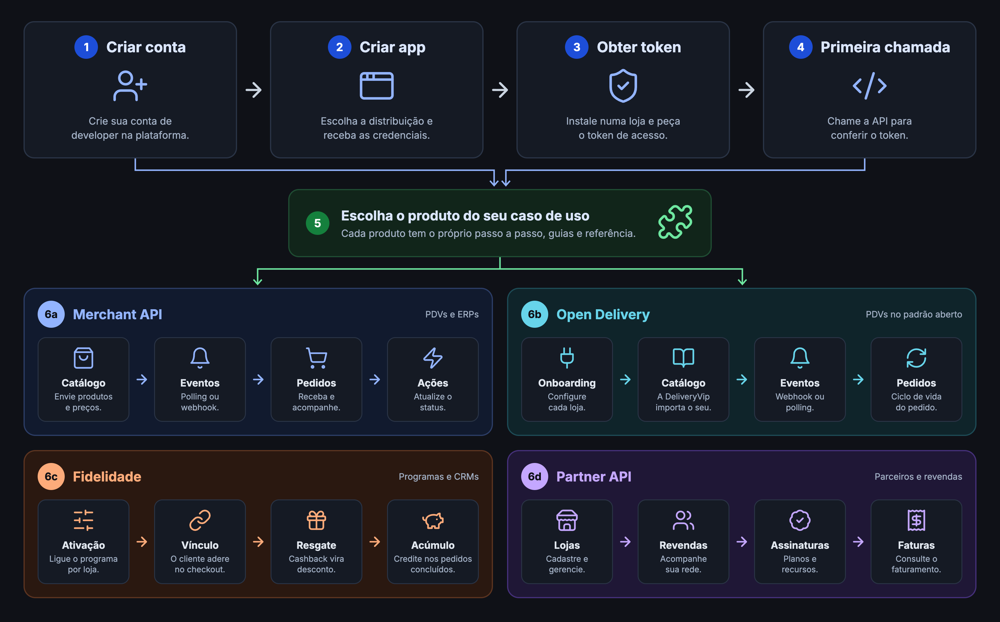

Este guia leva você da conta recém-criada até a primeira chamada autenticada. Os passos de conta, app e token são os mesmos para qualquer integração; no fim, você escolhe o produto que vai integrar.

<Warning>
**Não existe sandbox self-service.** A DeliveryVip não tem um ambiente de testes separado: as chamadas vão para a API de produção. Para testar, peça uma **loja de teste** pelo [Discord](https://discord.gg/AJF8Yha4) e instale o seu app nela. Faça isso logo no início: sem uma loja com o app instalado, o token funciona mas não há dados para consultar.
</Warning>

<Frame caption="Jornada do developer: conta, app, token, primeira chamada e o produto do seu caso de uso">
  
  
</Frame>

## O caminho

<Steps>
<Step title="Crie sua conta" icon="user-plus">
Cadastre-se na [plataforma](https://developer.deliveryvip.com.br/users/sign_up) e, no [painel de developers](https://developer.deliveryvip.com.br), clique em **Criar nova conta de Desenvolvedor**. Se você já tem um usuário na DeliveryVip, entre com ele e pule o cadastro.

Detalhes em [Primeiros passos](/inicio/primeiros-passos).
</Step>

<Step title="Crie um app" icon="grid-2-plus">
No painel, clique em **Novo Aplicativo**. O app é a identidade da sua integração: ele tem o `client_id`, o `client_secret` e as permissões (scopes) que as lojas vão autorizar.

Marque só as permissões que a sua integração usa:

| Permissão | Scope | Para quê |
| --- | --- | --- |
| Merchant API | `od.all` | Pedidos, eventos, catálogo, indoor, descontos e tools. Também é o scope do Open Delivery. |
| Fidelidade | `dv.loyalty` | Configuração do programa de fidelidade da loja. Usado junto com `od.all`. |
| Partner API | `dv.partner` | Lojas, revendas, assinaturas, recursos e faturas de um parceiro. |
| Marketplace API | `dv.marketplace` | API de marketplace. |
</Step>

<Step title="Escolha a distribuição" icon="code-branch">
A distribuição define como a loja autoriza o seu app e qual fluxo OAuth você usa para obter o token. A escolha é feita na criação do app.

<CardGroup cols={2}>
<Card title="Distribuição direta" icon="plug" href="/inicio/primeiros-passos/distribuicao-direta">
A loja cola o **token de autorização** na Delivery Store e instala. Seu sistema pega o token via `client_credentials`. Ideal para PDVs e integrações de servidor.
</Card>
<Card title="Distribuição interativa" icon="window-maximize" href="/inicio/primeiros-passos/distribuicao-interativa">
A loja cola o **token de autorização** e é levada para o seu app, dentro do painel ou fora dele, onde autoriza o acesso. Token via `authorization_code`. Ideal para apps com tela própria.
</Card>
</CardGroup>

<Tip>
Na dúvida, comece pela **direta**: é o fluxo mais simples, e é o que os guias de pedidos, Open Delivery e fidelidade usam nos exemplos.
</Tip>
</Step>

<Step title="Instale o app na loja de teste" icon="store">
O token só alcança as lojas que autorizaram o seu app. Peça a loja de teste no [Discord](https://discord.gg/AJF8Yha4) e siga [Instalando o app na loja](/inicio/primeiros-passos/instalando-app-na-loja). Ao final, guarde o `merchantId` da loja.
</Step>

<Step title="Obtenha o token de acesso" icon="key">
Troque as credenciais do app por um token. Na distribuição direta:

<CodeGroup>
```bash cURL
curl --request POST 'https://api.deliveryvip.com.br/authentication/v1/oauth/token' \
  --header 'Content-Type: application/x-www-form-urlencoded' \
  --data-urlencode 'grant_type=client_credentials' \
  --data-urlencode 'client_id=<clientId>' \
  --data-urlencode 'client_secret=<clientSecret>' \
  --data-urlencode 'scope=od.all'
```

```js Node.js
const response = await fetch('https://api.deliveryvip.com.br/authentication/v1/oauth/token', {
  method: 'POST',
  headers: { 'Content-Type': 'application/x-www-form-urlencoded' },
  body: new URLSearchParams({
    grant_type: 'client_credentials',
    client_id: process.env.DV_CLIENT_ID,
    client_secret: process.env.DV_CLIENT_SECRET,
    scope: 'od.all',
  }),
})
const { access_token, expires_in } = await response.json()
```

```python Python
import os
import requests

response = requests.post(
    "https://api.deliveryvip.com.br/authentication/v1/oauth/token",
    data={
        "grant_type": "client_credentials",
        "client_id": os.environ["DV_CLIENT_ID"],
        "client_secret": os.environ["DV_CLIENT_SECRET"],
        "scope": "od.all",
    },
)
access_token = response.json()["access_token"]
```
</CodeGroup>

```json Resposta (200)
{
  "access_token": "{token}",
  "token_type": "Bearer",
  "expires_in": 86400,
  "scope": "od.all",
  "created_at": 1761750000
}
```

Peça em `scope` os scopes que o app tem, separados por espaço (`od.all dv.loyalty`). Sem `scope`, a API usa `od.all`. O token vale **24 horas**: guarde-o e reaproveite em todas as chamadas. Veja [Autenticação](/inicio/conceitos/autenticacao) para renovação e erros.
</Step>

<Step title="Faça a primeira chamada" icon="terminal">
Confira o token em `GET /authentication/v1/oauth/token/info`. A chamada funciona com qualquer scope e mostra a qual app o token pertence e quanto tempo ainda resta.

<CodeGroup>
```bash cURL
curl 'https://api.deliveryvip.com.br/authentication/v1/oauth/token/info' \
  --header 'Authorization: Bearer {token}'
```

```js Node.js
const response = await fetch('https://api.deliveryvip.com.br/authentication/v1/oauth/token/info', {
  headers: { Authorization: `Bearer ${token}` },
})
console.log(await response.json())
```

```python Python
response = requests.get(
    "https://api.deliveryvip.com.br/authentication/v1/oauth/token/info",
    headers={"Authorization": f"Bearer {token}"},
)
print(response.json())
```
</CodeGroup>

```json Resposta (200)
{
  "resource_owner_id": null,
  "resource_owner_type": null,
  "scope": ["od.all"],
  "expires_in": 86321,
  "application": { "uid": "<clientId>" },
  "created_at": 1761750000
}
```

<Check>
Recebeu `200` com o `uid` do seu app? A autenticação está funcionando. Um `401` indica token ausente, expirado ou revogado.
</Check>
</Step>
</Steps>

## Escolha o seu caminho

Com o token em mãos, siga o guia do produto que você vai integrar.

<CardGroup cols={2}>
<Card title="Merchant API" icon="store" href="/guides/merchant">
PDV ou ERP: receba pedidos por webhook ou polling, sincronize o catálogo e gerencie comandas e descontos. Scope `od.all`. Comece por [Receba seu primeiro pedido](/guides/merchant/order/fluxo-de-integracao/recepcao-de-pedidos).
</Card>
<Card title="Open Delivery" icon="right-left" href="/guides/open-delivery">
Seu PDV já fala Open Delivery. Host `od.deliveryvip.com.br`, um `client_secret` por loja. Scope `od.all`.
</Card>
<Card title="Fidelidade" icon="gift" href="/guides/merchant/loyalty">
Programa de cashback ou CRM no checkout das lojas. Scopes `od.all` e `dv.loyalty`, mais a extensão de fidelidade no app.
</Card>
<Card title="Partner API" icon="handshake" href="/guides/partner">
Parceiro ou revenda: cadastre lojas e gerencie assinaturas, recursos e faturas. Scope `dv.partner`.
</Card>
</CardGroup>


## Antes de escrever código

Estes conceitos valem para todas as APIs e evitam os erros mais comuns de integração.

<CardGroup cols={3}>
<Card title="Autenticação" icon="key" href="/inicio/conceitos/autenticacao">
Fluxos OAuth2, scopes, expiração e renovação.
</Card>
<Card title="Erros" icon="circle-exclamation" href="/inicio/conceitos/erros">
Formato do corpo de erro e o que fazer com cada status.
</Card>
<Card title="Paginação" icon="arrow-right-arrow-left" href="/inicio/conceitos/paginacao">
Cursores `next` e `previous`, `per_page` e header `Link`.
</Card>
<Card title="Datas e horários" icon="clock" href="/inicio/conceitos/datas-e-horarios">
RFC 3339 com offset: UTC-3 na API própria, UTC no Open Delivery.
</Card>
<Card title="Rate limiting" icon="gauge-high" href="/inicio/conceitos/rate-limiting">
Limite de requisições e como reagir ao `429`.
</Card>
<Card title="Postman" icon="paper-plane" href="/inicio/conceitos/postman">
Importe as specs e explore a API sem escrever código.
</Card>
</CardGroup>

## Suporte

<CardGroup cols={2}>
<Card title="Discord" icon="discord" href="https://discord.gg/AJF8Yha4">
Canal de desenvolvedores: dúvidas, loja de teste e acompanhamento da integração.
</Card>
<Card title="Reunião com o time" icon="calendar" href="https://calendar.app.google/EchaXk57y7xp8Hyx6">
Agende uma conversa para revisar a sua integração.
</Card>
</CardGroup>
